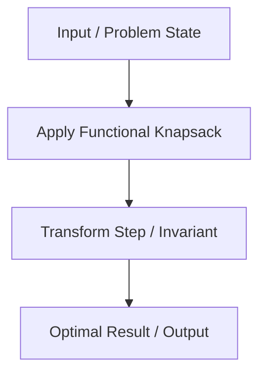

# Functional Knapsack

> **Category:** Greedy · **Tier:** Core Interview (Classic)

---

## 🔗 Resources & Visualizers
- **YouTube:** [Watch Functional Knapsack Visual Guide](https://www.youtube.com/results?search_query=Functional%20Knapsack%20algorithm%20visual%20explanation)
- **Blog / Editorial:** [CP-Algorithms / GeeksforGeeks Guide](https://www.google.com/search?q=Functional%20Knapsack%20algorithm%20tutorial%20CP%20algorithms)
- **Interactive Visualizer:** [VisuAlgo Interactive Simulation](https://visualgo.net/en)

---

## 🧠 Intuition & Mental Model
> [!TIP]
> **Core Concept:** Fractional Knapsack is a greedy algorithm where items can be taken

Fractional Knapsack is a greedy algorithm where items can be taken
partially to maximize total value under a weight limit.
Items are selected based on the highest value-to-weight ratio first.
It guarantees an optimal solution because fractional choices are allowed.
Algorithm Explanation
Compute value / weight for each item
Sort items in descending order of ratio
Pick full items while possible
Take fraction of the next item if capacity is insufficient
Stop when knapsack is full

---

## 🎯 When to Use & Problem Triggers
- **Trigger 1:** When the brute-force enumeration takes quadratic time or higher and a linear/logarithmic invariant exists.
- **Trigger 2:** Common patterns involving **Greedy**, subsegments, query sequences, or optimal substructures.
- **Trigger 3:** Constraints where $N \ge 10^5$ require $O(N)$ or $O(N \log N)$ performance.

---

## 📊 Visual Explanation & Dry Run



<details>
<summary>🔍 <strong>Step-by-Step Algorithm Walkthrough</strong> (Click to expand)</summary>

1. **Initialization:** Set up boundary pointers, state variables, or base auxiliary arrays.
2. **Iteration / Traversal:** Advance through the input elements while maintaining the algorithmic invariant.
3. **State Transition:** Update the current state, dynamic array, or accumulator in $O(1)$ or $O(\log N)$.
4. **Final Result:** Extract the optimal answer from the computed state or reconstructed solution.

</details>

---

## 💻 Algorithm Code (Java)

```java
import java.util.*;

class FractionalKnapsack {

    static class Item {
        int weight;
        int value;

        Item(int w, int v) {
            this.weight = w;
            this.value = v;
        }
    }

    public static void main(String[] args) {
        Item[] items = {
                new Item(10, 60),
                new Item(20, 100),
                new Item(30, 120)
        };

        int capacity = 50;

        double result = fractionalKnapsack(items, capacity);
        System.out.println("Maximum value = " + result);
    }

    static double fractionalKnapsack(Item[] items, int capacity) {
        Arrays.sort(items, (a, b) ->
                Double.compare(
                        (double) b.value / b.weight,
                        (double) a.value / a.weight
                )
        );

        double totalValue = 0.0;

        for (Item item : items) {
            if (capacity == 0)
                break;

            if (item.weight <= capacity) {
                capacity -= item.weight;
                totalValue += item.value;
            } else {
                totalValue += item.value * ((double) capacity / item.weight);
                capacity = 0;
            }
        }

        return totalValue;
    }
}
```

---

## ⏱️ Complexity Analysis
- **Time Complexity (TC):** Typically `O(N)` or `O(N log N)` depending on auxiliary sorting or tree operations.
- **Space Complexity (SC):** Typically `O(1)` auxiliary space or `O(N)` for auxiliary arrays/tables.

---

## 🔄 Similar & Connected Algorithms
- **Related Category:** Explore other fundamental algorithms in [Greedy](../).
- **Composite Patterns:** Often combined with Prefix Sums, Binary Search on Answer, or Dynamic Programming memoization.

---

## ⚔️ Practice Questions

### 🟡 LeetCode
- [ ] [Explore Functional Knapsack Problems on LeetCode](https://leetcode.com/problemset/?search=Functional%20Knapsack%20LeetCode) — `Practice`

### 🔵 CodeChef & Codeforces
- [ ] [Practice on Codeforces Problemset](https://codeforces.com/problemset) — `Catalog`
- [ ] [Practice on CodeChef Practice Portal](https://www.codechef.com/practice) — `Catalog`
