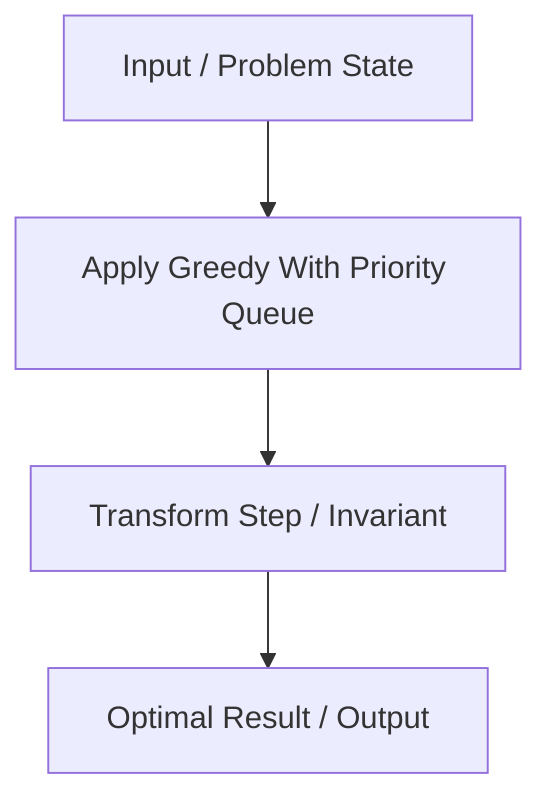

# Greedy With Priority Queue

> **Category:** Greedy · **Tier:** Core Interview (High-Yield)

---

## 🔗 Resources & Visualizers
- **YouTube:** [Watch Greedy With Priority Queue Visual Guide](https://www.youtube.com/results?search_query=Greedy%20With%20Priority%20Queue%20algorithm%20visual%20explanation)
- **Blog / Editorial:** [CP-Algorithms / GeeksforGeeks Guide](https://www.google.com/search?q=Greedy%20With%20Priority%20Queue%20algorithm%20tutorial%20CP%20algorithms)
- **Interactive Visualizer:** [VisuAlgo Interactive Simulation](https://visualgo.net/en)

---

## 🧠 Intuition & Mental Model
> [!TIP]
> **Core Concept:** Greedy with Priority Queue is an algorithmic technique where

Greedy with Priority Queue is an algorithmic technique where
we repeatedly make the best local choice using a Priority Queue to always
access the most optimal element (minimum or maximum) efficiently.
It works when local optimal decisions lead to a global optimal solution.
Algorithm Explanation
Store elements in a Priority Queue (min-heap or max-heap).
At every step, pick the best element (top of heap).
Process it and update the queue if required.
Repeat until the queue is empty or condition is met.
Connect ropes with minimum cost(classic Greedy+PQ)

---

## 🎯 When to Use & Problem Triggers
- **Trigger 1:** When the brute-force enumeration takes quadratic time or higher and a linear/logarithmic invariant exists.
- **Trigger 2:** Common patterns involving **Greedy**, subsegments, query sequences, or optimal substructures.
- **Trigger 3:** Constraints where $N \ge 10^5$ require $O(N)$ or $O(N \log N)$ performance.

---

## 📊 Visual Explanation & Dry Run



<details>
<summary>🔍 <strong>Step-by-Step Algorithm Walkthrough</strong> (Click to expand)</summary>

1. **Initialization:** Set up boundary pointers, state variables, or base auxiliary arrays.
2. **Iteration / Traversal:** Advance through the input elements while maintaining the algorithmic invariant.
3. **State Transition:** Update the current state, dynamic array, or accumulator in $O(1)$ or $O(\log N)$.
4. **Final Result:** Extract the optimal answer from the computed state or reconstructed solution.

</details>

---

## 💻 Algorithm Code (Java)

```java
import java.util.PriorityQueue;

class GreedyWithPQ {
    public static void main(String[] args) {
        int[] ropes = {4, 3, 2, 6};

        PriorityQueue<Integer> pq = new PriorityQueue<>();

        for (int r : ropes) {
            pq.add(r);
        }

        int totalCost = 0;

        while (pq.size() > 1) {

            int first = pq.poll();
            int second = pq.poll();

            int cost = first + second;
            totalCost += cost;

            pq.add(cost);
        }

        System.out.println(totalCost);
    }
}
```

---

## ⏱️ Complexity Analysis
- **Time Complexity (TC):** Typically `O(N)` or `O(N log N)` depending on auxiliary sorting or tree operations.
- **Space Complexity (SC):** Typically `O(1)` auxiliary space or `O(N)` for auxiliary arrays/tables.

---

## 🔄 Similar & Connected Algorithms
- **Related Category:** Explore other fundamental algorithms in [Greedy](../).
- **Composite Patterns:** Often combined with Prefix Sums, Binary Search on Answer, or Dynamic Programming memoization.

---

## ⚔️ Practice Questions

### 🟡 LeetCode
- [ ] [Explore Greedy With Priority Queue Problems on LeetCode](https://leetcode.com/problemset/?search=Greedy%20With%20Priority%20Queue%20LeetCode) — `Practice`

### 🔵 CodeChef & Codeforces
- [ ] [Practice on Codeforces Problemset](https://codeforces.com/problemset) — `Catalog`
- [ ] [Practice on CodeChef Practice Portal](https://www.codechef.com/practice) — `Catalog`
