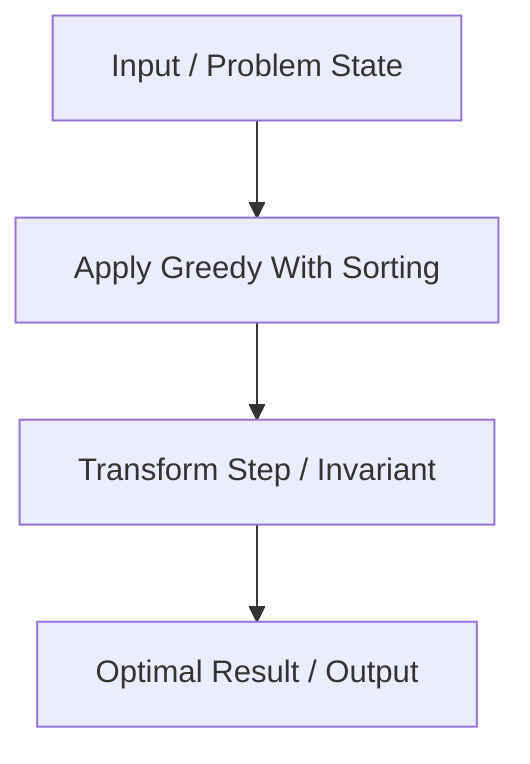

# Greedy With Sorting

> **Category:** Greedy · **Tier:** Core Interview (Essential)

---

## 🔗 Resources & Visualizers
- **YouTube:** [Watch Greedy With Sorting Visual Guide](https://www.youtube.com/results?search_query=Greedy%20With%20Sorting%20algorithm%20visual%20explanation)
- **Blog / Editorial:** [CP-Algorithms / GeeksforGeeks Guide](https://www.google.com/search?q=Greedy%20With%20Sorting%20algorithm%20tutorial%20CP%20algorithms)
- **Interactive Visualizer:** [VisuAlgo Interactive Simulation](https://visualgo.net/en)

---

## 🧠 Intuition & Mental Model
> [!TIP]
> **Core Concept:** Greedy with Sorting is an algorithmic approach where we first sort

Greedy with Sorting is an algorithmic approach where we first sort
the data based on a specific criterion, then make locally optimal choices at each step.
The idea is that these optimal local decisions lead to a globally optimal solution.
Algorithm Explanation
Sort activities by ending time.
Always pick the activity that finishes earliest and does not
overlap with the previously selected one.
Repeat until no more activities can be selected.

---

## 🎯 When to Use & Problem Triggers
- **Trigger 1:** When the brute-force enumeration takes quadratic time or higher and a linear/logarithmic invariant exists.
- **Trigger 2:** Common patterns involving **Greedy**, subsegments, query sequences, or optimal substructures.
- **Trigger 3:** Constraints where $N \ge 10^5$ require $O(N)$ or $O(N \log N)$ performance.

---

## 📊 Visual Explanation & Dry Run



<details>
<summary>🔍 <strong>Step-by-Step Algorithm Walkthrough</strong> (Click to expand)</summary>

1. **Initialization:** Set up boundary pointers, state variables, or base auxiliary arrays.
2. **Iteration / Traversal:** Advance through the input elements while maintaining the algorithmic invariant.
3. **State Transition:** Update the current state, dynamic array, or accumulator in $O(1)$ or $O(\log N)$.
4. **Final Result:** Extract the optimal answer from the computed state or reconstructed solution.

</details>

---

## 💻 Algorithm Code (Java)

```java
import java.util.Arrays;

class Main {

    static class Activity {
        int start;
        int end;

        Activity(int s, int e) {
            this.start = s;
            this.end = e;
        }
    }

    public static void main(String[] args) {
        Activity[] a = {
                new Activity(1, 3),
                new Activity(2, 4),
                new Activity(3, 5),
                new Activity(0, 6),
                new Activity(5, 7),
                new Activity(8, 9)
        };

        Arrays.sort(a, (x, y) -> x.end - y.end);

        int cnt = 1;
        int lastEnd = a[0].end;

        for (int i = 1; i < a.length; i++) {
            if (a[i].start >= lastEnd) {
                cnt++;
                lastEnd = a[i].end;
            }
        }

        System.out.println(cnt);
    }
}
```

---

## ⏱️ Complexity Analysis
- **Time Complexity (TC):** Typically `O(N)` or `O(N log N)` depending on auxiliary sorting or tree operations.
- **Space Complexity (SC):** Typically `O(1)` auxiliary space or `O(N)` for auxiliary arrays/tables.

---

## 🔄 Similar & Connected Algorithms
- **Related Category:** Explore other fundamental algorithms in [Greedy](../).
- **Composite Patterns:** Often combined with Prefix Sums, Binary Search on Answer, or Dynamic Programming memoization.

---

## ⚔️ Practice Questions

### 🟡 LeetCode
- [ ] [Explore Greedy With Sorting Problems on LeetCode](https://leetcode.com/problemset/?search=Greedy%20With%20Sorting%20LeetCode) — `Practice`

### 🔵 CodeChef & Codeforces
- [ ] [Practice on Codeforces Problemset](https://codeforces.com/problemset) — `Catalog`
- [ ] [Practice on CodeChef Practice Portal](https://www.codechef.com/practice) — `Catalog`
