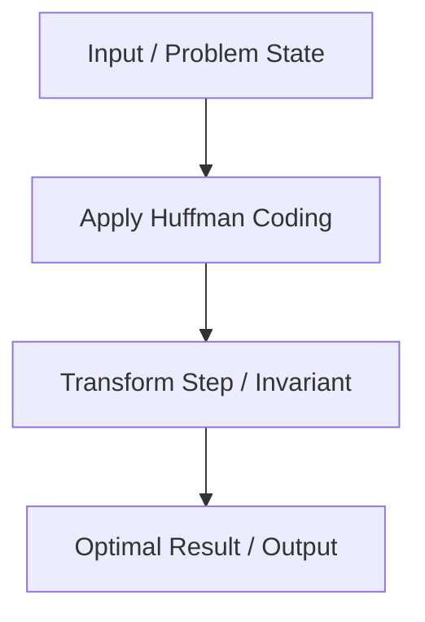

# Huffman Coding

> **Category:** Greedy · **Tier:** Core Interview (Classic)

---

## 🔗 Resources & Visualizers
- **YouTube:** [Watch Huffman Coding Visual Guide](https://www.youtube.com/results?search_query=Huffman%20Coding%20algorithm%20visual%20explanation)
- **Blog / Editorial:** [CP-Algorithms / GeeksforGeeks Guide](https://www.google.com/search?q=Huffman%20Coding%20algorithm%20tutorial%20CP%20algorithms)
- **Interactive Visualizer:** [VisuAlgo Interactive Simulation](https://visualgo.net/en)

---

## 🧠 Intuition & Mental Model
> [!TIP]
> **Core Concept:** Huffman Coding is a greedy compression algorithm used to generate optimal prefix

Huffman Coding is a greedy compression algorithm used to generate optimal prefix
codes based on character frequencies.
Characters with higher frequency get shorter codes, and those with lower
frequency get longer codes, minimizing total encoding length.
Algorithm Explanation
Create a min-heap of nodes using character frequencies
Repeatedly extract two minimum frequency nodes
Merge them into a new node with summed frequency
Insert the merged node back into the heap
Repeat until one node remains → Huffman Tree
Traverse tree to generate binary codes (0 = left, 1 = right)

---

## 🎯 When to Use & Problem Triggers
- **Trigger 1:** When the brute-force enumeration takes quadratic time or higher and a linear/logarithmic invariant exists.
- **Trigger 2:** Common patterns involving **Greedy**, subsegments, query sequences, or optimal substructures.
- **Trigger 3:** Constraints where $N \ge 10^5$ require $O(N)$ or $O(N \log N)$ performance.

---

## 📊 Visual Explanation & Dry Run



<details>
<summary>🔍 <strong>Step-by-Step Algorithm Walkthrough</strong> (Click to expand)</summary>

1. **Initialization:** Set up boundary pointers, state variables, or base auxiliary arrays.
2. **Iteration / Traversal:** Advance through the input elements while maintaining the algorithmic invariant.
3. **State Transition:** Update the current state, dynamic array, or accumulator in $O(1)$ or $O(\log N)$.
4. **Final Result:** Extract the optimal answer from the computed state or reconstructed solution.

</details>

---

## 💻 Algorithm Code (Java)

```java
import java.util.PriorityQueue;

public class HuffmanCoding {

    static class Node {
        char ch;
        int freq;
        Node left, right;

        Node(char ch, int freq) {
            this.ch = ch;
            this.freq = freq;
        }
    }

    public static void main(String[] args) {
        char[] chars = {'a', 'b', 'c', 'd', 'e', 'f'};
        int[] freq = {5, 9, 12, 13, 16, 45};

        PriorityQueue<Node> pq = new PriorityQueue<>(
                (x, y) -> x.freq - y.freq
        );

        for (int i = 0; i < chars.length; i++) {
            pq.add(new Node(chars[i], freq[i]));
        }

        while (pq.size() > 1) {
            Node left = pq.poll();
            Node right = pq.poll();

            Node merged = new Node('-', left.freq + right.freq);

            merged.left = left;
            merged.right = right;

            pq.add(merged);
        }

        Node root = pq.poll();
        printCodes(root, "");

    }

    static void printCodes(Node node, String code) {
        if (node == null) return;

        if (node.ch != '-') {
            System.out.println(node.ch + " : " + code);
        }

        printCodes(node.left, code + "0");
        printCodes(node.right, code + "1");
    }
}
```

---

## ⏱️ Complexity Analysis
- **Time Complexity (TC):** Typically `O(N)` or `O(N log N)` depending on auxiliary sorting or tree operations.
- **Space Complexity (SC):** Typically `O(1)` auxiliary space or `O(N)` for auxiliary arrays/tables.

---

## 🔄 Similar & Connected Algorithms
- **Related Category:** Explore other fundamental algorithms in [Greedy](../).
- **Composite Patterns:** Often combined with Prefix Sums, Binary Search on Answer, or Dynamic Programming memoization.

---

## ⚔️ Practice Questions

### 🟡 LeetCode
- [ ] [Explore Huffman Coding Problems on LeetCode](https://leetcode.com/problemset/?search=Huffman%20Coding%20LeetCode) — `Practice`

### 🔵 CodeChef & Codeforces
- [ ] [Practice on Codeforces Problemset](https://codeforces.com/problemset) — `Catalog`
- [ ] [Practice on CodeChef Practice Portal](https://www.codechef.com/practice) — `Catalog`
