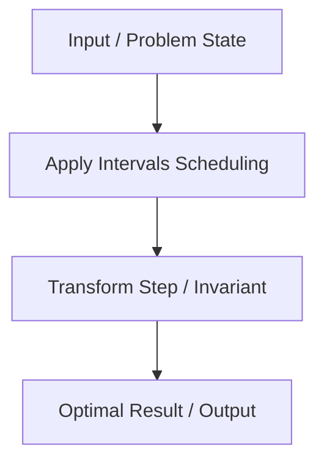

# Intervals Scheduling

> **Category:** Greedy · **Tier:** Core Interview (High-Yield)

---

## 🔗 Resources & Visualizers
- **YouTube:** [Watch Intervals Scheduling Visual Guide](https://www.youtube.com/results?search_query=Intervals%20Scheduling%20algorithm%20visual%20explanation)
- **Blog / Editorial:** [CP-Algorithms / GeeksforGeeks Guide](https://www.google.com/search?q=Intervals%20Scheduling%20algorithm%20tutorial%20CP%20algorithms)
- **Interactive Visualizer:** [VisuAlgo Interactive Simulation](https://visualgo.net/en)

---

## 🧠 Intuition & Mental Model
> [!TIP]
> **Core Concept:** Interval Scheduling is a greedy algorithm used to select the maximum

Interval Scheduling is a greedy algorithm used to select the maximum
number of non-overlapping intervals from a given set of intervals.
The strategy is to always pick the interval that finishes earliest,
leaving maximum room for future intervals.
Algorithm Explanation
Sort all intervals by ending time.
Pick the first interval (earliest finish).
For each next interval:
Select it only if its start ≥ last selected end.
Count all selected intervals.
Greedy choice works because choosing the earliest finishing
interval gives the most flexibility.

---

## 🎯 When to Use & Problem Triggers
- **Trigger 1:** When the brute-force enumeration takes quadratic time or higher and a linear/logarithmic invariant exists.
- **Trigger 2:** Common patterns involving **Greedy**, subsegments, query sequences, or optimal substructures.
- **Trigger 3:** Constraints where $N \ge 10^5$ require $O(N)$ or $O(N \log N)$ performance.

---

## 📊 Visual Explanation & Dry Run



<details>
<summary>🔍 <strong>Step-by-Step Algorithm Walkthrough</strong> (Click to expand)</summary>

1. **Initialization:** Set up boundary pointers, state variables, or base auxiliary arrays.
2. **Iteration / Traversal:** Advance through the input elements while maintaining the algorithmic invariant.
3. **State Transition:** Update the current state, dynamic array, or accumulator in $O(1)$ or $O(\log N)$.
4. **Final Result:** Extract the optimal answer from the computed state or reconstructed solution.

</details>

---

## 💻 Algorithm Code (Java)

```java
import java.io.*;
import java.util.*;

class Main {

    static class Interval {
        int s;
        int e;

        Interval(int s, int e) {
            this.s = s;
            this.e = e;
        }
    }

    public static void main(String[] args) throws Exception {
        Interval[] a = {
                new Interval(1, 3),
                new Interval(2, 4),
                new Interval(3, 5),
                new Interval(0, 6)
        };

        Arrays.sort(a, (x, y) -> x.e - y.e);

        int cnt = 1;
        int lastEnd = a[0].e;

        for (int i = 1; i < a.length; i++) {
            if (a[i].s >= lastEnd) {
                cnt++;
                lastEnd = a[i].e;
            }
        }

        System.out.println(cnt);
    }
}
```

---

## ⏱️ Complexity Analysis
- **Time Complexity (TC):** Typically `O(N)` or `O(N log N)` depending on auxiliary sorting or tree operations.
- **Space Complexity (SC):** Typically `O(1)` auxiliary space or `O(N)` for auxiliary arrays/tables.

---

## 🔄 Similar & Connected Algorithms
- **Related Category:** Explore other fundamental algorithms in [Greedy](../).
- **Composite Patterns:** Often combined with Prefix Sums, Binary Search on Answer, or Dynamic Programming memoization.

---

## ⚔️ Practice Questions

### 🟡 LeetCode
- [ ] [Explore Intervals Scheduling Problems on LeetCode](https://leetcode.com/problemset/?search=Intervals%20Scheduling%20LeetCode) — `Practice`

### 🔵 CodeChef & Codeforces
- [ ] [Practice on Codeforces Problemset](https://codeforces.com/problemset) — `Catalog`
- [ ] [Practice on CodeChef Practice Portal](https://www.codechef.com/practice) — `Catalog`
