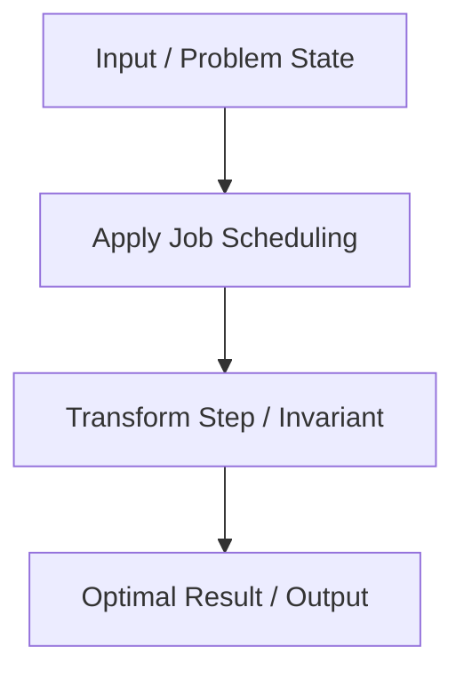

# Job Scheduling

> **Category:** Greedy · **Tier:** Core Interview (Classic)

---

## 🔗 Resources & Visualizers
- **YouTube:** [Watch Job Scheduling Visual Guide](https://www.youtube.com/results?search_query=Job%20Scheduling%20algorithm%20visual%20explanation)
- **Blog / Editorial:** [CP-Algorithms / GeeksforGeeks Guide](https://www.google.com/search?q=Job%20Scheduling%20algorithm%20tutorial%20CP%20algorithms)
- **Interactive Visualizer:** [VisuAlgo Interactive Simulation](https://visualgo.net/en)

---

## 🧠 Intuition & Mental Model
> [!TIP]
> **Core Concept:** Job Scheduling (Greedy) is an algorithm used to schedule jobs with

Job Scheduling (Greedy) is an algorithm used to schedule jobs with
deadlines and profits such that the total profit is maximized,
assuming each job takes one unit of time.
The greedy choice is to always prioritize the job with the highest profit first.
Algorithm Explanation (extremely concise & clear)
Sort all jobs in descending order of profit
Create a timeline of slots up to the maximum deadline
For each job, place it in the latest free slot before its deadline
Skip the job if no slot is available
That’s it — greedy + smart placement.

---

## 🎯 When to Use & Problem Triggers
- **Trigger 1:** When the brute-force enumeration takes quadratic time or higher and a linear/logarithmic invariant exists.
- **Trigger 2:** Common patterns involving **Greedy**, subsegments, query sequences, or optimal substructures.
- **Trigger 3:** Constraints where $N \ge 10^5$ require $O(N)$ or $O(N \log N)$ performance.

---

## 📊 Visual Explanation & Dry Run



<details>
<summary>🔍 <strong>Step-by-Step Algorithm Walkthrough</strong> (Click to expand)</summary>

1. **Initialization:** Set up boundary pointers, state variables, or base auxiliary arrays.
2. **Iteration / Traversal:** Advance through the input elements while maintaining the algorithmic invariant.
3. **State Transition:** Update the current state, dynamic array, or accumulator in $O(1)$ or $O(\log N)$.
4. **Final Result:** Extract the optimal answer from the computed state or reconstructed solution.

</details>

---

## 💻 Algorithm Code (Java)

```java
import java.io.*;
import java.util.*;

class JobScheduling {

    static class Job {
        int id;
        int deadline;
        int profit;

        Job(int id, int deadline, int profit) {
            this.id = id;
            this.deadline = deadline;
            this.profit = profit;
        }
    }

    public static void main(String[] args) throws Exception {
        PrintWriter out = new PrintWriter(System.out);

        Job[] jobs = {
                new Job(1, 4, 20),
                new Job(2, 1, 10),
                new Job(3, 1, 40),
                new Job(4, 1, 30)
        };

        Arrays.sort(jobs, (a, b) -> b.profit - a.profit);

        int maxDeadline = 0;
        for (Job j : jobs) {
            maxDeadline = Math.max(maxDeadline, j.deadline);
        }

        int[] slot = new int[maxDeadline + 1];
        Arrays.fill(slot, -1);

        int totaLProfit = 0;

        for (Job job : jobs) {
            for (int t = job.deadline; t > 0; t--) {
                if (slot[t] == -1) {
                    slot[t] = job.id;
                    totaLProfit += job.profit;
                    break;
                }
            }
        }

        out.print("Scheduled Jobs: ");
        for (int i = 1; i <= maxDeadline; i++) {
            if (slot[i] != -1) {
                out.print(slot[i] + " ");
            }
        }

        out.println();
        out.println("Total Profit: " + totaLProfit);

        out.flush();
    }
}
```

---

## ⏱️ Complexity Analysis
- **Time Complexity (TC):** Typically `O(N)` or `O(N log N)` depending on auxiliary sorting or tree operations.
- **Space Complexity (SC):** Typically `O(1)` auxiliary space or `O(N)` for auxiliary arrays/tables.

---

## 🔄 Similar & Connected Algorithms
- **Related Category:** Explore other fundamental algorithms in [Greedy](../).
- **Composite Patterns:** Often combined with Prefix Sums, Binary Search on Answer, or Dynamic Programming memoization.

---

## ⚔️ Practice Questions

### 🟡 LeetCode
- [ ] [Explore Job Scheduling Problems on LeetCode](https://leetcode.com/problemset/?search=Job%20Scheduling%20LeetCode) — `Practice`

### 🔵 CodeChef & Codeforces
- [ ] [Practice on Codeforces Problemset](https://codeforces.com/problemset) — `Catalog`
- [ ] [Practice on CodeChef Practice Portal](https://www.codechef.com/practice) — `Catalog`
