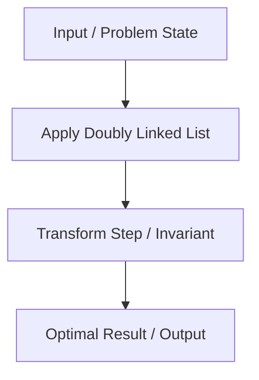

# Doubly Linked List

> **Category:** LinkedList · **Tier:** Core Interview (Essential)

---

## 🔗 Resources & Visualizers
- **YouTube:** [Watch Doubly Linked List Visual Guide](https://www.youtube.com/results?search_query=Doubly%20Linked%20List%20algorithm%20visual%20explanation)
- **Blog / Editorial:** [CP-Algorithms / GeeksforGeeks Guide](https://www.google.com/search?q=Doubly%20Linked%20List%20algorithm%20tutorial%20CP%20algorithms)
- **Interactive Visualizer:** [VisuAlgo Interactive Simulation](https://visualgo.net/en)

---

## 🧠 Intuition & Mental Model
> [!TIP]
> **Core Concept:** A Doubly Linked List is a linear data structure where each node stores

A Doubly Linked List is a linear data structure where each node stores
data and two references: one to the previous node and one to the next node.
It allows traversal in both forward and backward directions.
Algorithm Explanation
Each node has three parts → prev | data | next
head points to the first node
tail points to the last node
Insertion updates both next and prev links
Traversal can move:
Forward using next
Backward using prev

---

## 🎯 When to Use & Problem Triggers
- **Trigger 1:** When the brute-force enumeration takes quadratic time or higher and a linear/logarithmic invariant exists.
- **Trigger 2:** Common patterns involving **LinkedList**, subsegments, query sequences, or optimal substructures.
- **Trigger 3:** Constraints where $N \ge 10^5$ require $O(N)$ or $O(N \log N)$ performance.

---

## 📊 Visual Explanation & Dry Run



<details>
<summary>🔍 <strong>Step-by-Step Algorithm Walkthrough</strong> (Click to expand)</summary>

1. **Initialization:** Set up boundary pointers, state variables, or base auxiliary arrays.
2. **Iteration / Traversal:** Advance through the input elements while maintaining the algorithmic invariant.
3. **State Transition:** Update the current state, dynamic array, or accumulator in $O(1)$ or $O(\log N)$.
4. **Final Result:** Extract the optimal answer from the computed state or reconstructed solution.

</details>

---

## 💻 Algorithm Code (Java)

```java
class DoublyLinkedList {

    static class Node {
        int data;
        Node prev;
        Node next;

        Node(int d) {
            data = d;
            prev = null;
            next = null;
        }
    }

    Node head;
    Node tail;

    void insert(int val) {
        Node n = new Node(val);

        if (head == null) {
            head = n;
            tail = n;
            return;
        }

        tail.next = n;
        n.prev = tail;
        tail = n;
    }

    void display() {
        Node curr = head;

        while (curr != null) {
            System.out.print(curr.data + " ");
            curr = curr.next;
        }

        System.out.println();
    }

    public static void main(String[] args) {
        DoublyLinkedList dll = new DoublyLinkedList();

        dll.insert(10);
        dll.insert(20);
        dll.insert(30);

        dll.display();
    }
}
```

---

## ⏱️ Complexity Analysis
- **Time Complexity (TC):** Typically `O(N)` or `O(N log N)` depending on auxiliary sorting or tree operations.
- **Space Complexity (SC):** Typically `O(1)` auxiliary space or `O(N)` for auxiliary arrays/tables.

---

## 🔄 Similar & Connected Algorithms
- **Related Category:** Explore other fundamental algorithms in [LinkedList](../).
- **Composite Patterns:** Often combined with Prefix Sums, Binary Search on Answer, or Dynamic Programming memoization.

---

## ⚔️ Practice Questions

### 🟡 LeetCode
- [ ] [Explore Doubly Linked List Problems on LeetCode](https://leetcode.com/problemset/?search=Doubly%20Linked%20List%20LeetCode) — `Practice`

### 🔵 CodeChef & Codeforces
- [ ] [Practice on Codeforces Problemset](https://codeforces.com/problemset) — `Catalog`
- [ ] [Practice on CodeChef Practice Portal](https://www.codechef.com/practice) — `Catalog`
