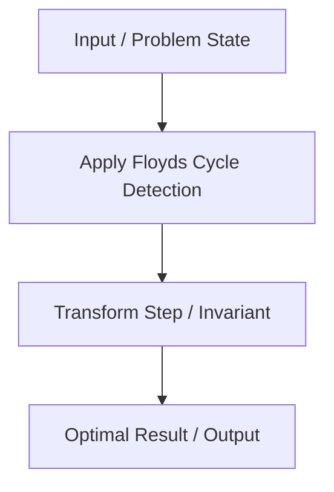

# Floyds Cycle Detection

> **Category:** LinkedList · **Tier:** Core Interview (Essential)

---

## 🔗 Resources & Visualizers
- **YouTube:** [Watch Floyds Cycle Detection Visual Guide](https://www.youtube.com/results?search_query=Floyds%20Cycle%20Detection%20algorithm%20visual%20explanation)
- **Blog / Editorial:** [CP-Algorithms / GeeksforGeeks Guide](https://www.google.com/search?q=Floyds%20Cycle%20Detection%20algorithm%20tutorial%20CP%20algorithms)
- **Interactive Visualizer:** [VisuAlgo Interactive Simulation](https://visualgo.net/en)

---

## 🧠 Intuition & Mental Model
> [!TIP]
> **Core Concept:** Cycle detection in a linked list checks whether any node is

Cycle detection in a linked list checks whether any node is
revisited while traversing the list.
If revisited, the linked list contains a cycle (loop).
Algorithm Explanation :
//
//        Use two pointers: slow and fast
//
//        slow moves 1 step at a time
//
//        fast moves 2 steps at a time
//
//        If the list has no cycle, fast will reach null
//
//        If the list has a cycle, slow and fast will meet at some node
//
//        Meeting point ⇒ Cycle exists

---

## 🎯 When to Use & Problem Triggers
- **Trigger 1:** When the brute-force enumeration takes quadratic time or higher and a linear/logarithmic invariant exists.
- **Trigger 2:** Common patterns involving **LinkedList**, subsegments, query sequences, or optimal substructures.
- **Trigger 3:** Constraints where $N \ge 10^5$ require $O(N)$ or $O(N \log N)$ performance.

---

## 📊 Visual Explanation & Dry Run



<details>
<summary>🔍 <strong>Step-by-Step Algorithm Walkthrough</strong> (Click to expand)</summary>

1. **Initialization:** Set up boundary pointers, state variables, or base auxiliary arrays.
2. **Iteration / Traversal:** Advance through the input elements while maintaining the algorithmic invariant.
3. **State Transition:** Update the current state, dynamic array, or accumulator in $O(1)$ or $O(\log N)$.
4. **Final Result:** Extract the optimal answer from the computed state or reconstructed solution.

</details>

---

## 💻 Algorithm Code (Java)

```java
class Node {
    int val;
    Node next;

    Node(int v) {
        val = v;
        next = null;
    }
}

class CycleDetection {

    static boolean hasCycle(Node head) {
        Node slow = head;
        Node fast = head;

        while (fast != null && fast.next != null) {
            slow = slow.next;
            fast = fast.next.next;

            if (slow == fast) {
                return true;
            }
        }

        return false;
    }

    public static void main(String[] args) {
        Node a = new Node(1);
        Node b = new Node(2);
        Node c = new Node(3);
        Node d = new Node(4);

        a.next = b;
        b.next = c;
        c.next = d;
        d.next = b;

        System.out.println(hasCycle(a));
    }
}
```

---

## ⏱️ Complexity Analysis
- **Time Complexity (TC):** Typically `O(N)` or `O(N log N)` depending on auxiliary sorting or tree operations.
- **Space Complexity (SC):** Typically `O(1)` auxiliary space or `O(N)` for auxiliary arrays/tables.

---

## 🔄 Similar & Connected Algorithms
- **Related Category:** Explore other fundamental algorithms in [LinkedList](../).
- **Composite Patterns:** Often combined with Prefix Sums, Binary Search on Answer, or Dynamic Programming memoization.

---

## ⚔️ Practice Questions

### 🟡 LeetCode
- [ ] [Explore Floyds Cycle Detection Problems on LeetCode](https://leetcode.com/problemset/?search=Floyds%20Cycle%20Detection%20LeetCode) — `Practice`

### 🔵 CodeChef & Codeforces
- [ ] [Practice on Codeforces Problemset](https://codeforces.com/problemset) — `Catalog`
- [ ] [Practice on CodeChef Practice Portal](https://www.codechef.com/practice) — `Catalog`
