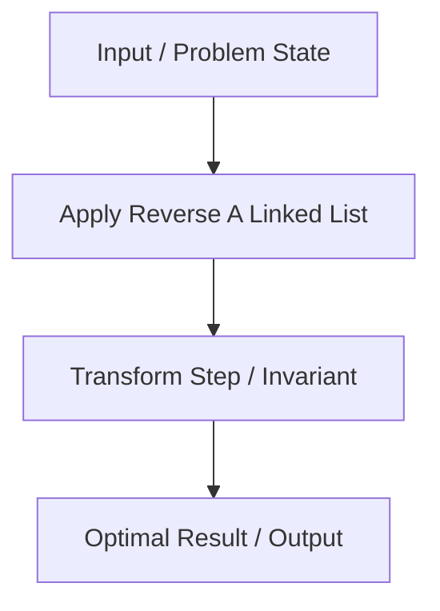

# Reverse A Linked List

> **Category:** LinkedList · **Tier:** Core Interview (Essential)

---

## 🔗 Resources & Visualizers
- **YouTube:** [Watch Reverse A Linked List Visual Guide](https://www.youtube.com/results?search_query=Reverse%20A%20Linked%20List%20algorithm%20visual%20explanation)
- **Blog / Editorial:** [CP-Algorithms / GeeksforGeeks Guide](https://www.google.com/search?q=Reverse%20A%20Linked%20List%20algorithm%20tutorial%20CP%20algorithms)
- **Interactive Visualizer:** [VisuAlgo Interactive Simulation](https://visualgo.net/en)

---

## 🧠 Intuition & Mental Model
> [!TIP]
> **Core Concept:** Reversing a linked list means changing the direction of links

Reversing a linked list means changing the direction of links
so the last node becomes the first.
Each node’s next pointer is redirected to its previous node.
Algorithm Explanation
Start with three pointers: prev, curr, next
curr points to current node being processed
Save curr.next into next (to not lose the list)
Reverse the link: point curr.next to prev
Move prev and curr one step forward
Repeat until curr becomes null
prev becomes the new head

---

## 🎯 When to Use & Problem Triggers
- **Trigger 1:** When the brute-force enumeration takes quadratic time or higher and a linear/logarithmic invariant exists.
- **Trigger 2:** Common patterns involving **LinkedList**, subsegments, query sequences, or optimal substructures.
- **Trigger 3:** Constraints where $N \ge 10^5$ require $O(N)$ or $O(N \log N)$ performance.

---

## 📊 Visual Explanation & Dry Run



<details>
<summary>🔍 <strong>Step-by-Step Algorithm Walkthrough</strong> (Click to expand)</summary>

1. **Initialization:** Set up boundary pointers, state variables, or base auxiliary arrays.
2. **Iteration / Traversal:** Advance through the input elements while maintaining the algorithmic invariant.
3. **State Transition:** Update the current state, dynamic array, or accumulator in $O(1)$ or $O(\log N)$.
4. **Final Result:** Extract the optimal answer from the computed state or reconstructed solution.

</details>

---

## 💻 Algorithm Code (Java)

```java
class ReverseLinkedList {

    static class Node {
        int data;
        Node next;

        Node(int d) {
            data = d;
            next = null;
        }
    }

    static Node reverse(Node head) {
        Node prev = null;
        Node curr = head;
        Node next = null;

        while (curr != null) {
            next = curr.next;
            curr.next = prev;
            prev = curr;
            curr = next;
        }

        return prev;
    }

    static void print(Node head) {
        while (head != null) {
            System.out.print(head.data + " ");
            head = head.next;
        }

        System.out.println();
    }

    public static void main(String[] args) {
        Node head = new Node(1);
        head.next = new Node(2);
        head.next.next = new Node(3);

        print(head);

        head = reverse(head);

        print(head);
    }
}
```

---

## ⏱️ Complexity Analysis
- **Time Complexity (TC):** Typically `O(N)` or `O(N log N)` depending on auxiliary sorting or tree operations.
- **Space Complexity (SC):** Typically `O(1)` auxiliary space or `O(N)` for auxiliary arrays/tables.

---

## 🔄 Similar & Connected Algorithms
- **Related Category:** Explore other fundamental algorithms in [LinkedList](../).
- **Composite Patterns:** Often combined with Prefix Sums, Binary Search on Answer, or Dynamic Programming memoization.

---

## ⚔️ Practice Questions

### 🟡 LeetCode
- [ ] [Explore Reverse A Linked List Problems on LeetCode](https://leetcode.com/problemset/?search=Reverse%20A%20Linked%20List%20LeetCode) — `Practice`

### 🔵 CodeChef & Codeforces
- [ ] [Practice on Codeforces Problemset](https://codeforces.com/problemset) — `Catalog`
- [ ] [Practice on CodeChef Practice Portal](https://www.codechef.com/practice) — `Catalog`
