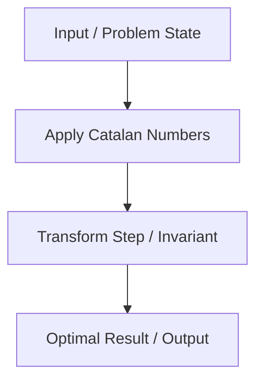

# Catalan Numbers

> **Category:** MathORNumberTheory · **Tier:** Advanced Interview (Math)

---

## 🔗 Resources & Visualizers
- **YouTube:** [Watch Catalan Numbers Visual Guide](https://www.youtube.com/results?search_query=Catalan%20Numbers%20algorithm%20visual%20explanation)
- **Blog / Editorial:** [CP-Algorithms / GeeksforGeeks Guide](https://www.google.com/search?q=Catalan%20Numbers%20algorithm%20tutorial%20CP%20algorithms)
- **Interactive Visualizer:** [VisuAlgo Interactive Simulation](https://visualgo.net/en)

---

## 🧠 Intuition & Mental Model
> [!TIP]
> **Core Concept:** Catalan Numbers count the number of ways to correctly form

Catalan Numbers count the number of ways to correctly form
structures like balanced parentheses, BSTs, or polygon triangulations.
The nth Catalan number is defined as
C(n) = (1 / (n + 1)) · (2n choose n)
Algorithm Explanation
Use Dynamic Programming
Let dp[i] store the i-th Catalan number
Base cases:
dp[0] = 1
dp[1] = 1
Transition:
For every i, split it into two parts j and i - j - 1
Multiply left and right possibilities
Formula:
dp[i] += dp[j] * dp[i - j - 1]

---

## 🎯 When to Use & Problem Triggers
- **Trigger 1:** When the brute-force enumeration takes quadratic time or higher and a linear/logarithmic invariant exists.
- **Trigger 2:** Common patterns involving **MathORNumberTheory**, subsegments, query sequences, or optimal substructures.
- **Trigger 3:** Constraints where $N \ge 10^5$ require $O(N)$ or $O(N \log N)$ performance.

---

## 📊 Visual Explanation & Dry Run



<details>
<summary>🔍 <strong>Step-by-Step Algorithm Walkthrough</strong> (Click to expand)</summary>

1. **Initialization:** Set up boundary pointers, state variables, or base auxiliary arrays.
2. **Iteration / Traversal:** Advance through the input elements while maintaining the algorithmic invariant.
3. **State Transition:** Update the current state, dynamic array, or accumulator in $O(1)$ or $O(\log N)$.
4. **Final Result:** Extract the optimal answer from the computed state or reconstructed solution.

</details>

---

## 💻 Algorithm Code (Java)

```java
import java.io.*;
import java.util.*;

class Main {
    public static void main(String[] args) throws Exception {
        int n = 3;
        long[] dp = new long[n + 1];

        dp[0] = 1;
        dp[1] = 1;

        for (int i = 2; i <= n; i++) {
            dp[i] = 0;
            for (int j = 0; j < i; j++) {
                dp[i] += dp[j] * dp[i - j - 1];
            }
        }

        System.out.println(dp[n]);
    }
}
```

---

## ⏱️ Complexity Analysis
- **Time Complexity (TC):** Typically `O(N)` or `O(N log N)` depending on auxiliary sorting or tree operations.
- **Space Complexity (SC):** Typically `O(1)` auxiliary space or `O(N)` for auxiliary arrays/tables.

---

## 🔄 Similar & Connected Algorithms
- **Related Category:** Explore other fundamental algorithms in [MathORNumberTheory](../).
- **Composite Patterns:** Often combined with Prefix Sums, Binary Search on Answer, or Dynamic Programming memoization.

---

## ⚔️ Practice Questions

### 🟡 LeetCode
- [ ] [Explore Catalan Numbers Problems on LeetCode](https://leetcode.com/problemset/?search=Catalan%20Numbers%20LeetCode) — `Practice`

### 🔵 CodeChef & Codeforces
- [ ] [Practice on Codeforces Problemset](https://codeforces.com/problemset) — `Catalog`
- [ ] [Practice on CodeChef Practice Portal](https://www.codechef.com/practice) — `Catalog`
