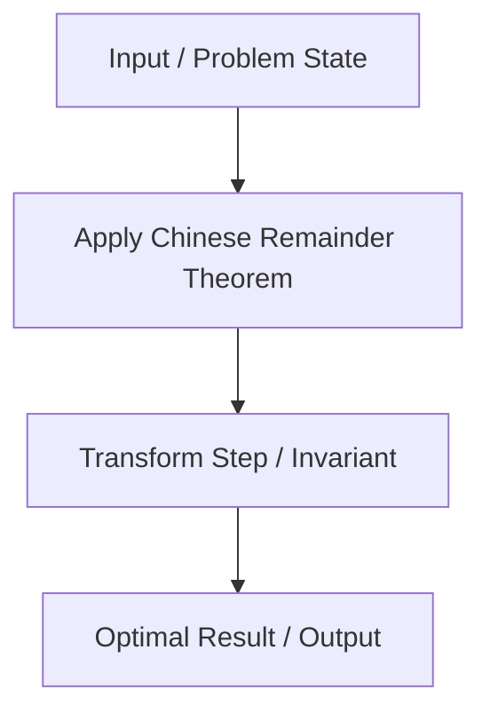

# Chinese Remainder Theorem

> **Category:** MathORNumberTheory · **Tier:** Competitive Programming (Math)

---

## 🔗 Resources & Visualizers
- **YouTube:** [Watch Chinese Remainder Theorem Visual Guide](https://www.youtube.com/results?search_query=Chinese%20Remainder%20Theorem%20algorithm%20visual%20explanation)
- **Blog / Editorial:** [CP-Algorithms / GeeksforGeeks Guide](https://www.google.com/search?q=Chinese%20Remainder%20Theorem%20algorithm%20tutorial%20CP%20algorithms)
- **Interactive Visualizer:** [VisuAlgo Interactive Simulation](https://visualgo.net/en)

---

## 🧠 Intuition & Mental Model
> [!TIP]
> **Core Concept:** Chinese Remainder Theorem states that if moduli are pairwise

Chinese Remainder Theorem states that if moduli are pairwise
coprime, then a system of congruences has a unique solution modulo
the product of moduli.
Algorithm Explanation :
You are given equations of the form
x ≡ ai (mod mi)
All mi must be pairwise coprime
Compute total modulus M = m1 * m2 * ... * mk
For each equation:
Compute Mi = M / mi
Compute modular inverse yi = Mi⁻¹ mod mi
Add contribution ai * Mi * yi
Final answer is (sum % M + M) % M

---

## 🎯 When to Use & Problem Triggers
- **Trigger 1:** When the brute-force enumeration takes quadratic time or higher and a linear/logarithmic invariant exists.
- **Trigger 2:** Common patterns involving **MathORNumberTheory**, subsegments, query sequences, or optimal substructures.
- **Trigger 3:** Constraints where $N \ge 10^5$ require $O(N)$ or $O(N \log N)$ performance.

---

## 📊 Visual Explanation & Dry Run



<details>
<summary>🔍 <strong>Step-by-Step Algorithm Walkthrough</strong> (Click to expand)</summary>

1. **Initialization:** Set up boundary pointers, state variables, or base auxiliary arrays.
2. **Iteration / Traversal:** Advance through the input elements while maintaining the algorithmic invariant.
3. **State Transition:** Update the current state, dynamic array, or accumulator in $O(1)$ or $O(\log N)$.
4. **Final Result:** Extract the optimal answer from the computed state or reconstructed solution.

</details>

---

## 💻 Algorithm Code (Java)

```java
import java.io.*;
import java.util.*;

class Main {

    static long modInverse(long a, long m) {
        long m0 = m;
        long x0 = 0, x1 = 1;

        while (a > 1) {
            long q = a / m;
            long t = m;

            m = a % m;
            a = t;

            t = x0;
            x0 = x1 - q * x0;
            x1 = t;
        }

        if (x1 < 0) x1 += m0;
        return x1;
    }

    public static void main(String[] args) throws Exception {
        long[] rem = {2, 3};
        long[] mod = {3, 5};

        int n = rem.length;

        long M = 1;
        for (int i = 0; i < n; i++) {
            M *= mod[i];
        }

        long ans = 0;

        for (int i = 0; i < n; i++) {
            long Mi = M / mod[i];

            long inv = modInverse(Mi, mod[i]);

            ans += rem[i] * Mi * inv;
        }

        ans = (ans % M + M) % M;

        System.out.println(ans);
    }
}
```

---

## ⏱️ Complexity Analysis
- **Time Complexity (TC):** Typically `O(N)` or `O(N log N)` depending on auxiliary sorting or tree operations.
- **Space Complexity (SC):** Typically `O(1)` auxiliary space or `O(N)` for auxiliary arrays/tables.

---

## 🔄 Similar & Connected Algorithms
- **Related Category:** Explore other fundamental algorithms in [MathORNumberTheory](../).
- **Composite Patterns:** Often combined with Prefix Sums, Binary Search on Answer, or Dynamic Programming memoization.

---

## ⚔️ Practice Questions

### 🟡 LeetCode
- [ ] [Explore Chinese Remainder Theorem Problems on LeetCode](https://leetcode.com/problemset/?search=Chinese%20Remainder%20Theorem%20LeetCode) — `Practice`

### 🔵 CodeChef & Codeforces
- [ ] [Practice on Codeforces Problemset](https://codeforces.com/problemset) — `Catalog`
- [ ] [Practice on CodeChef Practice Portal](https://www.codechef.com/practice) — `Catalog`
