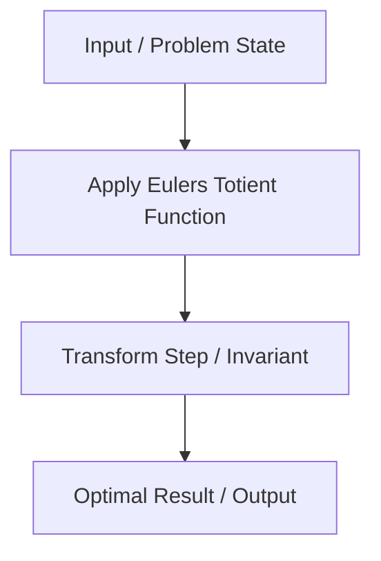

# Eulers Totient Function

> **Category:** MathORNumberTheory · **Tier:** Advanced Interview (Math)

---

## 🔗 Resources & Visualizers
- **YouTube:** [Watch Eulers Totient Function Visual Guide](https://www.youtube.com/results?search_query=Eulers%20Totient%20Function%20algorithm%20visual%20explanation)
- **Blog / Editorial:** [CP-Algorithms / GeeksforGeeks Guide](https://www.google.com/search?q=Eulers%20Totient%20Function%20algorithm%20tutorial%20CP%20algorithms)
- **Interactive Visualizer:** [VisuAlgo Interactive Simulation](https://visualgo.net/en)

---

## 🧠 Intuition & Mental Model
> [!TIP]
> **Core Concept:** Euler’s Totient Function φ(n) gives the count of

Euler’s Totient Function φ(n) gives the count of
positive integers ≤ n that are coprime with n.
Two numbers are coprime if their GCD = 1.
Algorithm Explanation
Start with result = n
Iterate through all possible prime factors p of n
If p divides n:
Remove all occurrences of p from n
Subtract result / p from result
After loop, if n > 1, it is a prime factor:
Subtract result / n
Final result is φ(original n)

---

## 🎯 When to Use & Problem Triggers
- **Trigger 1:** When the brute-force enumeration takes quadratic time or higher and a linear/logarithmic invariant exists.
- **Trigger 2:** Common patterns involving **MathORNumberTheory**, subsegments, query sequences, or optimal substructures.
- **Trigger 3:** Constraints where $N \ge 10^5$ require $O(N)$ or $O(N \log N)$ performance.

---

## 📊 Visual Explanation & Dry Run



<details>
<summary>🔍 <strong>Step-by-Step Algorithm Walkthrough</strong> (Click to expand)</summary>

1. **Initialization:** Set up boundary pointers, state variables, or base auxiliary arrays.
2. **Iteration / Traversal:** Advance through the input elements while maintaining the algorithmic invariant.
3. **State Transition:** Update the current state, dynamic array, or accumulator in $O(1)$ or $O(\log N)$.
4. **Final Result:** Extract the optimal answer from the computed state or reconstructed solution.

</details>

---

## 💻 Algorithm Code (Java)

```java
import java.io.*;
import java.util.*;

class Main {

    public static int phi(int n) {
        int result = n;

        for (int p = 2; p * p <= n; p++) {
            if (n % p == 0) {
                while (n % p == 0) {
                    n /= p;
                }

                result -= result / p;
            }
        }

        if (n > 1) {
            result -= result / n;
        }

        return result;
    }

    public static void main(String[] args) throws Exception {
        int n = 10;
        System.out.println(phi(n));
    }
}
```

---

## ⏱️ Complexity Analysis
- **Time Complexity (TC):** Typically `O(N)` or `O(N log N)` depending on auxiliary sorting or tree operations.
- **Space Complexity (SC):** Typically `O(1)` auxiliary space or `O(N)` for auxiliary arrays/tables.

---

## 🔄 Similar & Connected Algorithms
- **Related Category:** Explore other fundamental algorithms in [MathORNumberTheory](../).
- **Composite Patterns:** Often combined with Prefix Sums, Binary Search on Answer, or Dynamic Programming memoization.

---

## ⚔️ Practice Questions

### 🟡 LeetCode
- [ ] [Explore Eulers Totient Function Problems on LeetCode](https://leetcode.com/problemset/?search=Eulers%20Totient%20Function%20LeetCode) — `Practice`

### 🔵 CodeChef & Codeforces
- [ ] [Practice on Codeforces Problemset](https://codeforces.com/problemset) — `Catalog`
- [ ] [Practice on CodeChef Practice Portal](https://www.codechef.com/practice) — `Catalog`
