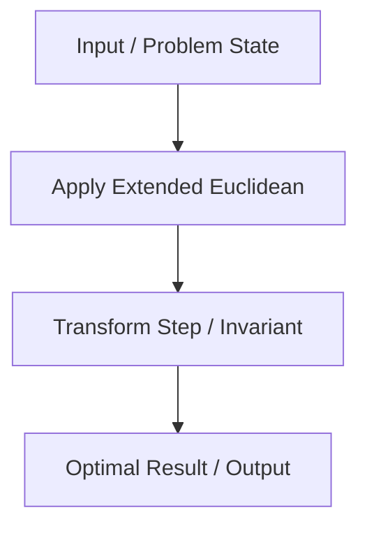

# Extended Euclidean

> **Category:** MathORNumberTheory · **Tier:** Advanced Interview (Math)

---

## 🔗 Resources & Visualizers
- **YouTube:** [Watch Extended Euclidean Visual Guide](https://www.youtube.com/results?search_query=Extended%20Euclidean%20algorithm%20visual%20explanation)
- **Blog / Editorial:** [CP-Algorithms / GeeksforGeeks Guide](https://www.google.com/search?q=Extended%20Euclidean%20algorithm%20tutorial%20CP%20algorithms)
- **Interactive Visualizer:** [VisuAlgo Interactive Simulation](https://visualgo.net/en)

---

## 🧠 Intuition & Mental Model
> [!TIP]
> **Core Concept:** The Extended Euclidean Algorithm finds integers x and y such that

The Extended Euclidean Algorithm finds integers x and y such that
a·x + b·y = gcd(a, b), along with the gcd of a and b.
How the Algorithm Works
Uses the same idea as Euclidean Algorithm (remainder reduction).
Recursively breaks gcd(a, b) into gcd(b, a % b).
While returning back, it builds coefficients x and y.
Final result satisfies: a*x + b*y = gcd(a, b).

---

## 🎯 When to Use & Problem Triggers
- **Trigger 1:** When the brute-force enumeration takes quadratic time or higher and a linear/logarithmic invariant exists.
- **Trigger 2:** Common patterns involving **MathORNumberTheory**, subsegments, query sequences, or optimal substructures.
- **Trigger 3:** Constraints where $N \ge 10^5$ require $O(N)$ or $O(N \log N)$ performance.

---

## 📊 Visual Explanation & Dry Run



<details>
<summary>🔍 <strong>Step-by-Step Algorithm Walkthrough</strong> (Click to expand)</summary>

1. **Initialization:** Set up boundary pointers, state variables, or base auxiliary arrays.
2. **Iteration / Traversal:** Advance through the input elements while maintaining the algorithmic invariant.
3. **State Transition:** Update the current state, dynamic array, or accumulator in $O(1)$ or $O(\log N)$.
4. **Final Result:** Extract the optimal answer from the computed state or reconstructed solution.

</details>

---

## 💻 Algorithm Code (Java)

```java
import java.io.*;
import java.util.*;

class Main {

    static long coeffX;
    static long coeffY;

    static long solve(long a, long b) {
        if (b == 0) {
            coeffX = 1;
            coeffY = 0;
            return a;
        }

        long gcd = solve(b, a % b);
        long prevX = coeffX;
        coeffX = coeffY;
        coeffY = prevX - (a / b) * coeffY;
        return gcd;
    }

    public static void main(String[] args) throws Exception {
        long a = 30;
        long b = 20;

        long gcd = solve(a, b);

        System.out.println("GCD = " + gcd);
        System.out.println("x = " + coeffX);
        System.out.println("y = " + coeffY);
        System.out.println("Verification = " + (a * coeffX + b * coeffY));
    }
}
```

---

## ⏱️ Complexity Analysis
- **Time Complexity (TC):** Typically `O(N)` or `O(N log N)` depending on auxiliary sorting or tree operations.
- **Space Complexity (SC):** Typically `O(1)` auxiliary space or `O(N)` for auxiliary arrays/tables.

---

## 🔄 Similar & Connected Algorithms
- **Related Category:** Explore other fundamental algorithms in [MathORNumberTheory](../).
- **Composite Patterns:** Often combined with Prefix Sums, Binary Search on Answer, or Dynamic Programming memoization.

---

## ⚔️ Practice Questions

### 🟡 LeetCode
- [ ] [Explore Extended Euclidean Problems on LeetCode](https://leetcode.com/problemset/?search=Extended%20Euclidean%20LeetCode) — `Practice`

### 🔵 CodeChef & Codeforces
- [ ] [Practice on Codeforces Problemset](https://codeforces.com/problemset) — `Catalog`
- [ ] [Practice on CodeChef Practice Portal](https://www.codechef.com/practice) — `Catalog`
