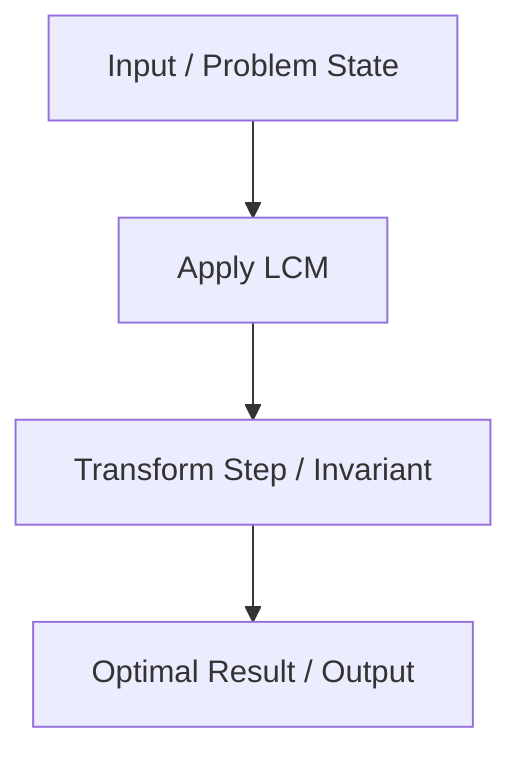

# LCM

> **Category:** MathORNumberTheory · **Tier:** Core Interview (Essential)

---

## 🔗 Resources & Visualizers
- **YouTube:** [Watch LCM Visual Guide](https://www.youtube.com/results?search_query=LCM%20algorithm%20visual%20explanation)
- **Blog / Editorial:** [CP-Algorithms / GeeksforGeeks Guide](https://www.google.com/search?q=LCM%20algorithm%20tutorial%20CP%20algorithms)
- **Interactive Visualizer:** [VisuAlgo Interactive Simulation](https://visualgo.net/en)

---

## 🧠 Intuition & Mental Model
> [!TIP]
> **Core Concept:** LCM (Least Common Multiple) of two numbers is the smallest positive number

LCM (Least Common Multiple) of two numbers is the smallest positive number
that is divisible by both numbers.
It is calculated using the relation: LCM(a, b) = (a × b) / GCD(a, b).
Algorithm Explanation
To compute LCM efficiently, we first compute GCD using Euclid’s Algorithm
Euclid’s Algorithm works by repeatedly replacing:
(a, b) → (b, a % b)
When b becomes 0, a becomes the GCD
Once GCD is known:
Multiply the two numbers
Divide the product by GCD
This avoids checking multiples manually (which is slow)

---

## 🎯 When to Use & Problem Triggers
- **Trigger 1:** When the brute-force enumeration takes quadratic time or higher and a linear/logarithmic invariant exists.
- **Trigger 2:** Common patterns involving **MathORNumberTheory**, subsegments, query sequences, or optimal substructures.
- **Trigger 3:** Constraints where $N \ge 10^5$ require $O(N)$ or $O(N \log N)$ performance.

---

## 📊 Visual Explanation & Dry Run



<details>
<summary>🔍 <strong>Step-by-Step Algorithm Walkthrough</strong> (Click to expand)</summary>

1. **Initialization:** Set up boundary pointers, state variables, or base auxiliary arrays.
2. **Iteration / Traversal:** Advance through the input elements while maintaining the algorithmic invariant.
3. **State Transition:** Update the current state, dynamic array, or accumulator in $O(1)$ or $O(\log N)$.
4. **Final Result:** Extract the optimal answer from the computed state or reconstructed solution.

</details>

---

## 💻 Algorithm Code (Java)

```java
import java.io.*;
import java.util.*;

class Main {

    static long gcd(long a, long b) {
        while (b != 0) {
            long r = a % b;
            a = b;
            b = r;
        }

        return a;
    }

    static long lcm(long a, long b) {
        return (a / gcd(a, b)) * b;
    }

    public static void main(String[] args) throws Exception {
        long a = 6;
        long b = 8;

        long ans = lcm(a, b);

        System.out.println(ans);
    }
}
```

---

## ⏱️ Complexity Analysis
- **Time Complexity (TC):** Typically `O(N)` or `O(N log N)` depending on auxiliary sorting or tree operations.
- **Space Complexity (SC):** Typically `O(1)` auxiliary space or `O(N)` for auxiliary arrays/tables.

---

## 🔄 Similar & Connected Algorithms
- **Related Category:** Explore other fundamental algorithms in [MathORNumberTheory](../).
- **Composite Patterns:** Often combined with Prefix Sums, Binary Search on Answer, or Dynamic Programming memoization.

---

## ⚔️ Practice Questions

### 🟡 LeetCode
- [ ] [Explore LCM Problems on LeetCode](https://leetcode.com/problemset/?search=LCM%20LeetCode) — `Practice`

### 🔵 CodeChef & Codeforces
- [ ] [Practice on Codeforces Problemset](https://codeforces.com/problemset) — `Catalog`
- [ ] [Practice on CodeChef Practice Portal](https://www.codechef.com/practice) — `Catalog`
