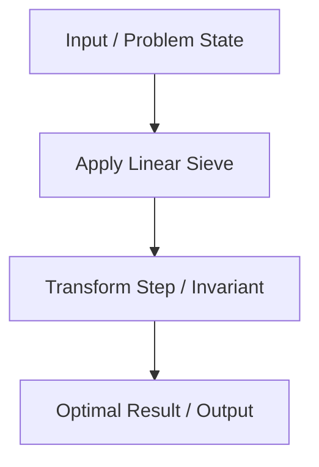

# Linear Sieve

> **Category:** MathORNumberTheory · **Tier:** Advanced Interview (Primes)

---

## 🔗 Resources & Visualizers
- **YouTube:** [Watch Linear Sieve Visual Guide](https://www.youtube.com/results?search_query=Linear%20Sieve%20algorithm%20visual%20explanation)
- **Blog / Editorial:** [CP-Algorithms / GeeksforGeeks Guide](https://www.google.com/search?q=Linear%20Sieve%20algorithm%20tutorial%20CP%20algorithms)
- **Interactive Visualizer:** [VisuAlgo Interactive Simulation](https://visualgo.net/en)

---

## 🧠 Intuition & Mental Model
> [!TIP]
> **Core Concept:** Linear Sieve is an algorithm to find all prime numbers up to

Linear Sieve is an algorithm to find all prime numbers up to
N in O(N) time by ensuring every composite number is marked exactly once.
How the Algorithm Works
Maintain a boolean array to mark prime/composite numbers
Maintain an array to store discovered prime numbers
Iterate numbers from 2 to N
If a number is not marked, it is prime → store it
For every prime discovered so far:
Mark currentNumber * prime as composite
Stop when:
product exceeds N, or
prime divides currentNumber (key to linear time)

---

## 🎯 When to Use & Problem Triggers
- **Trigger 1:** When the brute-force enumeration takes quadratic time or higher and a linear/logarithmic invariant exists.
- **Trigger 2:** Common patterns involving **MathORNumberTheory**, subsegments, query sequences, or optimal substructures.
- **Trigger 3:** Constraints where $N \ge 10^5$ require $O(N)$ or $O(N \log N)$ performance.

---

## 📊 Visual Explanation & Dry Run



<details>
<summary>🔍 <strong>Step-by-Step Algorithm Walkthrough</strong> (Click to expand)</summary>

1. **Initialization:** Set up boundary pointers, state variables, or base auxiliary arrays.
2. **Iteration / Traversal:** Advance through the input elements while maintaining the algorithmic invariant.
3. **State Transition:** Update the current state, dynamic array, or accumulator in $O(1)$ or $O(\log N)$.
4. **Final Result:** Extract the optimal answer from the computed state or reconstructed solution.

</details>

---

## 💻 Algorithm Code (Java)

```java
import java.io.*;
import java.util.*;

class LinearSieveExample {
    public static void main(String[] args) throws Exception {
        BufferedReader br = new BufferedReader(new InputStreamReader(System.in));
        PrintWriter out = new PrintWriter(System.out);

        int N = 20;
        boolean[] isComposite = new boolean[N + 1];

        int[] primes = new int[N + 1];
        int primeCount = 0;

        for (int i = 2; i <= N; i++) {
            if (!isComposite[i]) {
                primes[primeCount++] = i;
            }

            for (int j = 0; j < primeCount; j++) {
                int p = primes[j];
                if (i * p > N) break;
                isComposite[i * p] = true;
                if (i % p == 0) break;
            }
        }

        out.print("Primes till " + N + ": ");
        for (int i = 0; i < primeCount; i++) {
            out.print(primes[i] + " ");
        }

        out.println();
        out.flush();
    }
}
```

---

## ⏱️ Complexity Analysis
- **Time Complexity (TC):** Typically `O(N)` or `O(N log N)` depending on auxiliary sorting or tree operations.
- **Space Complexity (SC):** Typically `O(1)` auxiliary space or `O(N)` for auxiliary arrays/tables.

---

## 🔄 Similar & Connected Algorithms
- **Related Category:** Explore other fundamental algorithms in [MathORNumberTheory](../).
- **Composite Patterns:** Often combined with Prefix Sums, Binary Search on Answer, or Dynamic Programming memoization.

---

## ⚔️ Practice Questions

### 🟡 LeetCode
- [ ] [Explore Linear Sieve Problems on LeetCode](https://leetcode.com/problemset/?search=Linear%20Sieve%20LeetCode) — `Practice`

### 🔵 CodeChef & Codeforces
- [ ] [Practice on Codeforces Problemset](https://codeforces.com/problemset) — `Catalog`
- [ ] [Practice on CodeChef Practice Portal](https://www.codechef.com/practice) — `Catalog`
