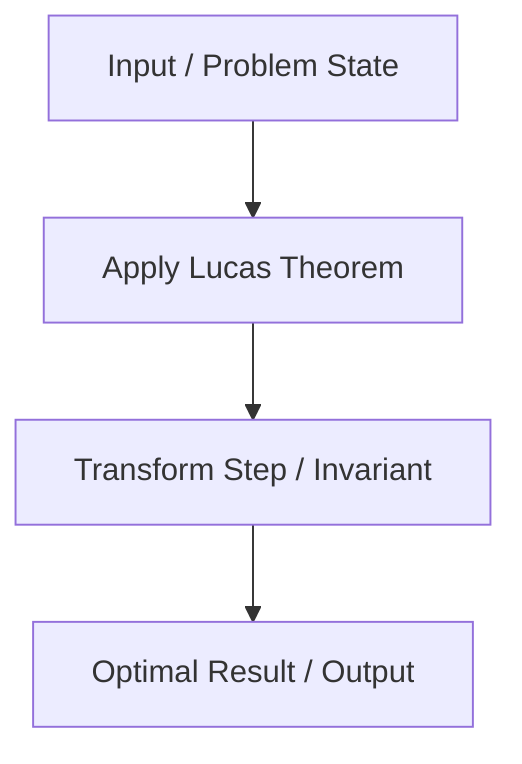

# Lucas Theorem

> **Category:** MathORNumberTheory · **Tier:** Competitive Programming (Combinatorics)

---

## 🔗 Resources & Visualizers
- **YouTube:** [Watch Lucas Theorem Visual Guide](https://www.youtube.com/results?search_query=Lucas%20Theorem%20algorithm%20visual%20explanation)
- **Blog / Editorial:** [CP-Algorithms / GeeksforGeeks Guide](https://www.google.com/search?q=Lucas%20Theorem%20algorithm%20tutorial%20CP%20algorithms)
- **Interactive Visualizer:** [VisuAlgo Interactive Simulation](https://visualgo.net/en)

---

## 🧠 Intuition & Mental Model
> [!TIP]
> **Core Concept:** Lucas Theorem helps compute nCr mod p where p is prime, by breaking

Lucas Theorem helps compute nCr mod p where p is prime, by breaking
n and r into base-p digits.
The result is the product of smaller combinations of
corresponding digits mod p.
Algorithm Explanation :
Works only when p is prime
Convert n and r into base-p representation
For each digit position:
Take digits ni from n and ri from r
If ri > ni → result = 0
Else multiply C(ni, ri) mod p
Final answer is the product of all digit-wise combinations mod p
Example used: n = 5, r = 2, p = 3
Expected result: 5C2 = 10, 10 mod 3 = 1

---

## 🎯 When to Use & Problem Triggers
- **Trigger 1:** When the brute-force enumeration takes quadratic time or higher and a linear/logarithmic invariant exists.
- **Trigger 2:** Common patterns involving **MathORNumberTheory**, subsegments, query sequences, or optimal substructures.
- **Trigger 3:** Constraints where $N \ge 10^5$ require $O(N)$ or $O(N \log N)$ performance.

---

## 📊 Visual Explanation & Dry Run



<details>
<summary>🔍 <strong>Step-by-Step Algorithm Walkthrough</strong> (Click to expand)</summary>

1. **Initialization:** Set up boundary pointers, state variables, or base auxiliary arrays.
2. **Iteration / Traversal:** Advance through the input elements while maintaining the algorithmic invariant.
3. **State Transition:** Update the current state, dynamic array, or accumulator in $O(1)$ or $O(\log N)$.
4. **Final Result:** Extract the optimal answer from the computed state or reconstructed solution.

</details>

---

## 💻 Algorithm Code (Java)

```java
import java.io.*;
import java.util.*;

class Main {

    static long nCrModP(long n, long r, int p) {
        if (r > n) return 0;

        long res = 1;

        for (int i = 1; i <= r; i++) {
            res = res * (n - r + i) / i;
        }

        return res % p;
    }

    static long lucas(long n, long r, int p) {
        long ans = 1;

        while (n > 0 && r > 0) {
            long ni = n % p;
            long ri = r % p;

            if (ri > ni) return 0;

            ans = (ans * nCrModP(ni, ri, p)) % p;

            n /= p;
            r /= p;
        }

        return ans;
    }

    public static void main(String[] args) throws Exception {
        BufferedReader br = new BufferedReader(new InputStreamReader(System.in));
        PrintWriter out = new PrintWriter(System.out);

        long n = 5;
        long r = 2;
        int p = 3;

        out.println(lucas(n, r, p));
        out.flush();
    }
}
```

---

## ⏱️ Complexity Analysis
- **Time Complexity (TC):** Typically `O(N)` or `O(N log N)` depending on auxiliary sorting or tree operations.
- **Space Complexity (SC):** Typically `O(1)` auxiliary space or `O(N)` for auxiliary arrays/tables.

---

## 🔄 Similar & Connected Algorithms
- **Related Category:** Explore other fundamental algorithms in [MathORNumberTheory](../).
- **Composite Patterns:** Often combined with Prefix Sums, Binary Search on Answer, or Dynamic Programming memoization.

---

## ⚔️ Practice Questions

### 🟡 LeetCode
- [ ] [Explore Lucas Theorem Problems on LeetCode](https://leetcode.com/problemset/?search=Lucas%20Theorem%20LeetCode) — `Practice`

### 🔵 CodeChef & Codeforces
- [ ] [Practice on Codeforces Problemset](https://codeforces.com/problemset) — `Catalog`
- [ ] [Practice on CodeChef Practice Portal](https://www.codechef.com/practice) — `Catalog`
