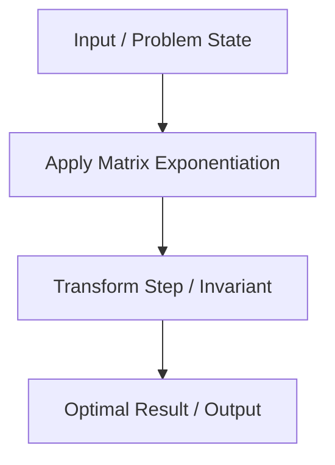

# Matrix Exponentiation

> **Category:** MathORNumberTheory · **Tier:** Advanced Interview (Fibonacci/DP)

---

## 🔗 Resources & Visualizers
- **YouTube:** [Watch Matrix Exponentiation Visual Guide](https://www.youtube.com/results?search_query=Matrix%20Exponentiation%20algorithm%20visual%20explanation)
- **Blog / Editorial:** [CP-Algorithms / GeeksforGeeks Guide](https://www.google.com/search?q=Matrix%20Exponentiation%20algorithm%20tutorial%20CP%20algorithms)
- **Interactive Visualizer:** [VisuAlgo Interactive Simulation](https://visualgo.net/en)

---

## 🧠 Intuition & Mental Model
> [!TIP]
> **Core Concept:** Matrix Exponentiation is a technique to compute the

Matrix Exponentiation is a technique to compute the
power of a matrix efficiently in O(log N) time.
It is mainly used to solve linear recurrence relations like Fibonacci.
Algorithm Explanation
Any linear recurrence can be represented using a transition matrix.
Instead of multiplying the matrix N times, we use binary exponentiation.
If power is even → square the matrix.
If power is odd → multiply once and reduce power.
This reduces time from O(N) to O(log N).
Final matrix multiplied with base vector gives the answer.
Example: Fibonacci Number using Matrix Exponentiation
We compute F(n) using matrix power.
Fibonacci Relation
F(n) = F(n−1) + F(n−2)
Transition Matrix
|1 1|
|1 0|

---

## 🎯 When to Use & Problem Triggers
- **Trigger 1:** When the brute-force enumeration takes quadratic time or higher and a linear/logarithmic invariant exists.
- **Trigger 2:** Common patterns involving **MathORNumberTheory**, subsegments, query sequences, or optimal substructures.
- **Trigger 3:** Constraints where $N \ge 10^5$ require $O(N)$ or $O(N \log N)$ performance.

---

## 📊 Visual Explanation & Dry Run



<details>
<summary>🔍 <strong>Step-by-Step Algorithm Walkthrough</strong> (Click to expand)</summary>

1. **Initialization:** Set up boundary pointers, state variables, or base auxiliary arrays.
2. **Iteration / Traversal:** Advance through the input elements while maintaining the algorithmic invariant.
3. **State Transition:** Update the current state, dynamic array, or accumulator in $O(1)$ or $O(\log N)$.
4. **Final Result:** Extract the optimal answer from the computed state or reconstructed solution.

</details>

---

## 💻 Algorithm Code (Java)

```java
import java.io.*;
import java.util.*;

class Main {

    static long[][] multiply(long[][] a, long[][] b) {
        long[][] r = new long[2][2];

        r[0][0] = a[0][0] * b[0][0] + a[0][1] * b[1][0];
        r[0][1] = a[0][0] * b[0][1] + a[0][1] * b[1][1];
        r[1][0] = a[1][0] * b[0][0] + a[1][1] * b[1][0];
        r[1][1] = a[1][0] * b[0][1] + a[1][1] * b[1][1];

        return r;
    }

    static long[][] power(long[][] m, int n) {
        if (n == 1) return m;

        long[][] half = power(m, n / 2);
        long[][] res = multiply(half, half);

        if (n % 2 == 1)
            res = multiply(res, m);

        return res;
    }

    static long fibonacci(int n) {
        if (n == 0) return 0;
        if (n == 1) return 1;

        long[][] base = {
                {1, 1},
                {1, 0}
        };

        long[][] ans = power(base, n - 1);
        return ans[0][0];
    }

    public static void main(String[] args) throws Exception {
        int n = 6;
        System.out.println(fibonacci(n));
    }
}
```

---

## ⏱️ Complexity Analysis
- **Time Complexity (TC):** Typically `O(N)` or `O(N log N)` depending on auxiliary sorting or tree operations.
- **Space Complexity (SC):** Typically `O(1)` auxiliary space or `O(N)` for auxiliary arrays/tables.

---

## 🔄 Similar & Connected Algorithms
- **Related Category:** Explore other fundamental algorithms in [MathORNumberTheory](../).
- **Composite Patterns:** Often combined with Prefix Sums, Binary Search on Answer, or Dynamic Programming memoization.

---

## ⚔️ Practice Questions

### 🟡 LeetCode
- [ ] [Explore Matrix Exponentiation Problems on LeetCode](https://leetcode.com/problemset/?search=Matrix%20Exponentiation%20LeetCode) — `Practice`

### 🔵 CodeChef & Codeforces
- [ ] [Practice on Codeforces Problemset](https://codeforces.com/problemset) — `Catalog`
- [ ] [Practice on CodeChef Practice Portal](https://www.codechef.com/practice) — `Catalog`
