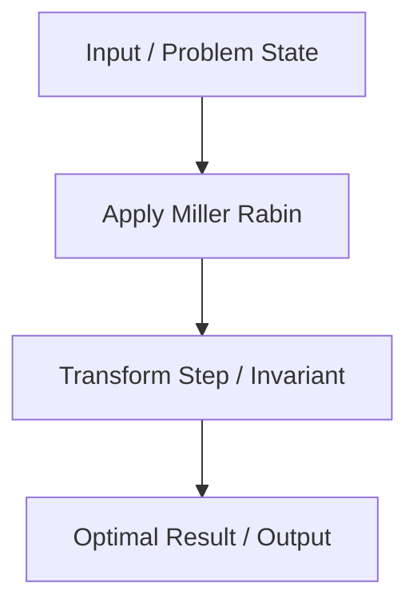

# Miller Rabin

> **Category:** MathORNumberTheory · **Tier:** Competitive Programming (Primality)

---

## 🔗 Resources & Visualizers
- **YouTube:** [Watch Miller Rabin Visual Guide](https://www.youtube.com/results?search_query=Miller%20Rabin%20algorithm%20visual%20explanation)
- **Blog / Editorial:** [CP-Algorithms / GeeksforGeeks Guide](https://www.google.com/search?q=Miller%20Rabin%20algorithm%20tutorial%20CP%20algorithms)
- **Interactive Visualizer:** [VisuAlgo Interactive Simulation](https://visualgo.net/en)

---

## 🧠 Intuition & Mental Model
> [!TIP]
> **Core Concept:** Miller–Rabin is a probabilistic primality test that

Miller–Rabin is a probabilistic primality test that
determines whether a number is prime or composite
using modular exponentiation and repeated squaring.
It is fast and reliable for very large numbers.
Algorithm Explanation :
Any odd number n > 2 can be written as
n − 1 = d × 2^r where d is odd
Pick a random base a such that 2 ≤ a ≤ n−2
Compute x = a^d % n
If x == 1 or x == n−1, pass this round
Otherwise, square x repeatedly r−1 times:
If x becomes n−1, pass
If none of the above happens → composite
Repeat for k iterations to reduce error probability

---

## 🎯 When to Use & Problem Triggers
- **Trigger 1:** When the brute-force enumeration takes quadratic time or higher and a linear/logarithmic invariant exists.
- **Trigger 2:** Common patterns involving **MathORNumberTheory**, subsegments, query sequences, or optimal substructures.
- **Trigger 3:** Constraints where $N \ge 10^5$ require $O(N)$ or $O(N \log N)$ performance.

---

## 📊 Visual Explanation & Dry Run



<details>
<summary>🔍 <strong>Step-by-Step Algorithm Walkthrough</strong> (Click to expand)</summary>

1. **Initialization:** Set up boundary pointers, state variables, or base auxiliary arrays.
2. **Iteration / Traversal:** Advance through the input elements while maintaining the algorithmic invariant.
3. **State Transition:** Update the current state, dynamic array, or accumulator in $O(1)$ or $O(\log N)$.
4. **Final Result:** Extract the optimal answer from the computed state or reconstructed solution.

</details>

---

## 💻 Algorithm Code (Java)

```java
import java.io.*;
import java.util.*;

class MillerRabin {

    static long modPow(long a, long b, long mod) {
        long res = 1;
        a %= mod;

        while (b > 0) {
            if ((b & 1) == 1)
                res = (res * a) % mod;
            a = (a * a) % mod;
            b >>= 1;
        }

        return res;
    }

    static boolean isPrime(long n, int k) {
        if (n < 2) return false;
        if (n == 2 || n == 3) return true;
        if (n % 2 == 0) return false;

        long d = n - 1;
        while ((d & 1) == 0)
            d >>= 1;

        Random rand = new Random();

        for (int i = 0; i < k; i++) {
            long a = 2 + rand.nextInt((int) (n - 4));
            long x = modPow(a, d, n);

            if (x == 1 || x == n - 1)
                continue;

            boolean composite = true;

            long temp = d;
            while (temp != n - 1) {
                x = (x * x) % n;
                temp <<= 1;

                if (x == n - 1) {
                    composite = false;
                    break;
                }
            }

            if (composite) return false;
        }
        return true;
    }

    public static void main(String[] args) {
        long n = 13;
        int k = 5;

        System.out.println(isPrime(n, k) ? "Prime" : "Composite");
    }
}
```

---

## ⏱️ Complexity Analysis
- **Time Complexity (TC):** Typically `O(N)` or `O(N log N)` depending on auxiliary sorting or tree operations.
- **Space Complexity (SC):** Typically `O(1)` auxiliary space or `O(N)` for auxiliary arrays/tables.

---

## 🔄 Similar & Connected Algorithms
- **Related Category:** Explore other fundamental algorithms in [MathORNumberTheory](../).
- **Composite Patterns:** Often combined with Prefix Sums, Binary Search on Answer, or Dynamic Programming memoization.

---

## ⚔️ Practice Questions

### 🟡 LeetCode
- [ ] [Explore Miller Rabin Problems on LeetCode](https://leetcode.com/problemset/?search=Miller%20Rabin%20LeetCode) — `Practice`

### 🔵 CodeChef & Codeforces
- [ ] [Practice on Codeforces Problemset](https://codeforces.com/problemset) — `Catalog`
- [ ] [Practice on CodeChef Practice Portal](https://www.codechef.com/practice) — `Catalog`
