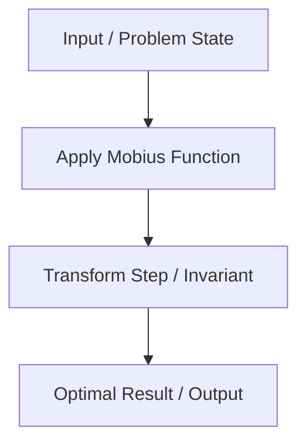

# Mobius Function

> **Category:** MathORNumberTheory · **Tier:** Competitive Programming (Number Theory)

---

## 🔗 Resources & Visualizers
- **YouTube:** [Watch Mobius Function Visual Guide](https://www.youtube.com/results?search_query=Mobius%20Function%20algorithm%20visual%20explanation)
- **Blog / Editorial:** [CP-Algorithms / GeeksforGeeks Guide](https://www.google.com/search?q=Mobius%20Function%20algorithm%20tutorial%20CP%20algorithms)
- **Interactive Visualizer:** [VisuAlgo Interactive Simulation](https://visualgo.net/en)

---

## 🧠 Intuition & Mental Model
> [!TIP]
> **Core Concept:** The Möbius function μ(n) returns:

The Möbius function μ(n) returns:
1 if n is square-free with even prime factors, -1
if square-free with odd prime factors, 0 if n has a squared prime factor
Algorithm Explanation :
We compute μ values for all numbers 1…N using a modified Sieve.
Initialize all μ values as 1.
For every prime p:
Multiply μ of all multiples of p by -1.
Set μ of all multiples of p² to 0 (not square-free).
Result: μ array filled in one pass similar to Sieve of Eratosthenes.

---

## 🎯 When to Use & Problem Triggers
- **Trigger 1:** When the brute-force enumeration takes quadratic time or higher and a linear/logarithmic invariant exists.
- **Trigger 2:** Common patterns involving **MathORNumberTheory**, subsegments, query sequences, or optimal substructures.
- **Trigger 3:** Constraints where $N \ge 10^5$ require $O(N)$ or $O(N \log N)$ performance.

---

## 📊 Visual Explanation & Dry Run



<details>
<summary>🔍 <strong>Step-by-Step Algorithm Walkthrough</strong> (Click to expand)</summary>

1. **Initialization:** Set up boundary pointers, state variables, or base auxiliary arrays.
2. **Iteration / Traversal:** Advance through the input elements while maintaining the algorithmic invariant.
3. **State Transition:** Update the current state, dynamic array, or accumulator in $O(1)$ or $O(\log N)$.
4. **Final Result:** Extract the optimal answer from the computed state or reconstructed solution.

</details>

---

## 💻 Algorithm Code (Java)

```java
import java.io.*;
import java.util.*;

class Main {
    public static void main(String[] args) throws Exception {
        BufferedReader br = new BufferedReader(new InputStreamReader(System.in));
        PrintWriter out = new PrintWriter(System.out);

        int n = 10;

        int[] mu = new int[n + 1];
        boolean[] isPrime = new boolean[n + 1];

        for (int i = 1; i <= n; i++) {
            mu[i] = 1;
            isPrime[i] = true;
        }

        for (int i = 2; i <= n; i++) {
            if (isPrime[i]) {
                for (int j = i; j <= n; j += i) {
                    mu[j] *= -1;
                    isPrime[j] = false;
                }

                long sq = (long) i * i;

                if (sq <= n) {
                    for (int j = (int) sq; j <= n; j += sq) {
                        mu[j] = 0;
                    }
                }
            }
        }

        for (int i = 1; i <= n; i++) {
            out.println("mu(" + i + ") = " + mu[i]);
        }

        out.flush();
    }
}
```

---

## ⏱️ Complexity Analysis
- **Time Complexity (TC):** Typically `O(N)` or `O(N log N)` depending on auxiliary sorting or tree operations.
- **Space Complexity (SC):** Typically `O(1)` auxiliary space or `O(N)` for auxiliary arrays/tables.

---

## 🔄 Similar & Connected Algorithms
- **Related Category:** Explore other fundamental algorithms in [MathORNumberTheory](../).
- **Composite Patterns:** Often combined with Prefix Sums, Binary Search on Answer, or Dynamic Programming memoization.

---

## ⚔️ Practice Questions

### 🟡 LeetCode
- [ ] [Explore Mobius Function Problems on LeetCode](https://leetcode.com/problemset/?search=Mobius%20Function%20LeetCode) — `Practice`

### 🔵 CodeChef & Codeforces
- [ ] [Practice on Codeforces Problemset](https://codeforces.com/problemset) — `Catalog`
- [ ] [Practice on CodeChef Practice Portal](https://www.codechef.com/practice) — `Catalog`
