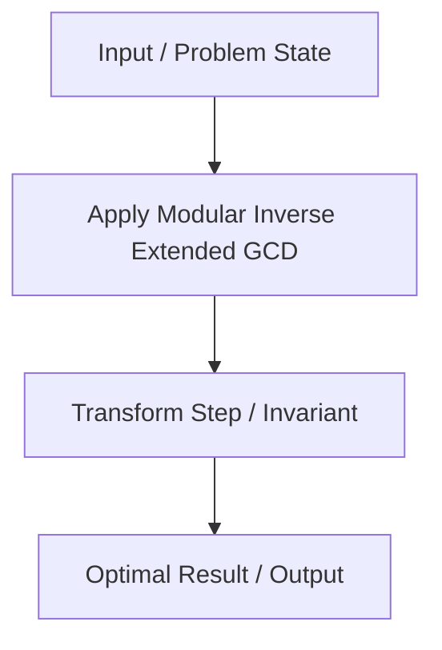

# Modular Inverse Extended GCD

> **Category:** MathORNumberTheory · **Tier:** Advanced Interview (Modular Math)

---

## 🔗 Resources & Visualizers
- **YouTube:** [Watch Modular Inverse Extended GCD Visual Guide](https://www.youtube.com/results?search_query=Modular%20Inverse%20Extended%20GCD%20algorithm%20visual%20explanation)
- **Blog / Editorial:** [CP-Algorithms / GeeksforGeeks Guide](https://www.google.com/search?q=Modular%20Inverse%20Extended%20GCD%20algorithm%20tutorial%20CP%20algorithms)
- **Interactive Visualizer:** [VisuAlgo Interactive Simulation](https://visualgo.net/en)

---

## 🧠 Intuition & Mental Model
> [!TIP]
> **Core Concept:** The modular inverse of a modulo m is a number x such that

The modular inverse of a modulo m is a number x such that
(a × x) % m = 1, and it exists only if gcd(a, m) = 1.
Algorithm Explanation (Extended GCD)
Extended GCD finds integers x and y such that
a·x + m·y = gcd(a, m)
If gcd(a, m) ≠ 1, inverse does not exist
If gcd(a, m) = 1, then
a·x + m·y = 1
Taking modulo m on both sides:
a·x ≡ 1 (mod m)
Hence, x is the modular inverse
If x is negative, convert it to positive using
(x % m + m) % m

---

## 🎯 When to Use & Problem Triggers
- **Trigger 1:** When the brute-force enumeration takes quadratic time or higher and a linear/logarithmic invariant exists.
- **Trigger 2:** Common patterns involving **MathORNumberTheory**, subsegments, query sequences, or optimal substructures.
- **Trigger 3:** Constraints where $N \ge 10^5$ require $O(N)$ or $O(N \log N)$ performance.

---

## 📊 Visual Explanation & Dry Run



<details>
<summary>🔍 <strong>Step-by-Step Algorithm Walkthrough</strong> (Click to expand)</summary>

1. **Initialization:** Set up boundary pointers, state variables, or base auxiliary arrays.
2. **Iteration / Traversal:** Advance through the input elements while maintaining the algorithmic invariant.
3. **State Transition:** Update the current state, dynamic array, or accumulator in $O(1)$ or $O(\log N)$.
4. **Final Result:** Extract the optimal answer from the computed state or reconstructed solution.

</details>

---

## 💻 Algorithm Code (Java)

```java
import java.io.*;

class Main {

    static long extendedGCD(long a, long b, long[] x, long[] y) {
        if (b == 0) {
            x[0] = 1;
            y[0] = 0;
            return a;
        }

        long[] x1 = new long[1];
        long[] y1 = new long[1];

        long gcd = extendedGCD(b, a % b, x1, y1);

        x[0] = y1[0];
        y[0] = x1[0] - (a / b) * y1[0];

        return gcd;
    }

    public static void main(String[] args) {
        long a = 3;
        long m = 11;

        long[] x = new long[1];
        long[] y = new long[1];

        long g = extendedGCD(a, m, x, y);

        if (g != 1) {
            System.out.println("Modular Inverse does not exist");
        } else {
            long inverse = (x[0] % m + m) % m;

            System.out.println("Modular inverse of " + a + " modulo " + m + " is " + inverse);
        }
    }
}
```

---

## ⏱️ Complexity Analysis
- **Time Complexity (TC):** Typically `O(N)` or `O(N log N)` depending on auxiliary sorting or tree operations.
- **Space Complexity (SC):** Typically `O(1)` auxiliary space or `O(N)` for auxiliary arrays/tables.

---

## 🔄 Similar & Connected Algorithms
- **Related Category:** Explore other fundamental algorithms in [MathORNumberTheory](../).
- **Composite Patterns:** Often combined with Prefix Sums, Binary Search on Answer, or Dynamic Programming memoization.

---

## ⚔️ Practice Questions

### 🟡 LeetCode
- [ ] [Explore Modular Inverse Extended GCD Problems on LeetCode](https://leetcode.com/problemset/?search=Modular%20Inverse%20Extended%20GCD%20LeetCode) — `Practice`

### 🔵 CodeChef & Codeforces
- [ ] [Practice on Codeforces Problemset](https://codeforces.com/problemset) — `Catalog`
- [ ] [Practice on CodeChef Practice Portal](https://www.codechef.com/practice) — `Catalog`
