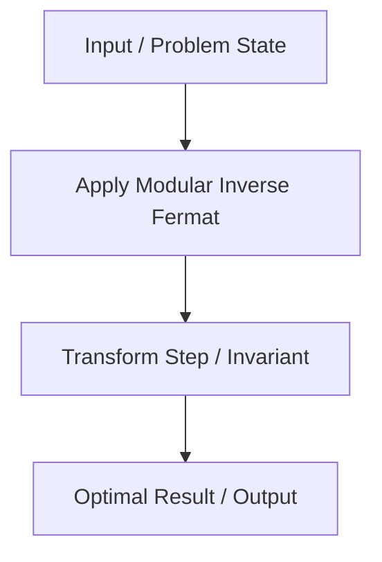

# Modular Inverse Fermat

> **Category:** MathORNumberTheory · **Tier:** Core Interview (High-Yield)

---

## 🔗 Resources & Visualizers
- **YouTube:** [Watch Modular Inverse Fermat Visual Guide](https://www.youtube.com/results?search_query=Modular%20Inverse%20Fermat%20algorithm%20visual%20explanation)
- **Blog / Editorial:** [CP-Algorithms / GeeksforGeeks Guide](https://www.google.com/search?q=Modular%20Inverse%20Fermat%20algorithm%20tutorial%20CP%20algorithms)
- **Interactive Visualizer:** [VisuAlgo Interactive Simulation](https://visualgo.net/en)

---

## 🧠 Intuition & Mental Model
> [!TIP]
> **Core Concept:** The modular inverse of a under modulo m is a number x such that

The modular inverse of a under modulo m is a number x such that
(a × x) % m = 1, when m is prime and gcd(a, m) = 1.
Algorithm Explanation
Fermat’s Little Theorem says:
a^(m−1) % m = 1 (when m is prime and a % m ≠ 0)
Rearranging gives:
a^(m−2) % m = a^(-1) % m
So, modular inverse = fast power of a to (m−2) under modulo m
Fast power is computed using Binary Exponentiation to stay efficient

---

## 🎯 When to Use & Problem Triggers
- **Trigger 1:** When the brute-force enumeration takes quadratic time or higher and a linear/logarithmic invariant exists.
- **Trigger 2:** Common patterns involving **MathORNumberTheory**, subsegments, query sequences, or optimal substructures.
- **Trigger 3:** Constraints where $N \ge 10^5$ require $O(N)$ or $O(N \log N)$ performance.

---

## 📊 Visual Explanation & Dry Run



<details>
<summary>🔍 <strong>Step-by-Step Algorithm Walkthrough</strong> (Click to expand)</summary>

1. **Initialization:** Set up boundary pointers, state variables, or base auxiliary arrays.
2. **Iteration / Traversal:** Advance through the input elements while maintaining the algorithmic invariant.
3. **State Transition:** Update the current state, dynamic array, or accumulator in $O(1)$ or $O(\log N)$.
4. **Final Result:** Extract the optimal answer from the computed state or reconstructed solution.

</details>

---

## 💻 Algorithm Code (Java)

```java
import java.io.*;
import java.util.*;

class Main {

    static long power(long base, long exp, long mod) {
        long result = 1;

        base = base % mod;

        while (exp > 0) {
            if ((exp & 1) == 1) {
                result = (result * base) % mod;
            }

            base = (base * base) % mod;
            exp >>= 1;
        }

        return result;
    }

    static long modInverse(long a, long mod) {
        return power(a, mod - 2, mod);
    }

    public static void main(String[] args) throws Exception {
        long a = 3;
        long mod = 11;

        long inverse = modInverse(a, mod);

        System.out.println(inverse);
    }
}
```

---

## ⏱️ Complexity Analysis
- **Time Complexity (TC):** Typically `O(N)` or `O(N log N)` depending on auxiliary sorting or tree operations.
- **Space Complexity (SC):** Typically `O(1)` auxiliary space or `O(N)` for auxiliary arrays/tables.

---

## 🔄 Similar & Connected Algorithms
- **Related Category:** Explore other fundamental algorithms in [MathORNumberTheory](../).
- **Composite Patterns:** Often combined with Prefix Sums, Binary Search on Answer, or Dynamic Programming memoization.

---

## ⚔️ Practice Questions

### 🟡 LeetCode
- [ ] [Explore Modular Inverse Fermat Problems on LeetCode](https://leetcode.com/problemset/?search=Modular%20Inverse%20Fermat%20LeetCode) — `Practice`

### 🔵 CodeChef & Codeforces
- [ ] [Practice on Codeforces Problemset](https://codeforces.com/problemset) — `Catalog`
- [ ] [Practice on CodeChef Practice Portal](https://www.codechef.com/practice) — `Catalog`
