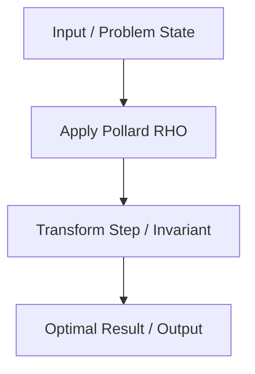

# Pollard RHO

> **Category:** MathORNumberTheory · **Tier:** Competitive Programming (Factorization)

---

## 🔗 Resources & Visualizers
- **YouTube:** [Watch Pollard RHO Visual Guide](https://www.youtube.com/results?search_query=Pollard%20RHO%20algorithm%20visual%20explanation)
- **Blog / Editorial:** [CP-Algorithms / GeeksforGeeks Guide](https://www.google.com/search?q=Pollard%20RHO%20algorithm%20tutorial%20CP%20algorithms)
- **Interactive Visualizer:** [VisuAlgo Interactive Simulation](https://visualgo.net/en)

---

## 🧠 Intuition & Mental Model
> [!TIP]
> **Core Concept:** Pollard Rho is a probabilistic integer factorization

Pollard Rho is a probabilistic integer factorization
algorithm used to find a non-trivial factor of a composite number efficiently.
It works well for large numbers where trial division is slow.
How the Algorithm :
Goal: find a factor d of n such that 1 < d < n
Choose a polynomial function:
f(x) = (x² + c) mod n
Start with two values:
x → moves one step
y → moves two steps (cycle detection like Floyd)
Repeatedly compute:
x = f(x)
y = f(f(y))
At each step, compute:
d = gcd(|x − y|, n)
Outcomes:
d == 1 → continue
d == n → failure, restart with different c
1 < d < n → factor found
example n = 91

---

## 🎯 When to Use & Problem Triggers
- **Trigger 1:** When the brute-force enumeration takes quadratic time or higher and a linear/logarithmic invariant exists.
- **Trigger 2:** Common patterns involving **MathORNumberTheory**, subsegments, query sequences, or optimal substructures.
- **Trigger 3:** Constraints where $N \ge 10^5$ require $O(N)$ or $O(N \log N)$ performance.

---

## 📊 Visual Explanation & Dry Run



<details>
<summary>🔍 <strong>Step-by-Step Algorithm Walkthrough</strong> (Click to expand)</summary>

1. **Initialization:** Set up boundary pointers, state variables, or base auxiliary arrays.
2. **Iteration / Traversal:** Advance through the input elements while maintaining the algorithmic invariant.
3. **State Transition:** Update the current state, dynamic array, or accumulator in $O(1)$ or $O(\log N)$.
4. **Final Result:** Extract the optimal answer from the computed state or reconstructed solution.

</details>

---

## 💻 Algorithm Code (Java)

```java
import java.io.*;
import java.math.BigInteger;
import java.util.Random;

class Main {

    static final Random rnd = new Random();

    static BigInteger f(BigInteger x, BigInteger c, BigInteger n) {
        return x.multiply(x).add(c).mod(n);
    }

    static BigInteger pollardRho(BigInteger n) {
        if (n.mod(BigInteger.TWO).equals(BigInteger.ZERO))
            return BigInteger.TWO;

        BigInteger x = new BigInteger(n.bitLength(), rnd).mod(n);

        BigInteger y = x;

        BigInteger c = new BigInteger(n.bitLength(), rnd).mod(n);

        BigInteger d = BigInteger.ONE;

        while (d.equals(BigInteger.ONE)) {
            x = f(x, c, n);
            y = f(y, c, n);
            y = f(y, c, n);
            d = x.subtract(y).abs().gcd(n);
        }

        return d.equals(n) ? BigInteger.ONE : d;
    }

    public static void main(String[] args) throws Exception {

        BufferedReader br = new BufferedReader(new InputStreamReader(System.in));
        PrintWriter out = new PrintWriter(System.out);

        BigInteger n = new BigInteger("91");

        BigInteger factor = pollardRho(n);

        out.println("Number : " + n);

        out.println("Factor: " + factor);
        out.println("Other : " + n.divide(factor));

        out.flush();
    }
}
```

---

## ⏱️ Complexity Analysis
- **Time Complexity (TC):** Typically `O(N)` or `O(N log N)` depending on auxiliary sorting or tree operations.
- **Space Complexity (SC):** Typically `O(1)` auxiliary space or `O(N)` for auxiliary arrays/tables.

---

## 🔄 Similar & Connected Algorithms
- **Related Category:** Explore other fundamental algorithms in [MathORNumberTheory](../).
- **Composite Patterns:** Often combined with Prefix Sums, Binary Search on Answer, or Dynamic Programming memoization.

---

## ⚔️ Practice Questions

### 🟡 LeetCode
- [ ] [Explore Pollard RHO Problems on LeetCode](https://leetcode.com/problemset/?search=Pollard%20RHO%20LeetCode) — `Practice`

### 🔵 CodeChef & Codeforces
- [ ] [Practice on Codeforces Problemset](https://codeforces.com/problemset) — `Catalog`
- [ ] [Practice on CodeChef Practice Portal](https://www.codechef.com/practice) — `Catalog`
