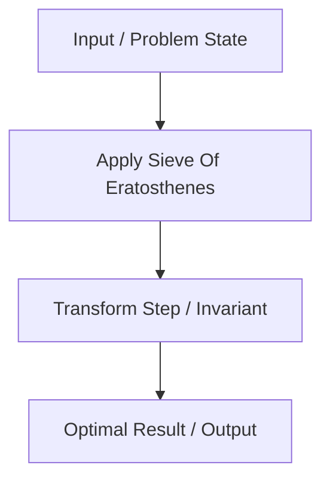

# Sieve Of Eratosthenes

> **Category:** MathORNumberTheory · **Tier:** Core Interview (Essential)

---

## 🔗 Resources & Visualizers
- **YouTube:** [Watch Sieve Of Eratosthenes Visual Guide](https://www.youtube.com/results?search_query=Sieve%20Of%20Eratosthenes%20algorithm%20visual%20explanation)
- **Blog / Editorial:** [CP-Algorithms / GeeksforGeeks Guide](https://www.google.com/search?q=Sieve%20Of%20Eratosthenes%20algorithm%20tutorial%20CP%20algorithms)
- **Interactive Visualizer:** [VisuAlgo Interactive Simulation](https://visualgo.net/en)

---

## 🧠 Intuition & Mental Model
> [!TIP]
> **Core Concept:** The Sieve of Eratosthenes is an efficient algorithm to find all prime

The Sieve of Eratosthenes is an efficient algorithm to find all prime
numbers up to a given number N by iteratively marking multiples of primes as
non-prime
Algorithm Explanation
Create a boolean array isPrime[0..N] and assume all numbers are prime initially.
Mark 0 and 1 as non-prime.
Start from the first prime number 2.
For each number i from 2 to √N:
If i is still marked prime:
Mark all multiples of i starting from i*i as non-prime.
After completion, all indices marked true are prime numbers.

---

## 🎯 When to Use & Problem Triggers
- **Trigger 1:** When the brute-force enumeration takes quadratic time or higher and a linear/logarithmic invariant exists.
- **Trigger 2:** Common patterns involving **MathORNumberTheory**, subsegments, query sequences, or optimal substructures.
- **Trigger 3:** Constraints where $N \ge 10^5$ require $O(N)$ or $O(N \log N)$ performance.

---

## 📊 Visual Explanation & Dry Run



<details>
<summary>🔍 <strong>Step-by-Step Algorithm Walkthrough</strong> (Click to expand)</summary>

1. **Initialization:** Set up boundary pointers, state variables, or base auxiliary arrays.
2. **Iteration / Traversal:** Advance through the input elements while maintaining the algorithmic invariant.
3. **State Transition:** Update the current state, dynamic array, or accumulator in $O(1)$ or $O(\log N)$.
4. **Final Result:** Extract the optimal answer from the computed state or reconstructed solution.

</details>

---

## 💻 Algorithm Code (Java)

```java
import java.io.*;
import java.util.*;

class Main {
    public static void main(String[] args) throws Exception {
        int n = 10;
        boolean[] isPrime = new boolean[n + 1];
        Arrays.fill(isPrime, true);

        isPrime[0] = false;
        isPrime[1] = false;

        for (int i = 2; i <= n; i++) {
            if (isPrime[i]) {
                for (int j = i * i; j <= n; j += i) {
                    isPrime[j] = false;
                }
            }
        }

        for (int i = 2; i <= n; i++) {
            if (isPrime[i]) {
                System.out.print(i + " ");
            }
        }
    }
}
```

---

## ⏱️ Complexity Analysis
- **Time Complexity (TC):** Typically `O(N)` or `O(N log N)` depending on auxiliary sorting or tree operations.
- **Space Complexity (SC):** Typically `O(1)` auxiliary space or `O(N)` for auxiliary arrays/tables.

---

## 🔄 Similar & Connected Algorithms
- **Related Category:** Explore other fundamental algorithms in [MathORNumberTheory](../).
- **Composite Patterns:** Often combined with Prefix Sums, Binary Search on Answer, or Dynamic Programming memoization.

---

## ⚔️ Practice Questions

### 🟡 LeetCode
- [ ] [Explore Sieve Of Eratosthenes Problems on LeetCode](https://leetcode.com/problemset/?search=Sieve%20Of%20Eratosthenes%20LeetCode) — `Practice`

### 🔵 CodeChef & Codeforces
- [ ] [Practice on Codeforces Problemset](https://codeforces.com/problemset) — `Catalog`
- [ ] [Practice on CodeChef Practice Portal](https://www.codechef.com/practice) — `Catalog`
