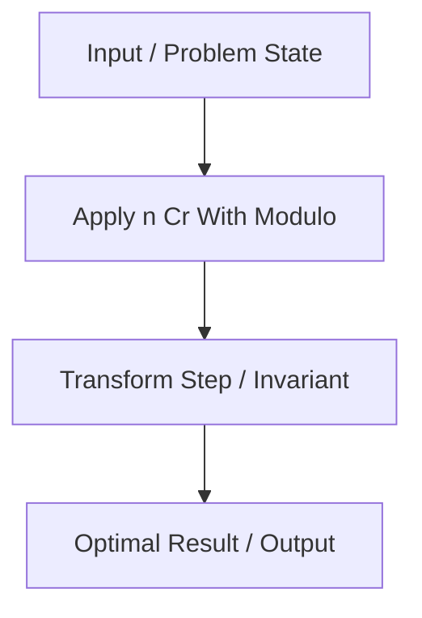

# n Cr With Modulo

> **Category:** MathORNumberTheory · **Tier:** Core Interview (High-Yield)

---

## 🔗 Resources & Visualizers
- **YouTube:** [Watch n Cr With Modulo Visual Guide](https://www.youtube.com/results?search_query=n%20Cr%20With%20Modulo%20algorithm%20visual%20explanation)
- **Blog / Editorial:** [CP-Algorithms / GeeksforGeeks Guide](https://www.google.com/search?q=n%20Cr%20With%20Modulo%20algorithm%20tutorial%20CP%20algorithms)
- **Interactive Visualizer:** [VisuAlgo Interactive Simulation](https://visualgo.net/en)

---

## 🧠 Intuition & Mental Model
> [!TIP]
> **Core Concept:** nCr represents the number of ways to choose r elements from n elements without order.

nCr represents the number of ways to choose r elements from n elements without order.
Formula: nCr = n! / (r! * (n−r)!), computed under modulo M.
Algorithm Explanation
Direct division is not possible under modulo.
If M is prime, we use Modular Multiplicative Inverse.
Precompute factorials fact[i] = i! % M.
Use Fermat’s Little Theorem
a⁻¹ mod M = a^(M−2) mod M
Final formula becomes:
nCr % M = fact[n] * inv(fact[r]) * inv(fact[n−r]) % M

---

## 🎯 When to Use & Problem Triggers
- **Trigger 1:** When the brute-force enumeration takes quadratic time or higher and a linear/logarithmic invariant exists.
- **Trigger 2:** Common patterns involving **MathORNumberTheory**, subsegments, query sequences, or optimal substructures.
- **Trigger 3:** Constraints where $N \ge 10^5$ require $O(N)$ or $O(N \log N)$ performance.

---

## 📊 Visual Explanation & Dry Run



<details>
<summary>🔍 <strong>Step-by-Step Algorithm Walkthrough</strong> (Click to expand)</summary>

1. **Initialization:** Set up boundary pointers, state variables, or base auxiliary arrays.
2. **Iteration / Traversal:** Advance through the input elements while maintaining the algorithmic invariant.
3. **State Transition:** Update the current state, dynamic array, or accumulator in $O(1)$ or $O(\log N)$.
4. **Final Result:** Extract the optimal answer from the computed state or reconstructed solution.

</details>

---

## 💻 Algorithm Code (Java)

```java
import java.io.*;
import java.util.*;

class Main {

    static final long MOD = 1000000007L;

    static long power(long a, long b) {
        long res = 1;

        while (b > 0) {
            if ((b & 1) == 1)
                res = (res * a) % MOD;

            a = (a * a) % MOD;

            b >>= 1;
        }

        return res;
    }

    static long nCr(int n, int r) {
        if (r > n) return 0;

        long[] fact = new long[n + 1];

        fact[0] = 1;

        for (int i = 1; i <= n; i++)
            fact[i] = (fact[i - 1] * i) % MOD;

        long invR = power(fact[r], MOD - 2);
        long invNR = power(fact[n - r], MOD - 2);

        return (((fact[n] * invR) % MOD) * invNR) % MOD;
    }


    public static void main(String[] args) {
        int n = 5, r = 2;

        System.out.println(nCr(n, r));
    }
}
```

---

## ⏱️ Complexity Analysis
- **Time Complexity (TC):** Typically `O(N)` or `O(N log N)` depending on auxiliary sorting or tree operations.
- **Space Complexity (SC):** Typically `O(1)` auxiliary space or `O(N)` for auxiliary arrays/tables.

---

## 🔄 Similar & Connected Algorithms
- **Related Category:** Explore other fundamental algorithms in [MathORNumberTheory](../).
- **Composite Patterns:** Often combined with Prefix Sums, Binary Search on Answer, or Dynamic Programming memoization.

---

## ⚔️ Practice Questions

### 🟡 LeetCode
- [ ] [Explore n Cr With Modulo Problems on LeetCode](https://leetcode.com/problemset/?search=n%20Cr%20With%20Modulo%20LeetCode) — `Practice`

### 🔵 CodeChef & Codeforces
- [ ] [Practice on Codeforces Problemset](https://codeforces.com/problemset) — `Catalog`
- [ ] [Practice on CodeChef Practice Portal](https://www.codechef.com/practice) — `Catalog`
