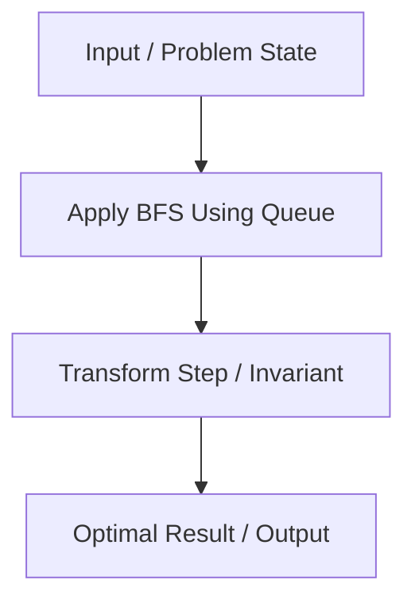

# BFS Using Queue

> **Category:** QueueAndDeque · **Tier:** Core Interview (Essential)

---

## 🔗 Resources & Visualizers
- **YouTube:** [Watch BFS Using Queue Visual Guide](https://www.youtube.com/results?search_query=BFS%20Using%20Queue%20algorithm%20visual%20explanation)
- **Blog / Editorial:** [CP-Algorithms / GeeksforGeeks Guide](https://www.google.com/search?q=BFS%20Using%20Queue%20algorithm%20tutorial%20CP%20algorithms)
- **Interactive Visualizer:** [VisuAlgo Interactive Simulation](https://visualgo.net/en)

---

## 🧠 Intuition & Mental Model
> [!TIP]
> **Core Concept:** Breadth First Search (BFS) is a graph traversal algorithm that explores nodes level by level.

Breadth First Search (BFS) is a graph traversal algorithm that explores nodes level by level.
It uses a Queue (FIFO) to visit all immediate neighbors before going deeper.
BFS Algorithm
Start from a source node
Mark it as visited
Push it into a queue
While queue is not empty
Remove (dequeue) front node
Process it
Push all unvisited neighbors into queue and mark them visited
Continue until queue becomes empty
Graph: 0 → {1, 2}, 1 → {3}, 2 → {}, 3 → {}

---

## 🎯 When to Use & Problem Triggers
- **Trigger 1:** When the brute-force enumeration takes quadratic time or higher and a linear/logarithmic invariant exists.
- **Trigger 2:** Common patterns involving **QueueAndDeque**, subsegments, query sequences, or optimal substructures.
- **Trigger 3:** Constraints where $N \ge 10^5$ require $O(N)$ or $O(N \log N)$ performance.

---

## 📊 Visual Explanation & Dry Run



<details>
<summary>🔍 <strong>Step-by-Step Algorithm Walkthrough</strong> (Click to expand)</summary>

1. **Initialization:** Set up boundary pointers, state variables, or base auxiliary arrays.
2. **Iteration / Traversal:** Advance through the input elements while maintaining the algorithmic invariant.
3. **State Transition:** Update the current state, dynamic array, or accumulator in $O(1)$ or $O(\log N)$.
4. **Final Result:** Extract the optimal answer from the computed state or reconstructed solution.

</details>

---

## 💻 Algorithm Code (Java)

```java
import java.util.*;

class Main {
    public static void main(String[] args) throws Exception {
        int n = 4;

        int[][] g = {
                {1, 2},
                {3},
                {},
                {}
        };

        boolean[] vis = new boolean[n];

        Queue<Integer> q = new ArrayDeque<>();

        q.add(0);
        vis[0] = true;

        while (!q.isEmpty()) {
            int u = q.poll();
            System.out.print(u + " ");

            for (int v : g[u]) {
                if (!vis[v]) {
                    vis[v] = true;
                    q.add(v);
                }
            }
        }
    }
}
```

---

## ⏱️ Complexity Analysis
- **Time Complexity (TC):** Typically `O(N)` or `O(N log N)` depending on auxiliary sorting or tree operations.
- **Space Complexity (SC):** Typically `O(1)` auxiliary space or `O(N)` for auxiliary arrays/tables.

---

## 🔄 Similar & Connected Algorithms
- **Related Category:** Explore other fundamental algorithms in [QueueAndDeque](../).
- **Composite Patterns:** Often combined with Prefix Sums, Binary Search on Answer, or Dynamic Programming memoization.

---

## ⚔️ Practice Questions

### 🟡 LeetCode
- [ ] [Explore BFS Using Queue Problems on LeetCode](https://leetcode.com/problemset/?search=BFS%20Using%20Queue%20LeetCode) — `Practice`

### 🔵 CodeChef & Codeforces
- [ ] [Practice on Codeforces Problemset](https://codeforces.com/problemset) — `Catalog`
- [ ] [Practice on CodeChef Practice Portal](https://www.codechef.com/practice) — `Catalog`
