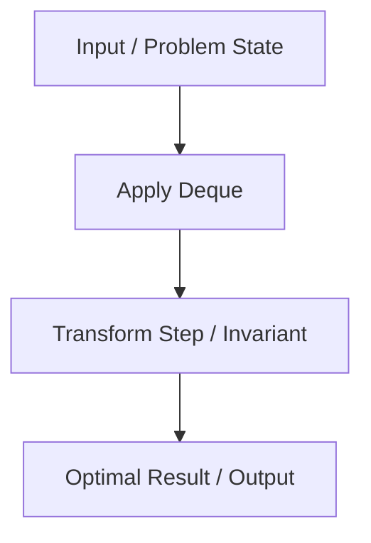

# Deque

> **Category:** QueueAndDeque · **Tier:** Core Interview (Essential)

---

## 🔗 Resources & Visualizers
- **YouTube:** [Watch Deque Visual Guide](https://www.youtube.com/results?search_query=Deque%20algorithm%20visual%20explanation)
- **Blog / Editorial:** [CP-Algorithms / GeeksforGeeks Guide](https://www.google.com/search?q=Deque%20algorithm%20tutorial%20CP%20algorithms)
- **Interactive Visualizer:** [VisuAlgo Interactive Simulation](https://visualgo.net/en)

---

## 🧠 Intuition & Mental Model
> [!TIP]
> **Core Concept:** A Deque Algorithm uses a double-ended queue to push and pop elements

A Deque Algorithm uses a double-ended queue to push and pop elements
from both front and back efficiently.
It is commonly used to maintain order (min/max) while
processing elements sequentially.
How the Algorithm Works :
We store indices in a deque, not values
Deque maintains a monotonic order (increasing or decreasing)
Before adding a new element:
Remove useless elements from the back
Before reading answer:
Remove out-of-range elements from the front
Front of deque always gives the current answer
Example Problem
Find maximum in every window of size k = 3
Array: [1, 3, -1, -3, 5]

---

## 🎯 When to Use & Problem Triggers
- **Trigger 1:** When the brute-force enumeration takes quadratic time or higher and a linear/logarithmic invariant exists.
- **Trigger 2:** Common patterns involving **QueueAndDeque**, subsegments, query sequences, or optimal substructures.
- **Trigger 3:** Constraints where $N \ge 10^5$ require $O(N)$ or $O(N \log N)$ performance.

---

## 📊 Visual Explanation & Dry Run



<details>
<summary>🔍 <strong>Step-by-Step Algorithm Walkthrough</strong> (Click to expand)</summary>

1. **Initialization:** Set up boundary pointers, state variables, or base auxiliary arrays.
2. **Iteration / Traversal:** Advance through the input elements while maintaining the algorithmic invariant.
3. **State Transition:** Update the current state, dynamic array, or accumulator in $O(1)$ or $O(\log N)$.
4. **Final Result:** Extract the optimal answer from the computed state or reconstructed solution.

</details>

---

## 💻 Algorithm Code (Java)

```java
import java.io.*;
import java.util.*;

class Main {
    public static void main(String[] args) {
        int[] arr = {1, 3, -1, -3, 5};
        int k = 3;

        Deque<Integer> dq = new ArrayDeque<>();

        for (int i = 0; i < arr.length; i++) {
            if (!dq.isEmpty() && dq.peekFirst() <= i - k)
                dq.pollFirst();

            while (!dq.isEmpty() && arr[dq.peekLast()] <= arr[i])
                dq.pollLast();

            dq.addLast(i);

            if (i >= k - 1)
                System.out.print(arr[dq.peekFirst()] + " ");
        }
    }
}
```

---

## ⏱️ Complexity Analysis
- **Time Complexity (TC):** Typically `O(N)` or `O(N log N)` depending on auxiliary sorting or tree operations.
- **Space Complexity (SC):** Typically `O(1)` auxiliary space or `O(N)` for auxiliary arrays/tables.

---

## 🔄 Similar & Connected Algorithms
- **Related Category:** Explore other fundamental algorithms in [QueueAndDeque](../).
- **Composite Patterns:** Often combined with Prefix Sums, Binary Search on Answer, or Dynamic Programming memoization.

---

## ⚔️ Practice Questions

### 🟡 LeetCode
- [ ] [Explore Deque Problems on LeetCode](https://leetcode.com/problemset/?search=Deque%20LeetCode) — `Practice`

### 🔵 CodeChef & Codeforces
- [ ] [Practice on Codeforces Problemset](https://codeforces.com/problemset) — `Catalog`
- [ ] [Practice on CodeChef Practice Portal](https://www.codechef.com/practice) — `Catalog`
