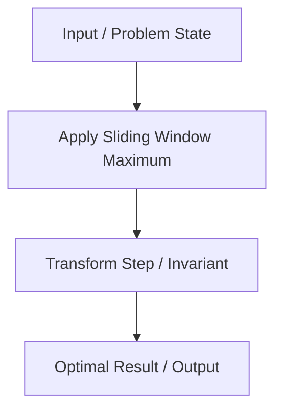

# Sliding Window Maximum

> **Category:** QueueAndDeque · **Tier:** Core Interview (High-Yield)

---

## 🔗 Resources & Visualizers
- **YouTube:** [Watch Sliding Window Maximum Visual Guide](https://www.youtube.com/results?search_query=Sliding%20Window%20Maximum%20algorithm%20visual%20explanation)
- **Blog / Editorial:** [CP-Algorithms / GeeksforGeeks Guide](https://www.google.com/search?q=Sliding%20Window%20Maximum%20algorithm%20tutorial%20CP%20algorithms)
- **Interactive Visualizer:** [VisuAlgo Interactive Simulation](https://visualgo.net/en)

---

## 🧠 Intuition & Mental Model
> [!TIP]
> **Core Concept:** The Sliding Window Maximum problem finds the maximum element

The Sliding Window Maximum problem finds the maximum element
in every contiguous subarray (window) of size k while moving the window one step at a time.
It is optimally solved using a Deque (Double Ended Queue).
Algorithm Explanation
We use a Deque to store indices, not values
The deque always keeps elements in decreasing order of values
The front of deque always stores the index of the maximum element of current window
For every index i:
Remove indices from front if they are outside the current window
Remove indices from back if their value is smaller than current element
Add current index to the back
If window size ≥ k, record the element at deque front as the maximum
Example used:
arr = [1, 3, -1, -3, 5, 3, 6, 7], k = 3

---

## 🎯 When to Use & Problem Triggers
- **Trigger 1:** When the brute-force enumeration takes quadratic time or higher and a linear/logarithmic invariant exists.
- **Trigger 2:** Common patterns involving **QueueAndDeque**, subsegments, query sequences, or optimal substructures.
- **Trigger 3:** Constraints where $N \ge 10^5$ require $O(N)$ or $O(N \log N)$ performance.

---

## 📊 Visual Explanation & Dry Run



<details>
<summary>🔍 <strong>Step-by-Step Algorithm Walkthrough</strong> (Click to expand)</summary>

1. **Initialization:** Set up boundary pointers, state variables, or base auxiliary arrays.
2. **Iteration / Traversal:** Advance through the input elements while maintaining the algorithmic invariant.
3. **State Transition:** Update the current state, dynamic array, or accumulator in $O(1)$ or $O(\log N)$.
4. **Final Result:** Extract the optimal answer from the computed state or reconstructed solution.

</details>

---

## 💻 Algorithm Code (Java)

```java
import java.io.*;
import java.util.*;

class SlidingWindowMaximum {
    public static void main(String[] args) throws Exception {
        int[] arr = {1, 3, -1, -3, 5, 3, 6, 7};
        int k = 3;

        Deque<Integer> dq = new ArrayDeque<>();
        StringBuilder sb = new StringBuilder();

        for (int i = 0; i < arr.length; i++) {
            if (!dq.isEmpty() && dq.peekFirst() <= i - k)
                dq.pollFirst();

            while (!dq.isEmpty() && arr[dq.peekLast()] < arr[i])
                dq.pollLast();

            dq.addLast(i);

            if (i >= k - 1)
                sb.append(arr[dq.peekFirst()]).append(" ");
        }

        System.out.println(sb.toString().trim());
    }
}
```

---

## ⏱️ Complexity Analysis
- **Time Complexity (TC):** Typically `O(N)` or `O(N log N)` depending on auxiliary sorting or tree operations.
- **Space Complexity (SC):** Typically `O(1)` auxiliary space or `O(N)` for auxiliary arrays/tables.

---

## 🔄 Similar & Connected Algorithms
- **Related Category:** Explore other fundamental algorithms in [QueueAndDeque](../).
- **Composite Patterns:** Often combined with Prefix Sums, Binary Search on Answer, or Dynamic Programming memoization.

---

## ⚔️ Practice Questions

### 🟡 LeetCode
- [ ] [Explore Sliding Window Maximum Problems on LeetCode](https://leetcode.com/problemset/?search=Sliding%20Window%20Maximum%20LeetCode) — `Practice`

### 🔵 CodeChef & Codeforces
- [ ] [Practice on Codeforces Problemset](https://codeforces.com/problemset) — `Catalog`
- [ ] [Practice on CodeChef Practice Portal](https://www.codechef.com/practice) — `Catalog`
