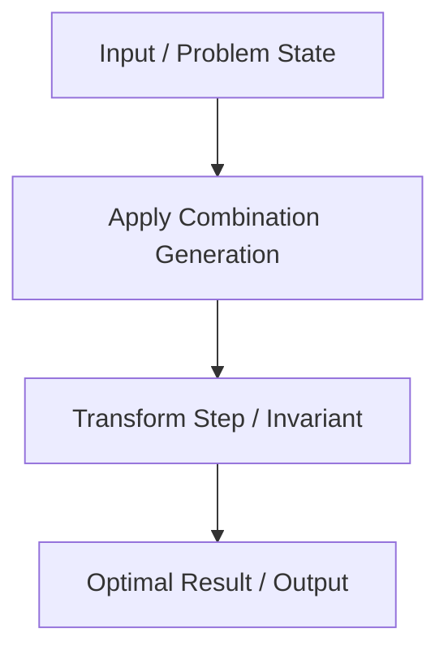

# Combination Generation

> **Category:** RecursionORBacktracking · **Tier:** Core Interview (High-Yield)

---

## 🔗 Resources & Visualizers
- **YouTube:** [Watch Combination Generation Visual Guide](https://www.youtube.com/results?search_query=Combination%20Generation%20algorithm%20visual%20explanation)
- **Blog / Editorial:** [CP-Algorithms / GeeksforGeeks Guide](https://www.google.com/search?q=Combination%20Generation%20algorithm%20tutorial%20CP%20algorithms)
- **Interactive Visualizer:** [VisuAlgo Interactive Simulation](https://visualgo.net/en)

---

## 🧠 Intuition & Mental Model
> [!TIP]
> **Core Concept:** Combination Generation is a recursive technique to generate all

Combination Generation is a recursive technique to generate all
possible selections of k elements from n elements without considering order.
It uses decision making (pick / not pick) at each recursive step.
Algorithm Explanation
We build combinations step by step
At each index, we choose the current element
Move to next index and reduce required elements (k)
When k == 0, one valid combination is formed
Backtrack to explore other choices
Array = {1, 2, 3}
Choose k = 2

---

## 🎯 When to Use & Problem Triggers
- **Trigger 1:** When the brute-force enumeration takes quadratic time or higher and a linear/logarithmic invariant exists.
- **Trigger 2:** Common patterns involving **RecursionORBacktracking**, subsegments, query sequences, or optimal substructures.
- **Trigger 3:** Constraints where $N \ge 10^5$ require $O(N)$ or $O(N \log N)$ performance.

---

## 📊 Visual Explanation & Dry Run



<details>
<summary>🔍 <strong>Step-by-Step Algorithm Walkthrough</strong> (Click to expand)</summary>

1. **Initialization:** Set up boundary pointers, state variables, or base auxiliary arrays.
2. **Iteration / Traversal:** Advance through the input elements while maintaining the algorithmic invariant.
3. **State Transition:** Update the current state, dynamic array, or accumulator in $O(1)$ or $O(\log N)$.
4. **Final Result:** Extract the optimal answer from the computed state or reconstructed solution.

</details>

---

## 💻 Algorithm Code (Java)

```java
import java.io.*;
import java.util.*;

class Main {

    static int[] arr = {1, 2, 3};
    static int n = arr.length;
    static int k = 2;
    static int[] temp = new int[k];

    public static void main(String[] args) {
        generate(0, 0);
    }

    static void generate(int idx, int cnt) {
        if (cnt == k) {
            System.out.println(Arrays.toString(temp));
            return;
        }

        if (idx == n) return;

        temp[cnt] = arr[idx];
        generate(idx + 1, cnt + 1);
        generate(idx + 1, cnt);
    }
}
```

---

## ⏱️ Complexity Analysis
- **Time Complexity (TC):** Typically `O(N)` or `O(N log N)` depending on auxiliary sorting or tree operations.
- **Space Complexity (SC):** Typically `O(1)` auxiliary space or `O(N)` for auxiliary arrays/tables.

---

## 🔄 Similar & Connected Algorithms
- **Related Category:** Explore other fundamental algorithms in [RecursionORBacktracking](../).
- **Composite Patterns:** Often combined with Prefix Sums, Binary Search on Answer, or Dynamic Programming memoization.

---

## ⚔️ Practice Questions

### 🟡 LeetCode
- [ ] [Explore Combination Generation Problems on LeetCode](https://leetcode.com/problemset/?search=Combination%20Generation%20LeetCode) — `Practice`

### 🔵 CodeChef & Codeforces
- [ ] [Practice on Codeforces Problemset](https://codeforces.com/problemset) — `Catalog`
- [ ] [Practice on CodeChef Practice Portal](https://www.codechef.com/practice) — `Catalog`
