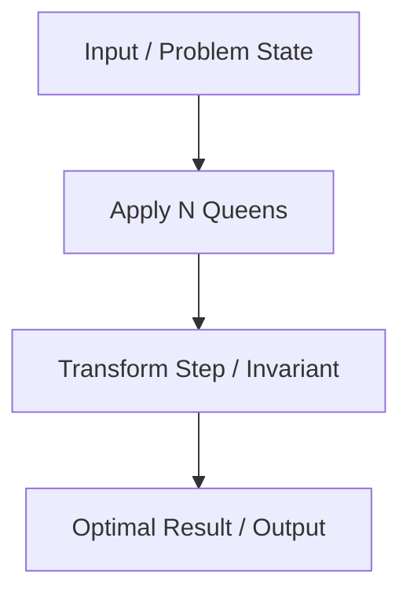

# N Queens

> **Category:** RecursionORBacktracking · **Tier:** Core Interview (Classic)

---

## 🔗 Resources & Visualizers
- **YouTube:** [Watch N Queens Visual Guide](https://www.youtube.com/results?search_query=N%20Queens%20algorithm%20visual%20explanation)
- **Blog / Editorial:** [CP-Algorithms / GeeksforGeeks Guide](https://www.google.com/search?q=N%20Queens%20algorithm%20tutorial%20CP%20algorithms)
- **Interactive Visualizer:** [VisuAlgo Interactive Simulation](https://visualgo.net/en)

---

## 🧠 Intuition & Mental Model
> [!TIP]
> **Core Concept:** N-Queen Problem: Place N queens on an N×N chessboard such that no

N-Queen Problem: Place N queens on an N×N chessboard such that no
two queens attack each other.
Queens must not share the same row, column, or diagonal.
Algorithm Explanation
Place queens row by row, starting from row 0
For the current row:
Try placing a queen in every column
Before placing, check safety
Safe means:
No queen in the same column
No queen in the left diagonal
No queen in the right diagonal
If safe:
Place the queen
Recursively move to the next row
If no column works:
Backtrack → remove the previous queen
When row == N → one valid solution found

---

## 🎯 When to Use & Problem Triggers
- **Trigger 1:** When the brute-force enumeration takes quadratic time or higher and a linear/logarithmic invariant exists.
- **Trigger 2:** Common patterns involving **RecursionORBacktracking**, subsegments, query sequences, or optimal substructures.
- **Trigger 3:** Constraints where $N \ge 10^5$ require $O(N)$ or $O(N \log N)$ performance.

---

## 📊 Visual Explanation & Dry Run



<details>
<summary>🔍 <strong>Step-by-Step Algorithm Walkthrough</strong> (Click to expand)</summary>

1. **Initialization:** Set up boundary pointers, state variables, or base auxiliary arrays.
2. **Iteration / Traversal:** Advance through the input elements while maintaining the algorithmic invariant.
3. **State Transition:** Update the current state, dynamic array, or accumulator in $O(1)$ or $O(\log N)$.
4. **Final Result:** Extract the optimal answer from the computed state or reconstructed solution.

</details>

---

## 💻 Algorithm Code (Java)

```java
import java.io.*;
import java.util.*;

class NQueen {

    static int N = 4;
    static int[][] board = new int[N][N];

    public static void main(String[] args) {
        solve(0);
    }

    static void solve(int row) {
        if (row == N) {
            printBoard();
            return;
        }

        for (int col = 0; col < N; col++) {
            if (isSafe(row, col)) {
                board[row][col] = 1;
                solve(row + 1);
                board[row][col] = 0;
            }
        }
    }

    static boolean isSafe(int row, int col) {
        for (int i = 0; i < row; i++)
            if (board[i][col] == 1) return false;

        for (int i = row, j = col; i >= 0 && j >= 0; i--, j--)
            if (board[i][j] == 1) return false;

        for (int i = row, j = col; i >= 0 && j < N; i--, j++)
            if (board[i][j] == 1) return false;

        return true;
    }

    static void printBoard() {
        for (int i = 0; i < N; i++) {
            for (int j = 0; j < N; j++)
                System.out.print(board[i][j] + " ");
            System.out.println();
        }

        System.out.println();
    }
}
```

---

## ⏱️ Complexity Analysis
- **Time Complexity (TC):** Typically `O(N)` or `O(N log N)` depending on auxiliary sorting or tree operations.
- **Space Complexity (SC):** Typically `O(1)` auxiliary space or `O(N)` for auxiliary arrays/tables.

---

## 🔄 Similar & Connected Algorithms
- **Related Category:** Explore other fundamental algorithms in [RecursionORBacktracking](../).
- **Composite Patterns:** Often combined with Prefix Sums, Binary Search on Answer, or Dynamic Programming memoization.

---

## ⚔️ Practice Questions

### 🟡 LeetCode
- [ ] [Explore N Queens Problems on LeetCode](https://leetcode.com/problemset/?search=N%20Queens%20LeetCode) — `Practice`

### 🔵 CodeChef & Codeforces
- [ ] [Practice on Codeforces Problemset](https://codeforces.com/problemset) — `Catalog`
- [ ] [Practice on CodeChef Practice Portal](https://www.codechef.com/practice) — `Catalog`
