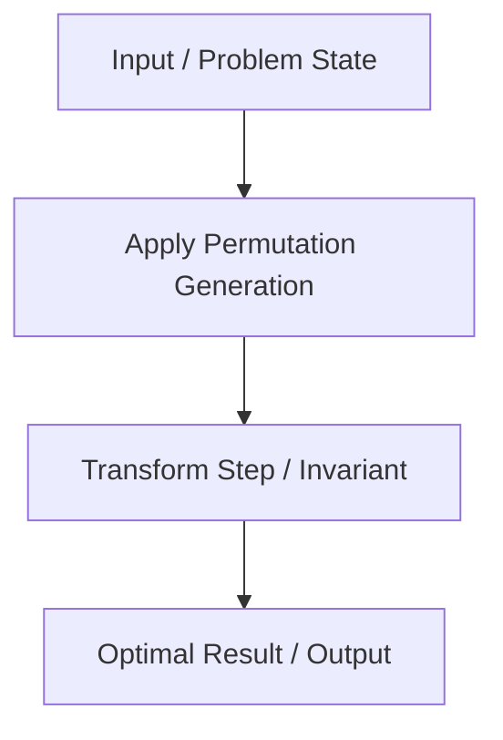

# Permutation Generation

> **Category:** RecursionORBacktracking · **Tier:** Core Interview (High-Yield)

---

## 🔗 Resources & Visualizers
- **YouTube:** [Watch Permutation Generation Visual Guide](https://www.youtube.com/results?search_query=Permutation%20Generation%20algorithm%20visual%20explanation)
- **Blog / Editorial:** [CP-Algorithms / GeeksforGeeks Guide](https://www.google.com/search?q=Permutation%20Generation%20algorithm%20tutorial%20CP%20algorithms)
- **Interactive Visualizer:** [VisuAlgo Interactive Simulation](https://visualgo.net/en)

---

## 🧠 Intuition & Mental Model
> [!TIP]
> **Core Concept:** Permutation generation is the process of producing all possible arrangements of elements

Permutation generation is the process of producing all possible arrangements of elements
where order matters, using recursion to fix one position at a time.
Algorithm Explanation :
Fix one position in the array at a time (starting from index 0)
Try placing every remaining element at the current position
Swap the chosen element into the current position
Recurse for the next position
After recursion, undo the swap (backtracking) to restore the original state
example: {1, 2, 3}

---

## 🎯 When to Use & Problem Triggers
- **Trigger 1:** When the brute-force enumeration takes quadratic time or higher and a linear/logarithmic invariant exists.
- **Trigger 2:** Common patterns involving **RecursionORBacktracking**, subsegments, query sequences, or optimal substructures.
- **Trigger 3:** Constraints where $N \ge 10^5$ require $O(N)$ or $O(N \log N)$ performance.

---

## 📊 Visual Explanation & Dry Run



<details>
<summary>🔍 <strong>Step-by-Step Algorithm Walkthrough</strong> (Click to expand)</summary>

1. **Initialization:** Set up boundary pointers, state variables, or base auxiliary arrays.
2. **Iteration / Traversal:** Advance through the input elements while maintaining the algorithmic invariant.
3. **State Transition:** Update the current state, dynamic array, or accumulator in $O(1)$ or $O(\log N)$.
4. **Final Result:** Extract the optimal answer from the computed state or reconstructed solution.

</details>

---

## 💻 Algorithm Code (Java)

```java
import java.io.*;
import java.util.*;

class Main {

    static void permute(int[] a, int idx) {
        if (idx == a.length) {
            System.out.println(Arrays.toString(a));
            return;
        }

        for (int i = idx; i < a.length; i++) {
            int temp = a[idx];
            a[idx] = a[i];
            a[i] = temp;

            permute(a, idx + 1);

            temp = a[idx];
            a[idx] = a[i];
            a[i] = temp;
        }
    }

    public static void main(String[] args) {
        int[] a = {1, 2, 3};
        permute(a, 0);
    }
}
```

---

## ⏱️ Complexity Analysis
- **Time Complexity (TC):** Typically `O(N)` or `O(N log N)` depending on auxiliary sorting or tree operations.
- **Space Complexity (SC):** Typically `O(1)` auxiliary space or `O(N)` for auxiliary arrays/tables.

---

## 🔄 Similar & Connected Algorithms
- **Related Category:** Explore other fundamental algorithms in [RecursionORBacktracking](../).
- **Composite Patterns:** Often combined with Prefix Sums, Binary Search on Answer, or Dynamic Programming memoization.

---

## ⚔️ Practice Questions

### 🟡 LeetCode
- [ ] [Explore Permutation Generation Problems on LeetCode](https://leetcode.com/problemset/?search=Permutation%20Generation%20LeetCode) — `Practice`

### 🔵 CodeChef & Codeforces
- [ ] [Practice on Codeforces Problemset](https://codeforces.com/problemset) — `Catalog`
- [ ] [Practice on CodeChef Practice Portal](https://www.codechef.com/practice) — `Catalog`
