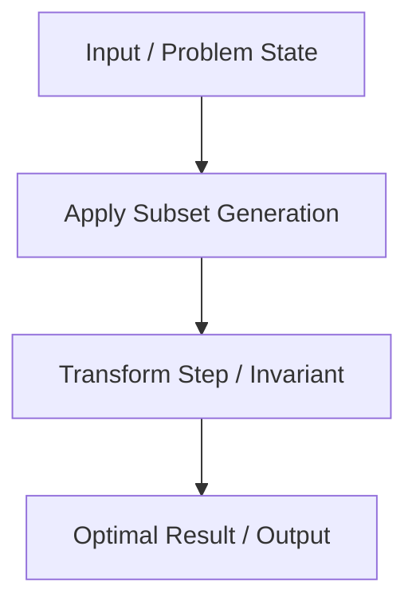

# Subset Generation

> **Category:** RecursionORBacktracking · **Tier:** Core Interview (High-Yield)

---

## 🔗 Resources & Visualizers
- **YouTube:** [Watch Subset Generation Visual Guide](https://www.youtube.com/results?search_query=Subset%20Generation%20algorithm%20visual%20explanation)
- **Blog / Editorial:** [CP-Algorithms / GeeksforGeeks Guide](https://www.google.com/search?q=Subset%20Generation%20algorithm%20tutorial%20CP%20algorithms)
- **Interactive Visualizer:** [VisuAlgo Interactive Simulation](https://visualgo.net/en)

---

## 🧠 Intuition & Mental Model
> [!TIP]
> **Core Concept:** Subset Generation is a recursive technique to generate all possible

Subset Generation is a recursive technique to generate all possible
subsets of a given set by making an
include / exclude decision for every element.
Algorithm Explanation
Each element has two choices:
→ include it in the current subset
→ exclude it from the current subset
We process elements one by one using recursion
When all elements are processed, the current subset becomes one valid answer
This naturally forms a binary recursion tree

---

## 🎯 When to Use & Problem Triggers
- **Trigger 1:** When the brute-force enumeration takes quadratic time or higher and a linear/logarithmic invariant exists.
- **Trigger 2:** Common patterns involving **RecursionORBacktracking**, subsegments, query sequences, or optimal substructures.
- **Trigger 3:** Constraints where $N \ge 10^5$ require $O(N)$ or $O(N \log N)$ performance.

---

## 📊 Visual Explanation & Dry Run



<details>
<summary>🔍 <strong>Step-by-Step Algorithm Walkthrough</strong> (Click to expand)</summary>

1. **Initialization:** Set up boundary pointers, state variables, or base auxiliary arrays.
2. **Iteration / Traversal:** Advance through the input elements while maintaining the algorithmic invariant.
3. **State Transition:** Update the current state, dynamic array, or accumulator in $O(1)$ or $O(\log N)$.
4. **Final Result:** Extract the optimal answer from the computed state or reconstructed solution.

</details>

---

## 💻 Algorithm Code (Java)

```java
import java.util.*;

class SubsetGeneration {
    public static void main(String[] args) {
        int[] arr = {1, 2};
        List<Integer> curr = new ArrayList<>();

        generate(0, arr, curr);
    }

    static void generate(int idx, int[] arr, List<Integer> curr) {
        if (idx == arr.length) {
            System.out.println(curr);
            return;
        }

        curr.add(arr[idx]);
        generate(idx + 1, arr, curr);
        curr.remove(curr.size() - 1);

        generate(idx + 1, arr, curr);
    }
}
```

---

## ⏱️ Complexity Analysis
- **Time Complexity (TC):** Typically `O(N)` or `O(N log N)` depending on auxiliary sorting or tree operations.
- **Space Complexity (SC):** Typically `O(1)` auxiliary space or `O(N)` for auxiliary arrays/tables.

---

## 🔄 Similar & Connected Algorithms
- **Related Category:** Explore other fundamental algorithms in [RecursionORBacktracking](../).
- **Composite Patterns:** Often combined with Prefix Sums, Binary Search on Answer, or Dynamic Programming memoization.

---

## ⚔️ Practice Questions

### 🟡 LeetCode
- [ ] [Explore Subset Generation Problems on LeetCode](https://leetcode.com/problemset/?search=Subset%20Generation%20LeetCode) — `Practice`

### 🔵 CodeChef & Codeforces
- [ ] [Practice on Codeforces Problemset](https://codeforces.com/problemset) — `Catalog`
- [ ] [Practice on CodeChef Practice Portal](https://www.codechef.com/practice) — `Catalog`
