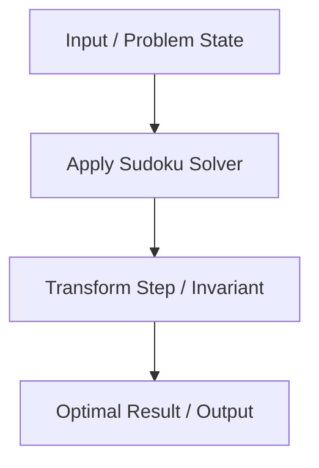

# Sudoku Solver

> **Category:** RecursionORBacktracking · **Tier:** Core Interview (Classic)

---

## 🔗 Resources & Visualizers
- **YouTube:** [Watch Sudoku Solver Visual Guide](https://www.youtube.com/results?search_query=Sudoku%20Solver%20algorithm%20visual%20explanation)
- **Blog / Editorial:** [CP-Algorithms / GeeksforGeeks Guide](https://www.google.com/search?q=Sudoku%20Solver%20algorithm%20tutorial%20CP%20algorithms)
- **Interactive Visualizer:** [VisuAlgo Interactive Simulation](https://visualgo.net/en)

---

## 🧠 Intuition & Mental Model
> [!TIP]
> **Core Concept:** Sudoku Solver using Backtracking is a recursive algorithm that fills

Sudoku Solver using Backtracking is a recursive algorithm that fills
empty cells by trying valid numbers and reverting
(backtracking) when a choice leads to an invalid state.
Algorithm Explanation
Find the first empty cell (value = 0)
Try digits 1 → 9 one by one
Check if placing a digit is safe (row, column, 3×3 box)
If safe → place the digit and recurse
If recursion fails → remove digit (backtrack)
If no empty cell left → Sudoku solved

---

## 🎯 When to Use & Problem Triggers
- **Trigger 1:** When the brute-force enumeration takes quadratic time or higher and a linear/logarithmic invariant exists.
- **Trigger 2:** Common patterns involving **RecursionORBacktracking**, subsegments, query sequences, or optimal substructures.
- **Trigger 3:** Constraints where $N \ge 10^5$ require $O(N)$ or $O(N \log N)$ performance.

---

## 📊 Visual Explanation & Dry Run



<details>
<summary>🔍 <strong>Step-by-Step Algorithm Walkthrough</strong> (Click to expand)</summary>

1. **Initialization:** Set up boundary pointers, state variables, or base auxiliary arrays.
2. **Iteration / Traversal:** Advance through the input elements while maintaining the algorithmic invariant.
3. **State Transition:** Update the current state, dynamic array, or accumulator in $O(1)$ or $O(\log N)$.
4. **Final Result:** Extract the optimal answer from the computed state or reconstructed solution.

</details>

---

## 💻 Algorithm Code (Java)

```java
import java.io.*;
import java.util.*;

class SudokuSolver {

    static int[][] g = {
            {5, 3, 0},
            {0, 7, 0},
            {0, 0, 0}
    };

    static boolean solve() {
        for (int r = 0; r < 3; r++) {
            for (int c = 0; c < 3; c++) {
                if (g[r][c] == 0) {
                    for (int d = 1; d <= 9; d++) {
                        if (ok(r, c, d)) {
                            g[r][c] = d;
                            if (solve()) return true;
                            g[r][c] = 0;
                        }
                    }

                    return false;
                }
            }
        }

        return true;
    }

    static boolean ok(int r, int c, int d) {
        for (int i = 0; i < 3; i++) {
            if (g[r][i] == d) return false;
            if (g[i][c] == d) return false;
        }
        int sr = (r / 3) * 3;
        int sc = (c / 3) * 3;

        for (int i = sr; i < sr + 3; i++) {
            for (int j = sc; j < sc + 3; j++) {
                if (g[i][j] == d) return false;
            }
        }

        return true;
    }

    static void print() {
        for (int[] r : g) {
            for (int v : r) System.out.print(v + " ");
            System.out.println();
        }
    }


    public static void main(String[] args) {
        solve();
        print();
    }
}
```

---

## ⏱️ Complexity Analysis
- **Time Complexity (TC):** Typically `O(N)` or `O(N log N)` depending on auxiliary sorting or tree operations.
- **Space Complexity (SC):** Typically `O(1)` auxiliary space or `O(N)` for auxiliary arrays/tables.

---

## 🔄 Similar & Connected Algorithms
- **Related Category:** Explore other fundamental algorithms in [RecursionORBacktracking](../).
- **Composite Patterns:** Often combined with Prefix Sums, Binary Search on Answer, or Dynamic Programming memoization.

---

## ⚔️ Practice Questions

### 🟡 LeetCode
- [ ] [Explore Sudoku Solver Problems on LeetCode](https://leetcode.com/problemset/?search=Sudoku%20Solver%20LeetCode) — `Practice`

### 🔵 CodeChef & Codeforces
- [ ] [Practice on Codeforces Problemset](https://codeforces.com/problemset) — `Catalog`
- [ ] [Practice on CodeChef Practice Portal](https://www.codechef.com/practice) — `Catalog`
