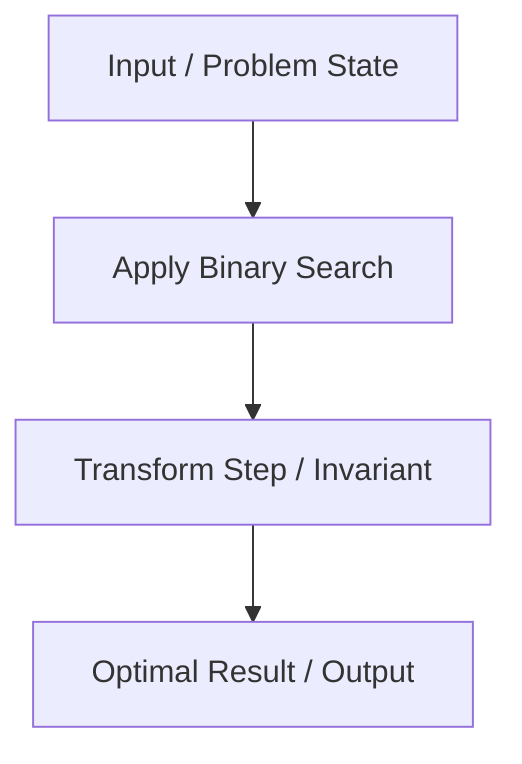

# Binary Search

> **Category:** SearchingAndSorting · **Tier:** Core Interview (Essential)

---

## 🔗 Resources & Visualizers
- **YouTube:** [Watch Binary Search Visual Guide](https://www.youtube.com/results?search_query=Binary%20Search%20algorithm%20visual%20explanation)
- **Blog / Editorial:** [CP-Algorithms / GeeksforGeeks Guide](https://www.google.com/search?q=Binary%20Search%20algorithm%20tutorial%20CP%20algorithms)
- **Interactive Visualizer:** [VisuAlgo Interactive Simulation](https://visualgo.net/en)

---

## 🧠 Intuition & Mental Model
> [!TIP]
> **Core Concept:** Binary Search is a searching algorithm used on sorted arrays.

Binary Search is a searching algorithm used on sorted arrays.
It repeatedly divides the search space into half, eliminating one half each time.
This reduces the search time drastically compared to linear search.
Algorithm Explanation
Work only on a sorted array
Compare the target with the middle element
If equal → found
If smaller → search left half
If larger → search right half
Repeat until found or search space ends

---

## 🎯 When to Use & Problem Triggers
- **Trigger 1:** When the brute-force enumeration takes quadratic time or higher and a linear/logarithmic invariant exists.
- **Trigger 2:** Common patterns involving **SearchingAndSorting**, subsegments, query sequences, or optimal substructures.
- **Trigger 3:** Constraints where $N \ge 10^5$ require $O(N)$ or $O(N \log N)$ performance.

---

## 📊 Visual Explanation & Dry Run



<details>
<summary>🔍 <strong>Step-by-Step Algorithm Walkthrough</strong> (Click to expand)</summary>

1. **Initialization:** Set up boundary pointers, state variables, or base auxiliary arrays.
2. **Iteration / Traversal:** Advance through the input elements while maintaining the algorithmic invariant.
3. **State Transition:** Update the current state, dynamic array, or accumulator in $O(1)$ or $O(\log N)$.
4. **Final Result:** Extract the optimal answer from the computed state or reconstructed solution.

</details>

---

## 💻 Algorithm Code (Java)

```java
import java.io.*;

class Main {
    public static void main(String[] args) throws Exception {

        PrintWriter out = new PrintWriter(System.out);

        int[] arr = {2, 5, 8, 12, 16, 23, 38, 56, 72};

        int target = 23;

        int l = 0;
        int r = arr.length - 1;

        int idx = -1;

        while (l <= r) {
            int m = l + (r - l) / 2;

            if (arr[m] == target) {
                idx = m;
                break;
            }

            if (arr[m] < target) {
                l = m + 1;
            } else {
                r = m - 1;
            }
        }

        out.println(idx);
        out.flush();
    }
}
```

---

## ⏱️ Complexity Analysis
- **Time Complexity (TC):** Typically `O(N)` or `O(N log N)` depending on auxiliary sorting or tree operations.
- **Space Complexity (SC):** Typically `O(1)` auxiliary space or `O(N)` for auxiliary arrays/tables.

---

## 🔄 Similar & Connected Algorithms
- **Related Category:** Explore other fundamental algorithms in [SearchingAndSorting](../).
- **Composite Patterns:** Often combined with Prefix Sums, Binary Search on Answer, or Dynamic Programming memoization.

---

## ⚔️ Practice Questions

### 🟡 LeetCode
- [ ] [704. Binary Search](https://leetcode.com/problems/binary-search/) — `Easy`
- [ ] [33. Search in Rotated Sorted Array](https://leetcode.com/problems/search-in-rotated-sorted-array/) — `Medium`
- [ ] [875. Koko Eating Bananas](https://leetcode.com/problems/koko-eating-bananas/) — `Medium`

### 🔵 CodeChef & Codeforces
- [ ] [702C - Cellular Network](https://codeforces.com/problemset/problem/702/C) — `1500`
