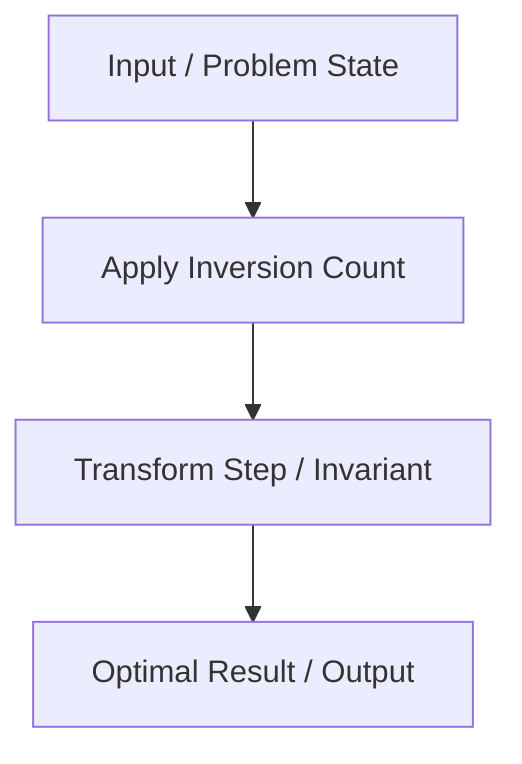

# Inversion Count

> **Category:** SearchingAndSorting · **Tier:** Core Interview (Merge Sort Variation)

---

## 🔗 Resources & Visualizers
- **YouTube:** [Watch Inversion Count Visual Guide](https://www.youtube.com/results?search_query=Inversion%20Count%20algorithm%20visual%20explanation)
- **Blog / Editorial:** [CP-Algorithms / GeeksforGeeks Guide](https://www.google.com/search?q=Inversion%20Count%20algorithm%20tutorial%20CP%20algorithms)
- **Interactive Visualizer:** [VisuAlgo Interactive Simulation](https://visualgo.net/en)

---

## 🧠 Intuition & Mental Model
> [!TIP]
> **Core Concept:** Inversion Count is the number of index pairs (i, j)

Inversion Count is the number of index pairs (i, j)
such that i < j and arr[i] > arr[j].
It measures how far an array is from being sorted.
A fully sorted array has 0 inversions.
Algorithm Explanation
Use Merge Sort idea.
While merging two sorted halves:
If left element ≤ right → no inversion.
If left element > right → all remaining left elements form inversions.
Sum these counts during merge steps.

---

## 🎯 When to Use & Problem Triggers
- **Trigger 1:** When the brute-force enumeration takes quadratic time or higher and a linear/logarithmic invariant exists.
- **Trigger 2:** Common patterns involving **SearchingAndSorting**, subsegments, query sequences, or optimal substructures.
- **Trigger 3:** Constraints where $N \ge 10^5$ require $O(N)$ or $O(N \log N)$ performance.

---

## 📊 Visual Explanation & Dry Run



<details>
<summary>🔍 <strong>Step-by-Step Algorithm Walkthrough</strong> (Click to expand)</summary>

1. **Initialization:** Set up boundary pointers, state variables, or base auxiliary arrays.
2. **Iteration / Traversal:** Advance through the input elements while maintaining the algorithmic invariant.
3. **State Transition:** Update the current state, dynamic array, or accumulator in $O(1)$ or $O(\log N)$.
4. **Final Result:** Extract the optimal answer from the computed state or reconstructed solution.

</details>

---

## 💻 Algorithm Code (Java)

```java
import java.io.*;
import java.util.*;

class Main {

    static long cnt;

    static void merge(int[] a, int l, int m, int r) {
        int n1 = m - l + 1;
        int n2 = r - m;

        int[] L = new int[n1];
        int[] R = new int[n2];

        for (int i = 0; i < n1; i++)
            L[i] = a[l + i];

        for (int j = 0; j < n2; j++)
            R[j] = a[m + 1 + j];

        int i = 0, j = 0, k = l;

        while (i < n1 && j < n2) {
            if (L[i] <= R[j]) {
                a[k++] = L[i++];
            } else {
                a[k++] = R[j++];
                cnt += (n1 - i);
            }
        }

        while (i < n1)
            a[k++] = L[i++];

        while (j < n2)
            a[k++] = R[j++];
    }

    static void mergeSort(int[] a, int l, int r) {
        if (l < r) {
            int m = (l + r) >> 1;
            mergeSort(a, l, m);
            mergeSort(a, m + 1, r);
            merge(a, l, m, r);
        }
    }

    public static void main(String[] args) throws Exception {
        PrintWriter out = new PrintWriter(System.out);

        int[] a = {8, 4, 2, 1};
        cnt = 0;

        mergeSort(a, 0, a.length - 1);

        out.println(cnt);
        out.flush();
    }
}
```

---

## ⏱️ Complexity Analysis
- **Time Complexity (TC):** Typically `O(N)` or `O(N log N)` depending on auxiliary sorting or tree operations.
- **Space Complexity (SC):** Typically `O(1)` auxiliary space or `O(N)` for auxiliary arrays/tables.

---

## 🔄 Similar & Connected Algorithms
- **Related Category:** Explore other fundamental algorithms in [SearchingAndSorting](../).
- **Composite Patterns:** Often combined with Prefix Sums, Binary Search on Answer, or Dynamic Programming memoization.

---

## ⚔️ Practice Questions

### 🟡 LeetCode
- [ ] [Explore Inversion Count Problems on LeetCode](https://leetcode.com/problemset/?search=Inversion%20Count%20LeetCode) — `Practice`

### 🔵 CodeChef & Codeforces
- [ ] [Practice on Codeforces Problemset](https://codeforces.com/problemset) — `Catalog`
- [ ] [Practice on CodeChef Practice Portal](https://www.codechef.com/practice) — `Catalog`
