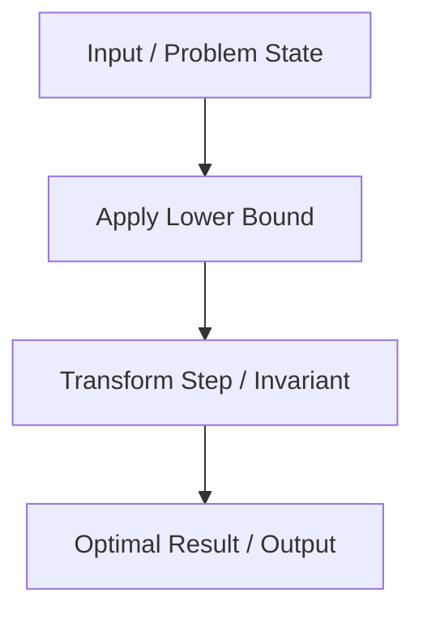

# Lower Bound

> **Category:** SearchingAndSorting · **Tier:** Core Interview (Essential)

---

## 🔗 Resources & Visualizers
- **YouTube:** [Watch Lower Bound Visual Guide](https://www.youtube.com/results?search_query=Lower%20Bound%20algorithm%20visual%20explanation)
- **Blog / Editorial:** [CP-Algorithms / GeeksforGeeks Guide](https://www.google.com/search?q=Lower%20Bound%20algorithm%20tutorial%20CP%20algorithms)
- **Interactive Visualizer:** [VisuAlgo Interactive Simulation](https://visualgo.net/en)

---

## 🧠 Intuition & Mental Model
> [!TIP]
> **Core Concept:** Lower Bound finds the first index in a sorted array where

Lower Bound finds the first index in a sorted array where
the element is greater than or equal to a given target.
If all elements are smaller than the target, it returns the array size.
It is implemented using Binary Search.
Algorithm Explanation
Work on a sorted array
Use binary search space [0 … n)
Whenever arr[mid] >= target, move left to find the earliest valid index
Otherwise, move right

---

## 🎯 When to Use & Problem Triggers
- **Trigger 1:** When the brute-force enumeration takes quadratic time or higher and a linear/logarithmic invariant exists.
- **Trigger 2:** Common patterns involving **SearchingAndSorting**, subsegments, query sequences, or optimal substructures.
- **Trigger 3:** Constraints where $N \ge 10^5$ require $O(N)$ or $O(N \log N)$ performance.

---

## 📊 Visual Explanation & Dry Run



<details>
<summary>🔍 <strong>Step-by-Step Algorithm Walkthrough</strong> (Click to expand)</summary>

1. **Initialization:** Set up boundary pointers, state variables, or base auxiliary arrays.
2. **Iteration / Traversal:** Advance through the input elements while maintaining the algorithmic invariant.
3. **State Transition:** Update the current state, dynamic array, or accumulator in $O(1)$ or $O(\log N)$.
4. **Final Result:** Extract the optimal answer from the computed state or reconstructed solution.

</details>

---

## 💻 Algorithm Code (Java)

```java
class Main {
    public static void main(String[] args) throws Exception {

        int[] arr = {1, 3, 5, 7, 9};
        int target = 6;

        int n = arr.length;

        int l = 0;
        int r = n;
        int ans = n;

        while (l < r) {
            int m = l + (r - l) / 2;

            if (arr[m] >= target) {
                ans = m;
                r = m;
            } else {
                l = m + 1;
            }
        }

        System.out.println(ans);
    }
}
```

---

## ⏱️ Complexity Analysis
- **Time Complexity (TC):** Typically `O(N)` or `O(N log N)` depending on auxiliary sorting or tree operations.
- **Space Complexity (SC):** Typically `O(1)` auxiliary space or `O(N)` for auxiliary arrays/tables.

---

## 🔄 Similar & Connected Algorithms
- **Related Category:** Explore other fundamental algorithms in [SearchingAndSorting](../).
- **Composite Patterns:** Often combined with Prefix Sums, Binary Search on Answer, or Dynamic Programming memoization.

---

## ⚔️ Practice Questions

### 🟡 LeetCode
- [ ] [Explore Lower Bound Problems on LeetCode](https://leetcode.com/problemset/?search=Lower%20Bound%20LeetCode) — `Practice`

### 🔵 CodeChef & Codeforces
- [ ] [Practice on Codeforces Problemset](https://codeforces.com/problemset) — `Catalog`
- [ ] [Practice on CodeChef Practice Portal](https://www.codechef.com/practice) — `Catalog`
