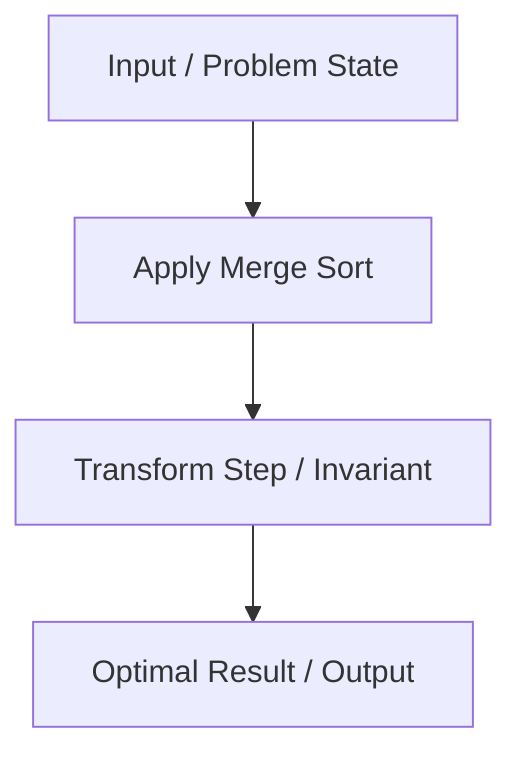

# Merge Sort

> **Category:** SearchingAndSorting · **Tier:** Core Interview (Essential)

---

## 🔗 Resources & Visualizers
- **YouTube:** [Watch Merge Sort Visual Guide](https://www.youtube.com/results?search_query=Merge%20Sort%20algorithm%20visual%20explanation)
- **Blog / Editorial:** [CP-Algorithms / GeeksforGeeks Guide](https://www.google.com/search?q=Merge%20Sort%20algorithm%20tutorial%20CP%20algorithms)
- **Interactive Visualizer:** [VisuAlgo Interactive Simulation](https://visualgo.net/en)

---

## 🧠 Intuition & Mental Model
> [!TIP]
> **Core Concept:** Merge Sort is a divide-and-conquer sorting algorithm that recursively

Merge Sort is a divide-and-conquer sorting algorithm that recursively
splits the array into halves, sorts each half, and then merges them back
in sorted order.
It guarantees O(N log N) time complexity regardless of input order.
Algorithm Explanation
Divide the array into two halves until each subarray has one element
Merge two sorted halves by comparing elements one by one
Repeat merging until the entire array is sorted

---

## 🎯 When to Use & Problem Triggers
- **Trigger 1:** When the brute-force enumeration takes quadratic time or higher and a linear/logarithmic invariant exists.
- **Trigger 2:** Common patterns involving **SearchingAndSorting**, subsegments, query sequences, or optimal substructures.
- **Trigger 3:** Constraints where $N \ge 10^5$ require $O(N)$ or $O(N \log N)$ performance.

---

## 📊 Visual Explanation & Dry Run



<details>
<summary>🔍 <strong>Step-by-Step Algorithm Walkthrough</strong> (Click to expand)</summary>

1. **Initialization:** Set up boundary pointers, state variables, or base auxiliary arrays.
2. **Iteration / Traversal:** Advance through the input elements while maintaining the algorithmic invariant.
3. **State Transition:** Update the current state, dynamic array, or accumulator in $O(1)$ or $O(\log N)$.
4. **Final Result:** Extract the optimal answer from the computed state or reconstructed solution.

</details>

---

## 💻 Algorithm Code (Java)

```java
import java.io.*;
import java.util.*;

class Main {
    public static void main(String[] args) throws Exception {
        PrintWriter out = new PrintWriter(System.out);

        int[] arr = {5, 2, 4, 1, 3};

        mergeSort(arr, 0, arr.length - 1);

        for (int x : arr)
            out.print((x + " "));

        out.println();
        out.flush();
    }

    static void mergeSort(int[] arr, int l, int r) {
        if (l >= r) return;

        int m = l + (r - l) / 2;

        mergeSort(arr, l, m);
        mergeSort(arr, m + 1, r);

        merge(arr, l, m, r);
    }

    static void merge(int[] arr, int l, int m, int r) {
        int n1 = m - l + 1;
        int n2 = r - m;

        int[] left = new int[n1];
        int[] right = new int[n2];

        for (int i = 0; i < n1; i++)
            left[i] = arr[l + i];

        for (int j = 0; j < n2; j++)
            right[j] = arr[m + 1 + j];

        int i = 0;
        int j = 0;
        int k = l;

        while (i < n1 && j < n2) {
            if (left[i] <= right[j])
                arr[k++] = left[i++];
            else
                arr[k++] = right[j++];
        }

        while (i < n1)
            arr[k++] = left[i++];

        while (j < n2)
            arr[k++] = right[j++];
    }
}
```

---

## ⏱️ Complexity Analysis
- **Time Complexity (TC):** Typically `O(N)` or `O(N log N)` depending on auxiliary sorting or tree operations.
- **Space Complexity (SC):** Typically `O(1)` auxiliary space or `O(N)` for auxiliary arrays/tables.

---

## 🔄 Similar & Connected Algorithms
- **Related Category:** Explore other fundamental algorithms in [SearchingAndSorting](../).
- **Composite Patterns:** Often combined with Prefix Sums, Binary Search on Answer, or Dynamic Programming memoization.

---

## ⚔️ Practice Questions

### 🟡 LeetCode
- [ ] [Explore Merge Sort Problems on LeetCode](https://leetcode.com/problemset/?search=Merge%20Sort%20LeetCode) — `Practice`

### 🔵 CodeChef & Codeforces
- [ ] [Practice on Codeforces Problemset](https://codeforces.com/problemset) — `Catalog`
- [ ] [Practice on CodeChef Practice Portal](https://www.codechef.com/practice) — `Catalog`
