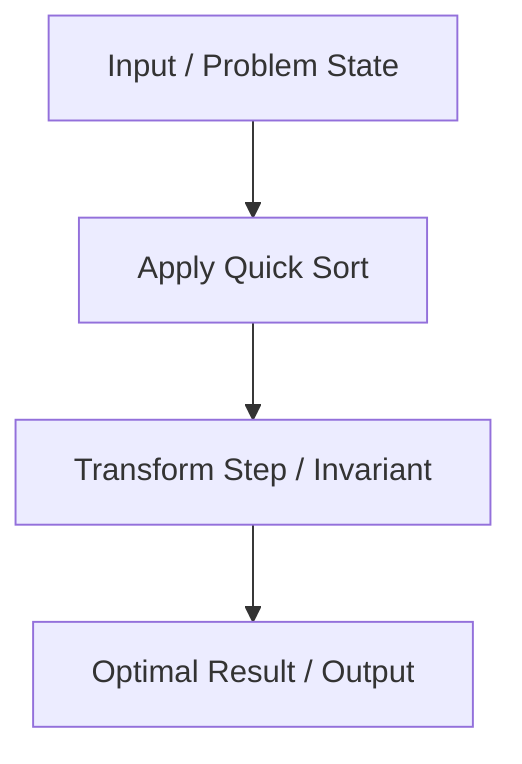

# Quick Sort

> **Category:** SearchingAndSorting · **Tier:** Core Interview (Essential)

---

## 🔗 Resources & Visualizers
- **YouTube:** [Watch Quick Sort Visual Guide](https://www.youtube.com/results?search_query=Quick%20Sort%20algorithm%20visual%20explanation)
- **Blog / Editorial:** [CP-Algorithms / GeeksforGeeks Guide](https://www.google.com/search?q=Quick%20Sort%20algorithm%20tutorial%20CP%20algorithms)
- **Interactive Visualizer:** [VisuAlgo Interactive Simulation](https://visualgo.net/en)

---

## 🧠 Intuition & Mental Model
> [!TIP]
> **Core Concept:** Quick Sort is a divide-and-conquer sorting algorithm

Quick Sort is a divide-and-conquer sorting algorithm
that selects a pivot element, partitions the array
around the pivot, and recursively sorts the left and right subarrays.
It is efficient in practice and widely used for large datasets.
Algorithm Explanation
Pick a pivot element (here: last element).
Rearrange elements so that smaller ones go left of pivot and
larger ones go right.
Recursively apply the same steps to left and right subarrays.

---

## 🎯 When to Use & Problem Triggers
- **Trigger 1:** When the brute-force enumeration takes quadratic time or higher and a linear/logarithmic invariant exists.
- **Trigger 2:** Common patterns involving **SearchingAndSorting**, subsegments, query sequences, or optimal substructures.
- **Trigger 3:** Constraints where $N \ge 10^5$ require $O(N)$ or $O(N \log N)$ performance.

---

## 📊 Visual Explanation & Dry Run



<details>
<summary>🔍 <strong>Step-by-Step Algorithm Walkthrough</strong> (Click to expand)</summary>

1. **Initialization:** Set up boundary pointers, state variables, or base auxiliary arrays.
2. **Iteration / Traversal:** Advance through the input elements while maintaining the algorithmic invariant.
3. **State Transition:** Update the current state, dynamic array, or accumulator in $O(1)$ or $O(\log N)$.
4. **Final Result:** Extract the optimal answer from the computed state or reconstructed solution.

</details>

---

## 💻 Algorithm Code (Java)

```java
class QuickSort {

    static void quickSort(int[] arr, int low, int high) {

        if (low < high) {
            int pivotIndex = partition(arr, low, high);
            quickSort(arr, low, pivotIndex - 1);
            quickSort(arr, pivotIndex + 1, high);
        }
    }

    static int partition(int[] arr, int low, int high) {
        int pivot = arr[high];

        int i = low - 1;

        for (int j = low; j < high; j++) {
            if (arr[j] < pivot) {
                i++;

                int temp = arr[i];
                arr[i] = arr[j];
                arr[j] = temp;
            }
        }

        int temp = arr[i + 1];
        arr[i + 1] = arr[high];
        arr[high] = temp;

        return i + 1;

    }

    public static void main(String[] args) {
        int[] arr = {8, 3, 6, 2, 7, 4};

        quickSort(arr, 0, arr.length - 1);

        for (int x : arr) {
            System.out.print(x + " ");
        }
    }
}
```

---

## ⏱️ Complexity Analysis
- **Time Complexity (TC):** Typically `O(N)` or `O(N log N)` depending on auxiliary sorting or tree operations.
- **Space Complexity (SC):** Typically `O(1)` auxiliary space or `O(N)` for auxiliary arrays/tables.

---

## 🔄 Similar & Connected Algorithms
- **Related Category:** Explore other fundamental algorithms in [SearchingAndSorting](../).
- **Composite Patterns:** Often combined with Prefix Sums, Binary Search on Answer, or Dynamic Programming memoization.

---

## ⚔️ Practice Questions

### 🟡 LeetCode
- [ ] [Explore Quick Sort Problems on LeetCode](https://leetcode.com/problemset/?search=Quick%20Sort%20LeetCode) — `Practice`

### 🔵 CodeChef & Codeforces
- [ ] [Practice on Codeforces Problemset](https://codeforces.com/problemset) — `Catalog`
- [ ] [Practice on CodeChef Practice Portal](https://www.codechef.com/practice) — `Catalog`
