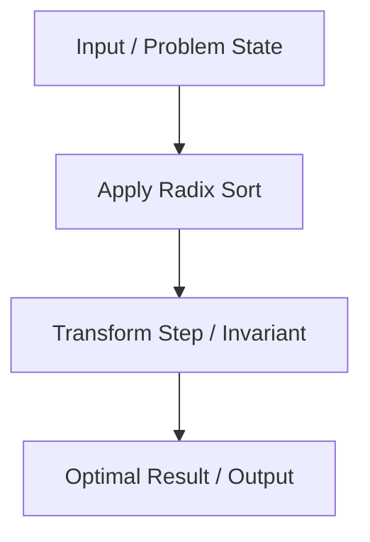

# Radix Sort

> **Category:** SearchingAndSorting · **Tier:** Core Interview (Classic)

---

## 🔗 Resources & Visualizers
- **YouTube:** [Watch Radix Sort Visual Guide](https://www.youtube.com/results?search_query=Radix%20Sort%20algorithm%20visual%20explanation)
- **Blog / Editorial:** [CP-Algorithms / GeeksforGeeks Guide](https://www.google.com/search?q=Radix%20Sort%20algorithm%20tutorial%20CP%20algorithms)
- **Interactive Visualizer:** [VisuAlgo Interactive Simulation](https://visualgo.net/en)

---

## 🧠 Intuition & Mental Model
> [!TIP]
> **Core Concept:** Radix Sort is a non-comparison sorting algorithm that sorts

Radix Sort is a non-comparison sorting algorithm that sorts
numbers digit by digit, starting from the least significant digit to
the most significant digit.
It uses a stable sub-sorting technique (usually Counting Sort)
at each digit place.
Algorithm Explanation
Find the maximum number to know how many digit places exist
For each digit place (1, 10, 100, …):
Group numbers based on the current digit
Rebuild the array using stable counting sort
Repeat until all digit places are processed

---

## 🎯 When to Use & Problem Triggers
- **Trigger 1:** When the brute-force enumeration takes quadratic time or higher and a linear/logarithmic invariant exists.
- **Trigger 2:** Common patterns involving **SearchingAndSorting**, subsegments, query sequences, or optimal substructures.
- **Trigger 3:** Constraints where $N \ge 10^5$ require $O(N)$ or $O(N \log N)$ performance.

---

## 📊 Visual Explanation & Dry Run



<details>
<summary>🔍 <strong>Step-by-Step Algorithm Walkthrough</strong> (Click to expand)</summary>

1. **Initialization:** Set up boundary pointers, state variables, or base auxiliary arrays.
2. **Iteration / Traversal:** Advance through the input elements while maintaining the algorithmic invariant.
3. **State Transition:** Update the current state, dynamic array, or accumulator in $O(1)$ or $O(\log N)$.
4. **Final Result:** Extract the optimal answer from the computed state or reconstructed solution.

</details>

---

## 💻 Algorithm Code (Java)

```java
import java.io.*;
import java.util.*;

class Main {

    static void radixSort(int[] arr) {
        int max = arr[0];
        for (int i = 1; i < arr.length; i++) {
            if (arr[i] > max) max = arr[i];
        }

        for (int exp = 1; max / exp > 0; exp *= 10) {
            countingSort(arr, exp);
        }
    }

    static void countingSort(int[] arr, int exp) {
        int n = arr.length;
        int[] output = new int[n];
        int[] count = new int[10];

        for (int i = 0; i < n; i++) {
            int digit = (arr[i] / exp) % 10;
            count[digit]++;
        }

        for (int i = 1; i < 10; i++) {
            count[i] += count[i - 1];
        }

        for (int i = n - 1; i >= 0; i--) {
            int digit = (arr[i] / exp) % 10;
            output[count[digit] - 1] = arr[i];
            count[digit]--;
        }

        for (int i = 0; i < n; i++) {
            arr[i] = output[i];
        }
    }

    public static void main(String[] args) throws Exception {
        BufferedReader br = new BufferedReader(new InputStreamReader(System.in));
        PrintWriter out = new PrintWriter(System.out);

        int[] arr = {170, 45, 75, 90, 802, 24, 2, 66};

        radixSort(arr);

        for (int x : arr) {
            out.print(x + " ");
        }

        out.flush();
    }
}
```

---

## ⏱️ Complexity Analysis
- **Time Complexity (TC):** Typically `O(N)` or `O(N log N)` depending on auxiliary sorting or tree operations.
- **Space Complexity (SC):** Typically `O(1)` auxiliary space or `O(N)` for auxiliary arrays/tables.

---

## 🔄 Similar & Connected Algorithms
- **Related Category:** Explore other fundamental algorithms in [SearchingAndSorting](../).
- **Composite Patterns:** Often combined with Prefix Sums, Binary Search on Answer, or Dynamic Programming memoization.

---

## ⚔️ Practice Questions

### 🟡 LeetCode
- [ ] [Explore Radix Sort Problems on LeetCode](https://leetcode.com/problemset/?search=Radix%20Sort%20LeetCode) — `Practice`

### 🔵 CodeChef & Codeforces
- [ ] [Practice on Codeforces Problemset](https://codeforces.com/problemset) — `Catalog`
- [ ] [Practice on CodeChef Practice Portal](https://www.codechef.com/practice) — `Catalog`
