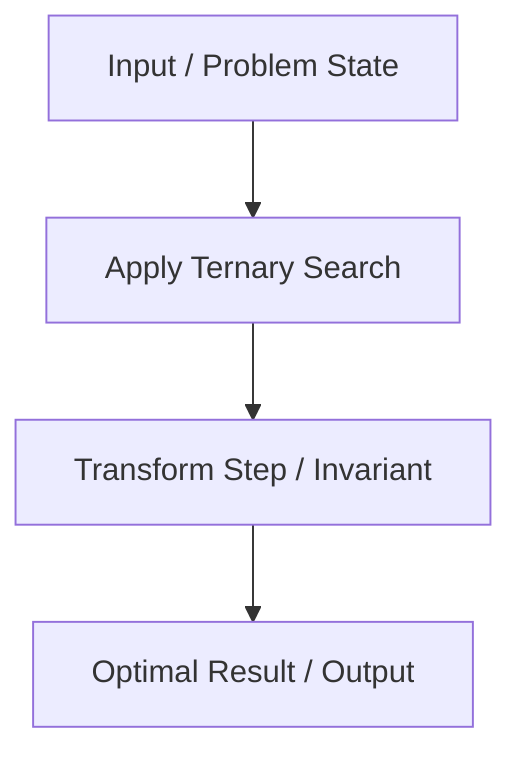

# Ternary Search

> **Category:** SearchingAndSorting · **Tier:** Advanced Interview (Unimodal)

---

## 🔗 Resources & Visualizers
- **YouTube:** [Watch Ternary Search Visual Guide](https://www.youtube.com/results?search_query=Ternary%20Search%20algorithm%20visual%20explanation)
- **Blog / Editorial:** [CP-Algorithms / GeeksforGeeks Guide](https://www.google.com/search?q=Ternary%20Search%20algorithm%20tutorial%20CP%20algorithms)
- **Interactive Visualizer:** [VisuAlgo Interactive Simulation](https://visualgo.net/en)

---

## 🧠 Intuition & Mental Model
> [!TIP]
> **Core Concept:** Ternary Search is a divide-and-conquer searching

Ternary Search is a divide-and-conquer searching
algorithm that works on a sorted array by dividing the search
space into three parts instead of two.
At every step, it compares the target with two mid
points and discards two-thirds of the array accordingly.
Algorithm Explanation
Maintain low and high pointers.
Compute two mid points:
mid1 = low + (high - low) / 3
mid2 = high - (high - low) / 3
Compare target with mid1 and mid2.
Narrow the search to one of three regions.
Repeat until found or search space becomes invalid.

---

## 🎯 When to Use & Problem Triggers
- **Trigger 1:** When the brute-force enumeration takes quadratic time or higher and a linear/logarithmic invariant exists.
- **Trigger 2:** Common patterns involving **SearchingAndSorting**, subsegments, query sequences, or optimal substructures.
- **Trigger 3:** Constraints where $N \ge 10^5$ require $O(N)$ or $O(N \log N)$ performance.

---

## 📊 Visual Explanation & Dry Run



<details>
<summary>🔍 <strong>Step-by-Step Algorithm Walkthrough</strong> (Click to expand)</summary>

1. **Initialization:** Set up boundary pointers, state variables, or base auxiliary arrays.
2. **Iteration / Traversal:** Advance through the input elements while maintaining the algorithmic invariant.
3. **State Transition:** Update the current state, dynamic array, or accumulator in $O(1)$ or $O(\log N)$.
4. **Final Result:** Extract the optimal answer from the computed state or reconstructed solution.

</details>

---

## 💻 Algorithm Code (Java)

```java
import java.io.*;

class Main {

    static int ternarySearch(int[] a, int x) {
        int l = 0;
        int r = a.length - 1;

        while (l <= r) {
            int m1 = l + (r - l) / 3;
            int m2 = r - (r - l) / 3;

            if (a[m1] == x)
                return m1;

            if (a[m2] == x)
                return m2;

            if (x < a[m1])
                r = m1 - 1;

            else if (x > a[m2])
                l = m2 + 1;

            else {
                l = m1 + 1;
                r = m2 - 1;
            }
        }

        return -1;
    }

    public static void main(String[] args) {
        int[] a = {2, 4, 6, 8, 10, 12, 14};
        int x = 10;

        int idx = ternarySearch(a, x);

        System.out.println(idx);
    }
}
```

---

## ⏱️ Complexity Analysis
- **Time Complexity (TC):** Typically `O(N)` or `O(N log N)` depending on auxiliary sorting or tree operations.
- **Space Complexity (SC):** Typically `O(1)` auxiliary space or `O(N)` for auxiliary arrays/tables.

---

## 🔄 Similar & Connected Algorithms
- **Related Category:** Explore other fundamental algorithms in [SearchingAndSorting](../).
- **Composite Patterns:** Often combined with Prefix Sums, Binary Search on Answer, or Dynamic Programming memoization.

---

## ⚔️ Practice Questions

### 🟡 LeetCode
- [ ] [Explore Ternary Search Problems on LeetCode](https://leetcode.com/problemset/?search=Ternary%20Search%20LeetCode) — `Practice`

### 🔵 CodeChef & Codeforces
- [ ] [Practice on Codeforces Problemset](https://codeforces.com/problemset) — `Catalog`
- [ ] [Practice on CodeChef Practice Portal](https://www.codechef.com/practice) — `Catalog`
