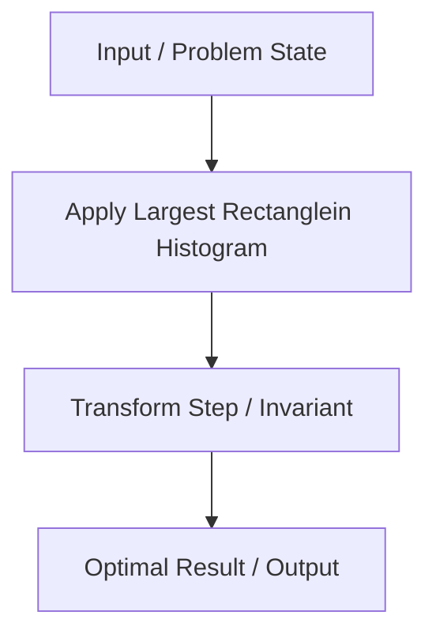

# Largest Rectanglein Histogram

> **Category:** Stacks · **Tier:** Core Interview (Hard/Classic)

---

## 🔗 Resources & Visualizers
- **YouTube:** [Watch Largest Rectanglein Histogram Visual Guide](https://www.youtube.com/results?search_query=Largest%20Rectanglein%20Histogram%20algorithm%20visual%20explanation)
- **Blog / Editorial:** [CP-Algorithms / GeeksforGeeks Guide](https://www.google.com/search?q=Largest%20Rectanglein%20Histogram%20algorithm%20tutorial%20CP%20algorithms)
- **Interactive Visualizer:** [VisuAlgo Interactive Simulation](https://visualgo.net/en)

---

## 🧠 Intuition & Mental Model
> [!TIP]
> **Core Concept:** The Largest Rectangle in a Histogram problem finds the

The Largest Rectangle in a Histogram problem finds the
maximum area rectangle that can be formed using contiguous bars of a histogram.
Each bar has a fixed width of 1 and varying heights.
Algorithm Explanation :
We use a monotonic increasing stack to store indices of bars.
The stack always keeps indices whose heights are in increasing order.
When a smaller height bar appears:
We pop bars from the stack.
Each popped bar becomes the smallest bar of a rectangle.
For each popped bar:
Width is calculated using current index and new stack top.
Area = height × width
After traversing all bars:
We pop remaining bars and calculate area similarly.
Track the maximum area during the process.

---

## 🎯 When to Use & Problem Triggers
- **Trigger 1:** When the brute-force enumeration takes quadratic time or higher and a linear/logarithmic invariant exists.
- **Trigger 2:** Common patterns involving **Stacks**, subsegments, query sequences, or optimal substructures.
- **Trigger 3:** Constraints where $N \ge 10^5$ require $O(N)$ or $O(N \log N)$ performance.

---

## 📊 Visual Explanation & Dry Run



<details>
<summary>🔍 <strong>Step-by-Step Algorithm Walkthrough</strong> (Click to expand)</summary>

1. **Initialization:** Set up boundary pointers, state variables, or base auxiliary arrays.
2. **Iteration / Traversal:** Advance through the input elements while maintaining the algorithmic invariant.
3. **State Transition:** Update the current state, dynamic array, or accumulator in $O(1)$ or $O(\log N)$.
4. **Final Result:** Extract the optimal answer from the computed state or reconstructed solution.

</details>

---

## 💻 Algorithm Code (Java)

```java
import java.io.*;
import java.util.*;

class Main {
    public static void main(String[] args) throws Exception {
        int[] h = {2, 1, 5, 6, 2, 3};
        int n = h.length;

        Stack<Integer> s = new Stack<>();

        int max = 0;

        for (int i = 0; i < n; i++) {
            while (!s.isEmpty() && h[s.peek()] > h[i]) {
                int ht = h[s.pop()];

                int w;
                if (s.isEmpty())
                    w = i;
                else
                    w = i - s.peek() - 1;

                max = Math.max(max, ht * w);
            }

            s.push(i);
        }

        while (!s.isEmpty()) {
            int ht = h[s.pop()];

            int w;
            if (s.isEmpty())
                w = n;
            else
                w = n - s.peek() - 1;

            max = Math.max(max, ht * w);
        }

        System.out.println(max);
    }
}
```

---

## ⏱️ Complexity Analysis
- **Time Complexity (TC):** Typically `O(N)` or `O(N log N)` depending on auxiliary sorting or tree operations.
- **Space Complexity (SC):** Typically `O(1)` auxiliary space or `O(N)` for auxiliary arrays/tables.

---

## 🔄 Similar & Connected Algorithms
- **Related Category:** Explore other fundamental algorithms in [Stacks](../).
- **Composite Patterns:** Often combined with Prefix Sums, Binary Search on Answer, or Dynamic Programming memoization.

---

## ⚔️ Practice Questions

### 🟡 LeetCode
- [ ] [Explore Largest Rectanglein Histogram Problems on LeetCode](https://leetcode.com/problemset/?search=Largest%20Rectanglein%20Histogram%20LeetCode) — `Practice`

### 🔵 CodeChef & Codeforces
- [ ] [Practice on Codeforces Problemset](https://codeforces.com/problemset) — `Catalog`
- [ ] [Practice on CodeChef Practice Portal](https://www.codechef.com/practice) — `Catalog`
