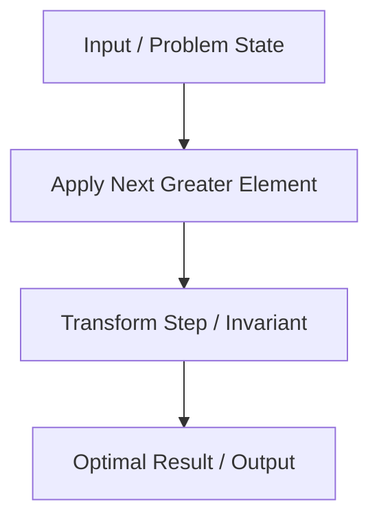

# Next Greater Element

> **Category:** Stacks · **Tier:** Core Interview (Essential)

---

## 🔗 Resources & Visualizers
- **YouTube:** [Watch Next Greater Element Visual Guide](https://www.youtube.com/results?search_query=Next%20Greater%20Element%20algorithm%20visual%20explanation)
- **Blog / Editorial:** [CP-Algorithms / GeeksforGeeks Guide](https://www.google.com/search?q=Next%20Greater%20Element%20algorithm%20tutorial%20CP%20algorithms)
- **Interactive Visualizer:** [VisuAlgo Interactive Simulation](https://visualgo.net/en)

---

## 🧠 Intuition & Mental Model
> [!TIP]
> **Core Concept:** Next Greater Element for an element is the first element to its right that is strictly greater.

Next Greater Element for an element is the first element to its right that is strictly greater.
If no such element exists, the answer is -1.
Algorithm Explanation
Traverse the array from right to left
Use a stack to store possible “greater elements”
For each element:
Remove (pop) all elements from stack ≤ current element
Top of stack (if exists) is the Next Greater Element
If stack is empty → answer is -1
Push current element into stack
Stack always maintains elements in strictly decreasing order

---

## 🎯 When to Use & Problem Triggers
- **Trigger 1:** When the brute-force enumeration takes quadratic time or higher and a linear/logarithmic invariant exists.
- **Trigger 2:** Common patterns involving **Stacks**, subsegments, query sequences, or optimal substructures.
- **Trigger 3:** Constraints where $N \ge 10^5$ require $O(N)$ or $O(N \log N)$ performance.

---

## 📊 Visual Explanation & Dry Run



<details>
<summary>🔍 <strong>Step-by-Step Algorithm Walkthrough</strong> (Click to expand)</summary>

1. **Initialization:** Set up boundary pointers, state variables, or base auxiliary arrays.
2. **Iteration / Traversal:** Advance through the input elements while maintaining the algorithmic invariant.
3. **State Transition:** Update the current state, dynamic array, or accumulator in $O(1)$ or $O(\log N)$.
4. **Final Result:** Extract the optimal answer from the computed state or reconstructed solution.

</details>

---

## 💻 Algorithm Code (Java)

```java
import java.io.*;
import java.util.*;

class Main {
    public static void main(String[] args) {
        int[] arr = {4, 5, 2, 25};
        int n = arr.length;
        int[] nge = new int[n];
        Stack<Integer> st = new Stack<>();

        for (int i = n - 1; i >= 0; i--) {
            while (!st.isEmpty() && st.peek() <= arr[i]) {
                st.pop();
            }

            nge[i] = st.isEmpty() ? -1 : st.peek();

            st.push(arr[i]);
        }

        for (int x : nge) {
            System.out.println(x + " ");
        }
    }
}
```

---

## ⏱️ Complexity Analysis
- **Time Complexity (TC):** Typically `O(N)` or `O(N log N)` depending on auxiliary sorting or tree operations.
- **Space Complexity (SC):** Typically `O(1)` auxiliary space or `O(N)` for auxiliary arrays/tables.

---

## 🔄 Similar & Connected Algorithms
- **Related Category:** Explore other fundamental algorithms in [Stacks](../).
- **Composite Patterns:** Often combined with Prefix Sums, Binary Search on Answer, or Dynamic Programming memoization.

---

## ⚔️ Practice Questions

### 🟡 LeetCode
- [ ] [496. Next Greater Element I](https://leetcode.com/problems/next-greater-element-i/) — `Easy`
- [ ] [503. Next Greater Element II](https://leetcode.com/problems/next-greater-element-ii/) — `Medium`
- [ ] [739. Daily Temperatures](https://leetcode.com/problems/daily-temperatures/) — `Medium`
- [ ] [84. Largest Rectangle in Histogram](https://leetcode.com/problems/largest-rectangle-in-histogram/) — `Hard`

### 🔵 CodeChef & Codeforces

