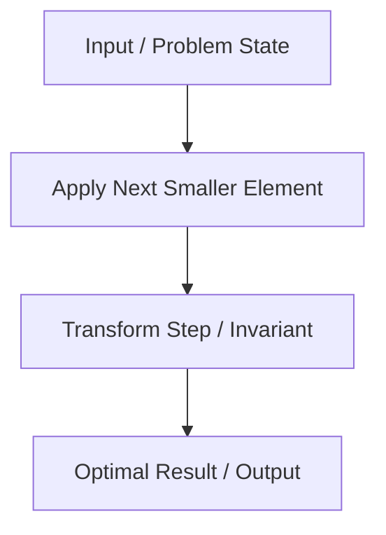

# Next Smaller Element

> **Category:** Stacks · **Tier:** Core Interview (Essential)

---

## 🔗 Resources & Visualizers
- **YouTube:** [Watch Next Smaller Element Visual Guide](https://www.youtube.com/results?search_query=Next%20Smaller%20Element%20algorithm%20visual%20explanation)
- **Blog / Editorial:** [CP-Algorithms / GeeksforGeeks Guide](https://www.google.com/search?q=Next%20Smaller%20Element%20algorithm%20tutorial%20CP%20algorithms)
- **Interactive Visualizer:** [VisuAlgo Interactive Simulation](https://visualgo.net/en)

---

## 🧠 Intuition & Mental Model
> [!TIP]
> **Core Concept:** Next Smaller Element (NSE):

Next Smaller Element (NSE):
For each element in an array, find the nearest element to its right
that is strictly smaller. If none exists, answer is -1.
Algorithm Explanation
We traverse the array from right to left
We use a stack to keep elements that are candidates for NSE
For every element:
Remove (pop) all elements from stack ≥ current element
After popping:
If stack is empty → NSE = -1
Else → NSE = top of stack
Push current element into stack
Stack always remains monotonically increasing (bottom → top)

---

## 🎯 When to Use & Problem Triggers
- **Trigger 1:** When the brute-force enumeration takes quadratic time or higher and a linear/logarithmic invariant exists.
- **Trigger 2:** Common patterns involving **Stacks**, subsegments, query sequences, or optimal substructures.
- **Trigger 3:** Constraints where $N \ge 10^5$ require $O(N)$ or $O(N \log N)$ performance.

---

## 📊 Visual Explanation & Dry Run



<details>
<summary>🔍 <strong>Step-by-Step Algorithm Walkthrough</strong> (Click to expand)</summary>

1. **Initialization:** Set up boundary pointers, state variables, or base auxiliary arrays.
2. **Iteration / Traversal:** Advance through the input elements while maintaining the algorithmic invariant.
3. **State Transition:** Update the current state, dynamic array, or accumulator in $O(1)$ or $O(\log N)$.
4. **Final Result:** Extract the optimal answer from the computed state or reconstructed solution.

</details>

---

## 💻 Algorithm Code (Java)

```java
import java.io.*;
import java.util.*;

class Main {
    public static void main(String[] args) throws Exception {
        int[] a = {4, 8, 5, 2};

        int[] nse = new int[a.length];
        Stack<Integer> st = new Stack<>();

        for (int i = a.length - 1; i >= 0; i--) {
            while (!st.isEmpty() && st.peek() >= a[i]) {
                st.pop();
            }

            if (st.isEmpty()) {
                nse[i] = -1;
            } else {
                nse[i] = st.peek();
            }

            st.push(a[i]);
        }

        for (int x : nse) {
            System.out.print(x + " ");
        }
    }
}
```

---

## ⏱️ Complexity Analysis
- **Time Complexity (TC):** Typically `O(N)` or `O(N log N)` depending on auxiliary sorting or tree operations.
- **Space Complexity (SC):** Typically `O(1)` auxiliary space or `O(N)` for auxiliary arrays/tables.

---

## 🔄 Similar & Connected Algorithms
- **Related Category:** Explore other fundamental algorithms in [Stacks](../).
- **Composite Patterns:** Often combined with Prefix Sums, Binary Search on Answer, or Dynamic Programming memoization.

---

## ⚔️ Practice Questions

### 🟡 LeetCode
- [ ] [Explore Next Smaller Element Problems on LeetCode](https://leetcode.com/problemset/?search=Next%20Smaller%20Element%20LeetCode) — `Practice`

### 🔵 CodeChef & Codeforces
- [ ] [Practice on Codeforces Problemset](https://codeforces.com/problemset) — `Catalog`
- [ ] [Practice on CodeChef Practice Portal](https://www.codechef.com/practice) — `Catalog`
