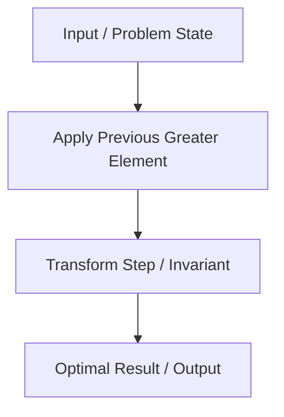

# Previous Greater Element

> **Category:** Stacks · **Tier:** Core Interview (Essential)

---

## 🔗 Resources & Visualizers
- **YouTube:** [Watch Previous Greater Element Visual Guide](https://www.youtube.com/results?search_query=Previous%20Greater%20Element%20algorithm%20visual%20explanation)
- **Blog / Editorial:** [CP-Algorithms / GeeksforGeeks Guide](https://www.google.com/search?q=Previous%20Greater%20Element%20algorithm%20tutorial%20CP%20algorithms)
- **Interactive Visualizer:** [VisuAlgo Interactive Simulation](https://visualgo.net/en)

---

## 🧠 Intuition & Mental Model
> [!TIP]
> **Core Concept:** For each element in an array, the Previous Greater Element (PGE)

For each element in an array, the Previous Greater Element (PGE)
is the nearest element to its left that is strictly greater than it.
If no such element exists, the answer is -1.
Algorithm Explanation
Traverse the array from left to right.
Maintain a monotonic decreasing stack (top always greater candidates).
For the current element:
Pop elements from stack while stack top ≤ current element.
After popping:
If stack is empty → PGE = -1
Else → PGE = stack top
Push the current element into the stack.
Each element is pushed and popped at most once.

---

## 🎯 When to Use & Problem Triggers
- **Trigger 1:** When the brute-force enumeration takes quadratic time or higher and a linear/logarithmic invariant exists.
- **Trigger 2:** Common patterns involving **Stacks**, subsegments, query sequences, or optimal substructures.
- **Trigger 3:** Constraints where $N \ge 10^5$ require $O(N)$ or $O(N \log N)$ performance.

---

## 📊 Visual Explanation & Dry Run



<details>
<summary>🔍 <strong>Step-by-Step Algorithm Walkthrough</strong> (Click to expand)</summary>

1. **Initialization:** Set up boundary pointers, state variables, or base auxiliary arrays.
2. **Iteration / Traversal:** Advance through the input elements while maintaining the algorithmic invariant.
3. **State Transition:** Update the current state, dynamic array, or accumulator in $O(1)$ or $O(\log N)$.
4. **Final Result:** Extract the optimal answer from the computed state or reconstructed solution.

</details>

---

## 💻 Algorithm Code (Java)

```java
import java.io.*;
import java.util.*;

class Main {
    public static void main(String[] args) throws Exception {
        int[] a = {10, 4, 2, 20, 40, 12};

        int n = a.length;

        int[] ans = new int[n];
        int[] st = new int[n];

        int top = -1;

        for (int i = 0; i < n; i++) {
            while (top >= 0 && st[top] <= a[i]) {
                top--;
            }

            if (top == -1) {
                ans[i] = -1;
            } else {
                ans[i] = st[top];
            }

            st[++top] = a[i];
        }

        for (int i = 0; i < n; i++) {
            System.out.print(ans[i] + " ");
        }
    }
}
```

---

## ⏱️ Complexity Analysis
- **Time Complexity (TC):** Typically `O(N)` or `O(N log N)` depending on auxiliary sorting or tree operations.
- **Space Complexity (SC):** Typically `O(1)` auxiliary space or `O(N)` for auxiliary arrays/tables.

---

## 🔄 Similar & Connected Algorithms
- **Related Category:** Explore other fundamental algorithms in [Stacks](../).
- **Composite Patterns:** Often combined with Prefix Sums, Binary Search on Answer, or Dynamic Programming memoization.

---

## ⚔️ Practice Questions

### 🟡 LeetCode
- [ ] [Explore Previous Greater Element Problems on LeetCode](https://leetcode.com/problemset/?search=Previous%20Greater%20Element%20LeetCode) — `Practice`

### 🔵 CodeChef & Codeforces
- [ ] [Practice on Codeforces Problemset](https://codeforces.com/problemset) — `Catalog`
- [ ] [Practice on CodeChef Practice Portal](https://www.codechef.com/practice) — `Catalog`
