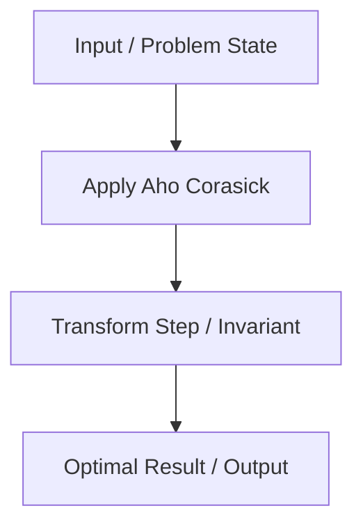

# Aho Corasick

> **Category:** Strings · **Tier:** Competitive Programming (String Matching)

---

## 🔗 Resources & Visualizers
- **YouTube:** [Watch Aho Corasick Visual Guide](https://www.youtube.com/results?search_query=Aho%20Corasick%20algorithm%20visual%20explanation)
- **Blog / Editorial:** [CP-Algorithms / GeeksforGeeks Guide](https://www.google.com/search?q=Aho%20Corasick%20algorithm%20tutorial%20CP%20algorithms)
- **Interactive Visualizer:** [VisuAlgo Interactive Simulation](https://visualgo.net/en)

---

## 🧠 Intuition & Mental Model
> [!TIP]
> **Core Concept:** Aho–Corasick Algorithm is a string matching algorithm used to find

Aho–Corasick Algorithm is a string matching algorithm used to find
multiple patterns simultaneously inside a text in linear time.
It builds a trie with failure links to avoid rechecking characters.
How the Algorithm Works
Insert all patterns into a Trie
Build Failure Links (like KMP fallback) using BFS
Traverse the text once
On mismatch → jump using failure link (no re-scan)
Whenever a node marks pattern end → pattern found

---

## 🎯 When to Use & Problem Triggers
- **Trigger 1:** When the brute-force enumeration takes quadratic time or higher and a linear/logarithmic invariant exists.
- **Trigger 2:** Common patterns involving **Strings**, subsegments, query sequences, or optimal substructures.
- **Trigger 3:** Constraints where $N \ge 10^5$ require $O(N)$ or $O(N \log N)$ performance.

---

## 📊 Visual Explanation & Dry Run



<details>
<summary>🔍 <strong>Step-by-Step Algorithm Walkthrough</strong> (Click to expand)</summary>

1. **Initialization:** Set up boundary pointers, state variables, or base auxiliary arrays.
2. **Iteration / Traversal:** Advance through the input elements while maintaining the algorithmic invariant.
3. **State Transition:** Update the current state, dynamic array, or accumulator in $O(1)$ or $O(\log N)$.
4. **Final Result:** Extract the optimal answer from the computed state or reconstructed solution.

</details>

---

## 💻 Algorithm Code (Java)

```java
import java.io.*;
import java.util.*;

class AhoCorasick {

    static class Node {
        Node[] next = new Node[26];
        Node fail;
        List<String> out = new ArrayList<>();
    }

    static Node root = new Node();

    static void insert(String s) {
        Node curr = root;

        for (char c : s.toCharArray()) {
            int idx = c - 'a';

            if (curr.next[idx] == null)
                curr.next[idx] = new Node();

            curr = curr.next[idx];
        }

        curr.out.add(s);
    }

    static void build() {
        Queue<Node> q = new ArrayDeque<>();

        for (int i = 0; i < 26; i++) {
            if (root.next[i] != null) {
                root.next[i].fail = root;
                q.add(root.next[i]);
            }
        }

        while (!q.isEmpty()) {
            Node curr = q.poll();

            for (int i = 0; i < 26; i++) {
                if (curr.next[i] != null) {
                    Node f = curr.fail;

                    while (f != null && f.next[i] == null)
                        f = f.fail;

                    curr.next[i].fail = (f == null) ? root : f.next[i];

                    curr.next[i].out.addAll(curr.next[i].fail.out);

                    q.add(curr.next[i]);
                }
            }
        }
    }

    static void search(String text) {
        Node curr = root;

        for (int i = 0; i < text.length(); i++) {
            int idx = text.charAt(i) - 'a';

            while (curr != root && curr.next[idx] == null)
                curr = curr.fail;

            if (curr.next[idx] != null)
                curr = curr.next[idx];

            for (String s : curr.out)
                System.out.println("Found \"" + s + "\" at index " + (i - s.length() + 1));
        }
    }

    public static void main(String[] args) {
        insert("he");
        insert("she");

        build();

        search("she");
    }
}
```

---

## ⏱️ Complexity Analysis
- **Time Complexity (TC):** Typically `O(N)` or `O(N log N)` depending on auxiliary sorting or tree operations.
- **Space Complexity (SC):** Typically `O(1)` auxiliary space or `O(N)` for auxiliary arrays/tables.

---

## 🔄 Similar & Connected Algorithms
- **Related Category:** Explore other fundamental algorithms in [Strings](../).
- **Composite Patterns:** Often combined with Prefix Sums, Binary Search on Answer, or Dynamic Programming memoization.

---

## ⚔️ Practice Questions

### 🟡 LeetCode
- [ ] [Explore Aho Corasick Problems on LeetCode](https://leetcode.com/problemset/?search=Aho%20Corasick%20LeetCode) — `Practice`

### 🔵 CodeChef & Codeforces
- [ ] [Practice on Codeforces Problemset](https://codeforces.com/problemset) — `Catalog`
- [ ] [Practice on CodeChef Practice Portal](https://www.codechef.com/practice) — `Catalog`
