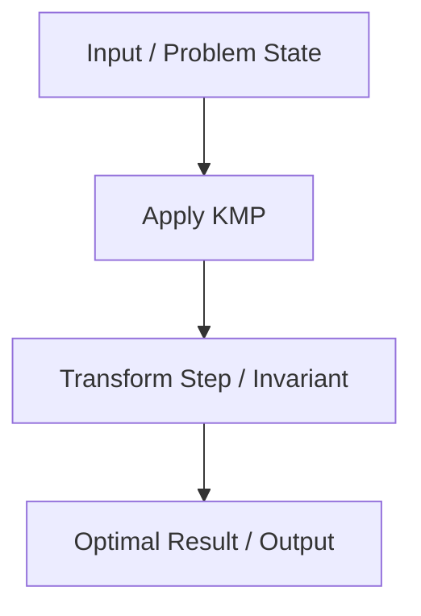

# KMP

> **Category:** Strings · **Tier:** Core Interview (Classic)

---

## 🔗 Resources & Visualizers
- **YouTube:** [Watch KMP Visual Guide](https://www.youtube.com/results?search_query=KMP%20algorithm%20visual%20explanation)
- **Blog / Editorial:** [CP-Algorithms / GeeksforGeeks Guide](https://www.google.com/search?q=KMP%20algorithm%20tutorial%20CP%20algorithms)
- **Interactive Visualizer:** [VisuAlgo Interactive Simulation](https://visualgo.net/en)

---

## 🧠 Intuition & Mental Model
> [!TIP]
> **Core Concept:** KMP (Knuth–Morris–Pratt) is a string pattern-matching

KMP (Knuth–Morris–Pratt) is a string pattern-matching
algorithm that avoids rechecking characters by using information from previous matches.
It preprocesses the pattern to achieve linear time searching.
How the Algorithm Works :
We preprocess the pattern to build an LPS array
LPS[i] = length of the longest proper prefix which is also a suffix for pattern[0…i]
While matching:
If characters match → move both pointers
If mismatch occurs → shift pattern using LPS instead of restarting
This avoids redundant comparisons and guarantees linear time
Example
Text = "ababcababc"
Pattern = "ababc"

---

## 🎯 When to Use & Problem Triggers
- **Trigger 1:** When the brute-force enumeration takes quadratic time or higher and a linear/logarithmic invariant exists.
- **Trigger 2:** Common patterns involving **Strings**, subsegments, query sequences, or optimal substructures.
- **Trigger 3:** Constraints where $N \ge 10^5$ require $O(N)$ or $O(N \log N)$ performance.

---

## 📊 Visual Explanation & Dry Run



<details>
<summary>🔍 <strong>Step-by-Step Algorithm Walkthrough</strong> (Click to expand)</summary>

1. **Initialization:** Set up boundary pointers, state variables, or base auxiliary arrays.
2. **Iteration / Traversal:** Advance through the input elements while maintaining the algorithmic invariant.
3. **State Transition:** Update the current state, dynamic array, or accumulator in $O(1)$ or $O(\log N)$.
4. **Final Result:** Extract the optimal answer from the computed state or reconstructed solution.

</details>

---

## 💻 Algorithm Code (Java)

```java
import java.io.*;
import java.util.*;

class Main {
    public static void main(String[] args) throws Exception {
        String txt = "ababcababc";
        String pat = "ababc";

        int n = txt.length();
        int m = pat.length();

        int[] lps = new int[n];

        computeLPS(pat, lps);

        int i = 0;
        int j = 0;

        while (i < n) {
            if (txt.charAt(i) == pat.charAt(j)) {
                i++;
                j++;
            }

            if (j == m) {
                System.out.println("Pattern found at index " + (i - j));
                j = lps[j - 1];
            } else if (i < n && txt.charAt(i) != pat.charAt(j)) {
                if (j != 0) {
                    j = lps[j - 1];
                } else {
                    i++;
                }
            }
        }
    }

    static void computeLPS(String pat, int[] lps) {
        int len = 0;
        int i = 1;

        lps[0] = 0;

        while (i < pat.length()) {
            if (pat.charAt(i) == pat.charAt(len)) {
                len++;
                lps[i] = len;
                i++;
            } else {
                if (len != 0) {
                    len = lps[len - 1];
                } else {
                    lps[i] = 0;
                    i++;
                }
            }
        }
    }
}
```

---

## ⏱️ Complexity Analysis
- **Time Complexity (TC):** Typically `O(N)` or `O(N log N)` depending on auxiliary sorting or tree operations.
- **Space Complexity (SC):** Typically `O(1)` auxiliary space or `O(N)` for auxiliary arrays/tables.

---

## 🔄 Similar & Connected Algorithms
- **Related Category:** Explore other fundamental algorithms in [Strings](../).
- **Composite Patterns:** Often combined with Prefix Sums, Binary Search on Answer, or Dynamic Programming memoization.

---

## ⚔️ Practice Questions

### 🟡 LeetCode
- [ ] [28. Find the Index of the First Occurrence in a String](https://leetcode.com/problems/find-the-index-of-the-first-occurrence-in-a-string/) — `Easy`
- [ ] [214. Shortest Palindrome](https://leetcode.com/problems/shortest-palindrome/) — `Hard`
- [ ] [1392. Longest Happy Prefix](https://leetcode.com/problems/longest-happy-prefix/) — `Hard`

### 🔵 CodeChef & Codeforces
- [ ] [471D - MUH and Cube Walls](https://codeforces.com/problemset/problem/471/D) — `1900`
