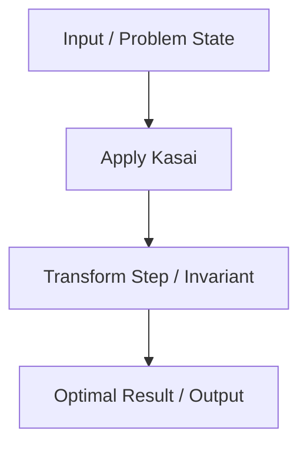

# Kasai

> **Category:** Strings · **Tier:** Competitive Programming (LCP Array)

---

## 🔗 Resources & Visualizers
- **YouTube:** [Watch Kasai Visual Guide](https://www.youtube.com/results?search_query=Kasai%20algorithm%20visual%20explanation)
- **Blog / Editorial:** [CP-Algorithms / GeeksforGeeks Guide](https://www.google.com/search?q=Kasai%20algorithm%20tutorial%20CP%20algorithms)
- **Interactive Visualizer:** [VisuAlgo Interactive Simulation](https://visualgo.net/en)

---

## 🧠 Intuition & Mental Model
> [!TIP]
> **Core Concept:** Kasai’s Algorithm constructs the LCP (Longest Common Prefix) array

Kasai’s Algorithm constructs the LCP (Longest Common Prefix) array
from a given suffix array in linear time.
It efficiently computes LCP values by reusing previously matched characters.
Algorithm Explanation :
You are given a string and its suffix array
Create an array rank[] where rank[i] = position of suffix i in suffix array
Traverse the string index by index
For each index i, compare suffix starting at i with the next suffix in suffix array
Count matching characters using a variable k
Store k as LCP value
Reduce k by 1 for the next iteration (important optimization)
This reuse makes the algorithm O(n)

---

## 🎯 When to Use & Problem Triggers
- **Trigger 1:** When the brute-force enumeration takes quadratic time or higher and a linear/logarithmic invariant exists.
- **Trigger 2:** Common patterns involving **Strings**, subsegments, query sequences, or optimal substructures.
- **Trigger 3:** Constraints where $N \ge 10^5$ require $O(N)$ or $O(N \log N)$ performance.

---

## 📊 Visual Explanation & Dry Run



<details>
<summary>🔍 <strong>Step-by-Step Algorithm Walkthrough</strong> (Click to expand)</summary>

1. **Initialization:** Set up boundary pointers, state variables, or base auxiliary arrays.
2. **Iteration / Traversal:** Advance through the input elements while maintaining the algorithmic invariant.
3. **State Transition:** Update the current state, dynamic array, or accumulator in $O(1)$ or $O(\log N)$.
4. **Final Result:** Extract the optimal answer from the computed state or reconstructed solution.

</details>

---

## 💻 Algorithm Code (Java)

```java
import java.io.*;
import java.util.*;

class Main {

    static int[] buildLCP(String s, int[] sa) {
        int n = s.length();
        int[] lcp = new int[n];
        int[] rank = new int[n];

        for (int i = 0; i < n; i++)
            rank[sa[i]] = i;

        int k = 0;

        for (int i = 0; i < n; i++) {
            if (rank[i] == n - 1) {
                k = 0;
                continue;
            }

            int j = sa[rank[i] + 1];

            while (i + k < n && j + k < n && s.charAt(i + k) == s.charAt(j + k))
                k++;

            lcp[rank[i]] = k;

            if (k > 0) k--;
        }

        return lcp;
    }

    public static void main(String[] args) {
        String s = "banana";

        int[] sa = {5, 3, 1, 0, 4, 2};

        int[] lcp = buildLCP(s, sa);

        for (int x : lcp)
            System.out.print(x + " ");
    }
}
```

---

## ⏱️ Complexity Analysis
- **Time Complexity (TC):** Typically `O(N)` or `O(N log N)` depending on auxiliary sorting or tree operations.
- **Space Complexity (SC):** Typically `O(1)` auxiliary space or `O(N)` for auxiliary arrays/tables.

---

## 🔄 Similar & Connected Algorithms
- **Related Category:** Explore other fundamental algorithms in [Strings](../).
- **Composite Patterns:** Often combined with Prefix Sums, Binary Search on Answer, or Dynamic Programming memoization.

---

## ⚔️ Practice Questions

### 🟡 LeetCode
- [ ] [Explore Kasai Problems on LeetCode](https://leetcode.com/problemset/?search=Kasai%20LeetCode) — `Practice`

### 🔵 CodeChef & Codeforces
- [ ] [Practice on Codeforces Problemset](https://codeforces.com/problemset) — `Catalog`
- [ ] [Practice on CodeChef Practice Portal](https://www.codechef.com/practice) — `Catalog`
