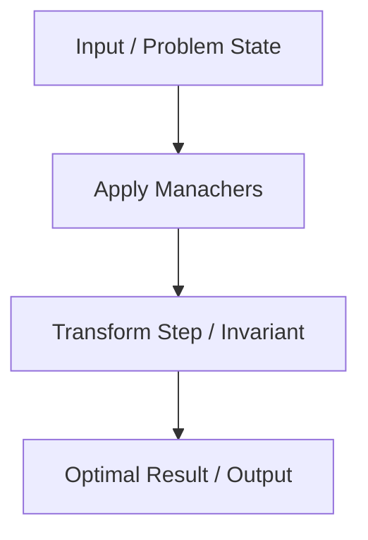

# Manachers

> **Category:** Strings · **Tier:** Advanced Interview (Palindromes)

---

## 🔗 Resources & Visualizers
- **YouTube:** [Watch Manachers Visual Guide](https://www.youtube.com/results?search_query=Manachers%20algorithm%20visual%20explanation)
- **Blog / Editorial:** [CP-Algorithms / GeeksforGeeks Guide](https://www.google.com/search?q=Manachers%20algorithm%20tutorial%20CP%20algorithms)
- **Interactive Visualizer:** [VisuAlgo Interactive Simulation](https://visualgo.net/en)

---

## 🧠 Intuition & Mental Model
> [!TIP]
> **Core Concept:** Manacher’s Algorithm finds the longest palindromic

Manacher’s Algorithm finds the longest palindromic
substring in a string in linear time O(n).
It avoids rechecking characters by using symmetry around palindrome centers.
Algorithm Explanation
Convert the string to a new format by inserting separators (#)
to handle even & odd palindromes uniformly
Maintain an array p[] where p[i] = radius of palindrome centered at i
Track the current center (c) and right boundary (r) of the farthest palindrome
For every position i:
Use mirror property: mirror = 2*c - i
Initialize p[i] using previously known palindrome info
Expand around i while characters match
Update c and r if palindrome expands beyond current boundary
The maximum value in p[] gives the longest palindrome

---

## 🎯 When to Use & Problem Triggers
- **Trigger 1:** When the brute-force enumeration takes quadratic time or higher and a linear/logarithmic invariant exists.
- **Trigger 2:** Common patterns involving **Strings**, subsegments, query sequences, or optimal substructures.
- **Trigger 3:** Constraints where $N \ge 10^5$ require $O(N)$ or $O(N \log N)$ performance.

---

## 📊 Visual Explanation & Dry Run



<details>
<summary>🔍 <strong>Step-by-Step Algorithm Walkthrough</strong> (Click to expand)</summary>

1. **Initialization:** Set up boundary pointers, state variables, or base auxiliary arrays.
2. **Iteration / Traversal:** Advance through the input elements while maintaining the algorithmic invariant.
3. **State Transition:** Update the current state, dynamic array, or accumulator in $O(1)$ or $O(\log N)$.
4. **Final Result:** Extract the optimal answer from the computed state or reconstructed solution.

</details>

---

## 💻 Algorithm Code (Java)

```java
import java.io.*;

class Main {
    public static void main(String[] args) throws Exception {
        String s = "aba";
        String t = transform(s);

        int n = t.length();

        int[] p = new int[n];

        int c = 0, r = 0;

        for (int i = 1; i < n - 1; i++) {
            int mir = 2 * c - i;

            if (i < r) p[i] = Math.min(r - i, p[mir]);

            while (t.charAt(i + 1 + p[i]) == t.charAt(i - 1 - p[i])) {
                p[i]++;
            }

            if (i + p[i] > r) {
                c = i;
                r = i + p[i];
            }
        }

        int len = 0, center = 0;
        for (int i = 1; i < n - 1; i++) {
            if (p[i] > len) {
                len = p[i];
                center = i;
            }
        }

        int start = (center - len) / 2;
        String ans = s.substring(start, start + len);

        System.out.println(ans);

    }

    static String transform(String s) {
        StringBuilder sb = new StringBuilder();
        sb.append("^");
        for (int i = 0; i < s.length(); i++) {
            sb.append("#").append(s.charAt(i));
        }

        sb.append("#$");
        return sb.toString();
    }
}
```

---

## ⏱️ Complexity Analysis
- **Time Complexity (TC):** Typically `O(N)` or `O(N log N)` depending on auxiliary sorting or tree operations.
- **Space Complexity (SC):** Typically `O(1)` auxiliary space or `O(N)` for auxiliary arrays/tables.

---

## 🔄 Similar & Connected Algorithms
- **Related Category:** Explore other fundamental algorithms in [Strings](../).
- **Composite Patterns:** Often combined with Prefix Sums, Binary Search on Answer, or Dynamic Programming memoization.

---

## ⚔️ Practice Questions

### 🟡 LeetCode
- [ ] [Explore Manachers Problems on LeetCode](https://leetcode.com/problemset/?search=Manachers%20LeetCode) — `Practice`

### 🔵 CodeChef & Codeforces
- [ ] [Practice on Codeforces Problemset](https://codeforces.com/problemset) — `Catalog`
- [ ] [Practice on CodeChef Practice Portal](https://www.codechef.com/practice) — `Catalog`
