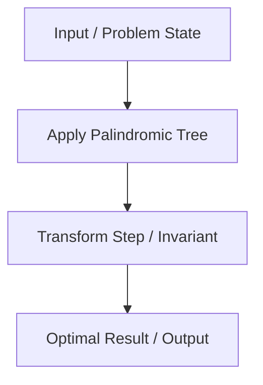

# Palindromic Tree

> **Category:** Strings · **Tier:** Competitive Programming (Palindromes)

---

## 🔗 Resources & Visualizers
- **YouTube:** [Watch Palindromic Tree Visual Guide](https://www.youtube.com/results?search_query=Palindromic%20Tree%20algorithm%20visual%20explanation)
- **Blog / Editorial:** [CP-Algorithms / GeeksforGeeks Guide](https://www.google.com/search?q=Palindromic%20Tree%20algorithm%20tutorial%20CP%20algorithms)
- **Interactive Visualizer:** [VisuAlgo Interactive Simulation](https://visualgo.net/en)

---

## 🧠 Intuition & Mental Model
> [!TIP]
> **Core Concept:** A Palindromic Tree (Eertree) is a data structure that stores

A Palindromic Tree (Eertree) is a data structure that stores
all distinct palindromic substrings of a string in linear time.
Each node represents one unique palindrome.
Algorithm :
We build the tree while scanning the string left to right
Tree always starts with two special roots
Root -1 → imaginary palindrome of length -1
Root 0 → empty palindrome of length 0
For every new character:
Start from the last added palindrome
Follow suffix links until we can extend a palindrome
If extended palindrome already exists → just move last
Else:
Create a new node
Set its length
Set its suffix link
Total nodes = total distinct palindromes

---

## 🎯 When to Use & Problem Triggers
- **Trigger 1:** When the brute-force enumeration takes quadratic time or higher and a linear/logarithmic invariant exists.
- **Trigger 2:** Common patterns involving **Strings**, subsegments, query sequences, or optimal substructures.
- **Trigger 3:** Constraints where $N \ge 10^5$ require $O(N)$ or $O(N \log N)$ performance.

---

## 📊 Visual Explanation & Dry Run



<details>
<summary>🔍 <strong>Step-by-Step Algorithm Walkthrough</strong> (Click to expand)</summary>

1. **Initialization:** Set up boundary pointers, state variables, or base auxiliary arrays.
2. **Iteration / Traversal:** Advance through the input elements while maintaining the algorithmic invariant.
3. **State Transition:** Update the current state, dynamic array, or accumulator in $O(1)$ or $O(\log N)$.
4. **Final Result:** Extract the optimal answer from the computed state or reconstructed solution.

</details>

---

## 💻 Algorithm Code (Java)

```java
import java.io.*;

class Main {

    static class Node {
        int len;
        int link;
        int[] next = new int[26];

        Node(int l) {
            len = l;
            link = 0;
        }
    }

    static Node[] tree = new Node[1000];
    static int size;
    static int last;
    static char[] s;
    static int n;

    static void init() {
        tree[0] = new Node(-1);
        tree[0].link = 0;
        tree[1] = new Node(0);
        tree[1].link = 0;
        size = 2;
        last = 1;
    }

    static void addChar(int pos) {
        int curr = last;
        while (true) {
            int currLen = tree[curr].len;
            if (pos - 1 - currLen >= 0 && s[pos] == s[pos - 1 - currLen])
                break;
            curr = tree[curr].link;
        }

        int c = s[pos] - 'a';
        if (tree[curr].next[c] != 0) {
            last = tree[curr].next[c];
            return;
        }

        tree[size] = new Node(tree[curr].len + 2);

        tree[curr].next[c] = size;

        if (tree[size].len == 1) {
            tree[size].link = 1;
        } else {
            int temp = tree[curr].link;

            while (true) {
                int tempLen = tree[temp].len;

                if (pos - 1 - tempLen >= 0 && s[pos] == s[pos - 1 - tempLen])
                    break;
                temp = tree[temp].link;
            }

            tree[size].link = tree[temp].next[c];
        }

        last = size;
        size++;
    }

    public static void main(String[] args) throws Exception {

        String str = "aba";

        s = str.toCharArray();

        n = s.length;

        init();

        for (int i = 0; i < n; i++) {
            addChar(i);
        }

        System.out.println("Total distinct palindromes = " + (size - 2));
    }
}
```

---

## ⏱️ Complexity Analysis
- **Time Complexity (TC):** Typically `O(N)` or `O(N log N)` depending on auxiliary sorting or tree operations.
- **Space Complexity (SC):** Typically `O(1)` auxiliary space or `O(N)` for auxiliary arrays/tables.

---

## 🔄 Similar & Connected Algorithms
- **Related Category:** Explore other fundamental algorithms in [Strings](../).
- **Composite Patterns:** Often combined with Prefix Sums, Binary Search on Answer, or Dynamic Programming memoization.

---

## ⚔️ Practice Questions

### 🟡 LeetCode
- [ ] [Explore Palindromic Tree Problems on LeetCode](https://leetcode.com/problemset/?search=Palindromic%20Tree%20LeetCode) — `Practice`

### 🔵 CodeChef & Codeforces
- [ ] [Practice on Codeforces Problemset](https://codeforces.com/problemset) — `Catalog`
- [ ] [Practice on CodeChef Practice Portal](https://www.codechef.com/practice) — `Catalog`
