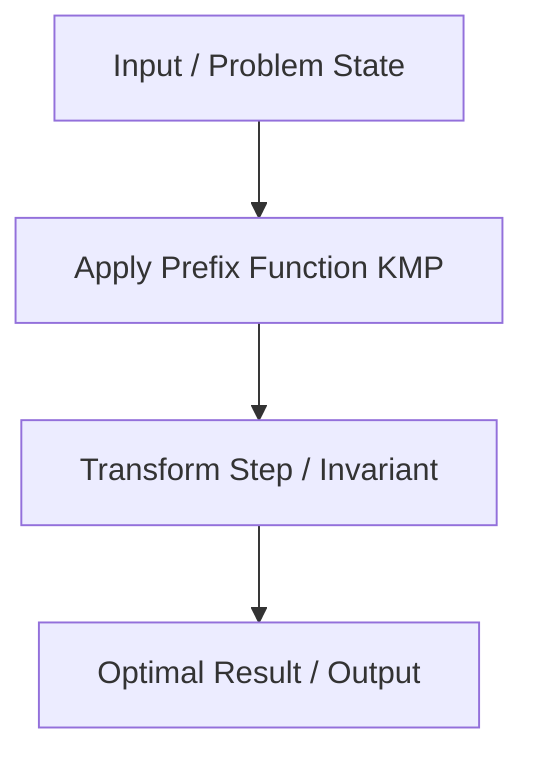

# Prefix Function KMP

> **Category:** Strings · **Tier:** Core Interview (High-Yield)

---

## 🔗 Resources & Visualizers
- **YouTube:** [Watch Prefix Function KMP Visual Guide](https://www.youtube.com/results?search_query=Prefix%20Function%20KMP%20algorithm%20visual%20explanation)
- **Blog / Editorial:** [CP-Algorithms / GeeksforGeeks Guide](https://www.google.com/search?q=Prefix%20Function%20KMP%20algorithm%20tutorial%20CP%20algorithms)
- **Interactive Visualizer:** [VisuAlgo Interactive Simulation](https://visualgo.net/en)

---

## 🧠 Intuition & Mental Model
> [!TIP]
> **Core Concept:** Prefix Function (π array) stores, for each index i, the length of the

Prefix Function (π array) stores, for each index i, the length of the
longest proper prefix of the string that is also a suffix ending at i.
It helps avoid rechecking characters during pattern matching.
Algorithm Explanation :
We build an array pi[] where pi[i] = length of longest prefix matching
suffix ending at i
Start from index 1 because prefix at index 0 is always 0
Maintain a pointer j → length of previous longest prefix
If characters match → extend prefix (j++)
If mismatch → jump back using pi[j-1] (no rechecking)
Store j in pi[i]
This jumping is what makes KMP linear time
Example string: "ababaca"

---

## 🎯 When to Use & Problem Triggers
- **Trigger 1:** When the brute-force enumeration takes quadratic time or higher and a linear/logarithmic invariant exists.
- **Trigger 2:** Common patterns involving **Strings**, subsegments, query sequences, or optimal substructures.
- **Trigger 3:** Constraints where $N \ge 10^5$ require $O(N)$ or $O(N \log N)$ performance.

---

## 📊 Visual Explanation & Dry Run



<details>
<summary>🔍 <strong>Step-by-Step Algorithm Walkthrough</strong> (Click to expand)</summary>

1. **Initialization:** Set up boundary pointers, state variables, or base auxiliary arrays.
2. **Iteration / Traversal:** Advance through the input elements while maintaining the algorithmic invariant.
3. **State Transition:** Update the current state, dynamic array, or accumulator in $O(1)$ or $O(\log N)$.
4. **Final Result:** Extract the optimal answer from the computed state or reconstructed solution.

</details>

---

## 💻 Algorithm Code (Java)

```java
import java.io.*;
import java.util.*;

class Main {
    public static void main(String[] args) throws Exception {
        String s = "ababaca";
        int n = s.length();

        int[] pi = new int[n];
        pi[0] = 0;

        for (int i = 1; i < n; i++) {
            int j = pi[i - 1];

            while (j > 0 && s.charAt(i) != s.charAt(j)) {
                j = pi[j - 1];
            }

            if (s.charAt(i) == s.charAt(j)) {
                j++;
            }

            pi[i] = j;
        }

        for (int x : pi) {
            System.out.print(x + " ");
        }
    }
}
```

---

## ⏱️ Complexity Analysis
- **Time Complexity (TC):** Typically `O(N)` or `O(N log N)` depending on auxiliary sorting or tree operations.
- **Space Complexity (SC):** Typically `O(1)` auxiliary space or `O(N)` for auxiliary arrays/tables.

---

## 🔄 Similar & Connected Algorithms
- **Related Category:** Explore other fundamental algorithms in [Strings](../).
- **Composite Patterns:** Often combined with Prefix Sums, Binary Search on Answer, or Dynamic Programming memoization.

---

## ⚔️ Practice Questions

### 🟡 LeetCode
- [ ] [Explore Prefix Function KMP Problems on LeetCode](https://leetcode.com/problemset/?search=Prefix%20Function%20KMP%20LeetCode) — `Practice`

### 🔵 CodeChef & Codeforces
- [ ] [Practice on Codeforces Problemset](https://codeforces.com/problemset) — `Catalog`
- [ ] [Practice on CodeChef Practice Portal](https://www.codechef.com/practice) — `Catalog`
