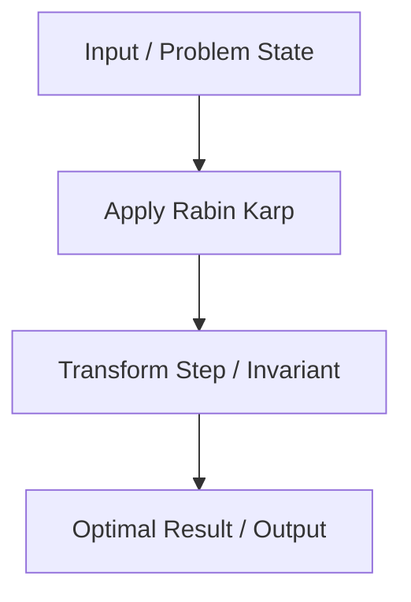

# Rabin Karp

> **Category:** Strings · **Tier:** Core Interview (Rolling Hash)

---

## 🔗 Resources & Visualizers
- **YouTube:** [Watch Rabin Karp Visual Guide](https://www.youtube.com/results?search_query=Rabin%20Karp%20algorithm%20visual%20explanation)
- **Blog / Editorial:** [CP-Algorithms / GeeksforGeeks Guide](https://www.google.com/search?q=Rabin%20Karp%20algorithm%20tutorial%20CP%20algorithms)
- **Interactive Visualizer:** [VisuAlgo Interactive Simulation](https://visualgo.net/en)

---

## 🧠 Intuition & Mental Model
> [!TIP]
> **Core Concept:** Rabin–Karp Algorithm is a string pattern matching algorithm that

Rabin–Karp Algorithm is a string pattern matching algorithm that
uses hashing to compare the pattern with substrings of text efficiently.
It avoids repeated character comparisons by sliding a rolling hash over the text.
Algorithm Explanation :
Convert the pattern into a numeric hash value
Compute hash for the first window of text (same length as pattern)
Slide the window one character at a time
Update hash using rolling hash formula (remove left char, add right char)
If window hash == pattern hash → verify characters one by one
Matching verification avoids false positives due to hash collision

---

## 🎯 When to Use & Problem Triggers
- **Trigger 1:** When the brute-force enumeration takes quadratic time or higher and a linear/logarithmic invariant exists.
- **Trigger 2:** Common patterns involving **Strings**, subsegments, query sequences, or optimal substructures.
- **Trigger 3:** Constraints where $N \ge 10^5$ require $O(N)$ or $O(N \log N)$ performance.

---

## 📊 Visual Explanation & Dry Run



<details>
<summary>🔍 <strong>Step-by-Step Algorithm Walkthrough</strong> (Click to expand)</summary>

1. **Initialization:** Set up boundary pointers, state variables, or base auxiliary arrays.
2. **Iteration / Traversal:** Advance through the input elements while maintaining the algorithmic invariant.
3. **State Transition:** Update the current state, dynamic array, or accumulator in $O(1)$ or $O(\log N)$.
4. **Final Result:** Extract the optimal answer from the computed state or reconstructed solution.

</details>

---

## 💻 Algorithm Code (Java)

```java
import java.io.*;
import java.util.*;

class RabinKarp {
    public static void main(String[] args) {
        String text = "abcd";
        String pattern = "bc";

        int n = text.length();
        int m = pattern.length();

        int base = 256;
        int mod = 101;

        int pHash = 0;
        int tHash = 0;
        int h = 1;

        for (int i = 0; i < m - 1; i++)
            h = (h * base) % mod;

        for (int i = 0; i < m; i++) {
            pHash = (base * pHash + pattern.charAt(i)) % mod;
            tHash = (base * tHash + text.charAt(i)) % mod;
        }

        for (int i = 0; i <= n; i++) {
            if (pHash == tHash) {
                int j = 0;
                while (j < m && text.charAt(i + j) == pattern.charAt(j))
                    j++;

                if (j == m)
                    System.out.println("Pattern found at index: " + i);
            }

            if (i < n - m) {
                tHash = (base * (tHash - text.charAt(i) * h) + text.charAt(i + m)) % mod;

                if (tHash < 0)
                    tHash += mod;
            }
        }
    }
}
```

---

## ⏱️ Complexity Analysis
- **Time Complexity (TC):** Typically `O(N)` or `O(N log N)` depending on auxiliary sorting or tree operations.
- **Space Complexity (SC):** Typically `O(1)` auxiliary space or `O(N)` for auxiliary arrays/tables.

---

## 🔄 Similar & Connected Algorithms
- **Related Category:** Explore other fundamental algorithms in [Strings](../).
- **Composite Patterns:** Often combined with Prefix Sums, Binary Search on Answer, or Dynamic Programming memoization.

---

## ⚔️ Practice Questions

### 🟡 LeetCode
- [ ] [Explore Rabin Karp Problems on LeetCode](https://leetcode.com/problemset/?search=Rabin%20Karp%20LeetCode) — `Practice`

### 🔵 CodeChef & Codeforces
- [ ] [Practice on Codeforces Problemset](https://codeforces.com/problemset) — `Catalog`
- [ ] [Practice on CodeChef Practice Portal](https://www.codechef.com/practice) — `Catalog`
